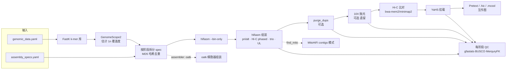

# sanger-tol/genomeassembly

> | 项目 | 内容 |
> |---|---|
> | 仓库 | https://github.com/sanger-tol/genomeassembly |
> | 版本 | **1.0.1**（2026-09-11，commit `131f0ea`；首个稳定版 1.0.0 于 2026-08-17 发布） |
> | 本地路径 | `/media/deyuan/18T_B/genome_assembly/pipelines/sanger-tol_genomeassembly` |
> | 框架 | Nextflow ≥ 25.10.4（strict syntax），nf-core 模板 4.1.0，nf-schema 2.6.1 |
> | 许可证 | MIT |
> | 维护方 | Wellcome Sanger Institute · Tree of Life（Darwin Tree of Life 项目） |
> | 引用 | Zenodo DOI 10.5281/zenodo.10391851 |

## 1. 一句话定位

Sanger Tree of Life 团队把自己的参考基因组组装流程做成了 Nextflow 版：以 **PacBio HiFi**（也支持 ONT）长读长为主，用 **Hi-C** 挂载到染色体级。它支持三种分型方式：Hi-C phasing、trio binning、ONT ultra-long 辅助；每个阶段都会自动跑 QC，还附带线粒体和质体组装。

> ⚠️ CHANGELOG 1.0.0 原话：该流程"与 ToL 当前的组装工作流等价，但发布时**尚未在 ToL 生产中使用**"。

## 2. 适用场景与输入数据

**适合**：二倍体真核生物的高质量参考基因组，数据为 HiFi（或 ONT）+ Hi-C，可选 trio 亲本数据或 ONT 超长读长。
**不适合**：只有 Illumina 短读长的组装（流程不含短读长组装器）；多倍体（1.0.0 说明里写的是"未来版本"才支持）。

### 2.1 两个输入文件（YAML 或 JSON）

**① `--genomic_data`：描述手里有哪些数据**

| platform | 允许的格式 | 用途 |
|---|---|---|
| `pacbio_hifi` | `.fa/.fasta/.fna/.fq/.fastq`（可 gz） | 主组装数据 |
| `oxford_nanopore` | `.fq/.fastq`（可 gz） | 主组装（hifiasm `--ont`）或 ultra-long 辅助 |
| `illumina_hic` | **`.cram`（未比对）** | Hi-C phasing + 挂载 |
| `illumina_10x` | `.fq/.fastq`（可 gz） | 10X 抛光（遗留功能） |
| `illumina` | **`.cram`（未比对）** | trio 亲本数据 |

同一 dataset 下所有文件扩展名必须一致（`functions/local/input_validation/main.nf`）。长读长可以附上预先算好的 FastK 库（`fastk: {hist, ktab, kmer_size}`），这样能跳过建库。

> Hi-C、Illumina 数据**必须是未比对的 CRAM**。FASTQ 转 CRAM 的方法（`docs/usage.md`）：
> ```bash
> samtools import -@8 -r ID:{prefix} -r CN:{hic-kit} -r PU:{prefix} -r SM:{sample} \
>     {prefix}_R1.fastq.gz {prefix}_R2.fastq.gz -o {prefix}.cram
> ```

**② `--assembly_specs`：描述要做哪几种组装**（每条就是一套组装方案）

必填字段：`id`、`assembler`（`hifiasm` / `mitohifi` / `oatk`）、`long_read_dataset`、`long_read_platform`。

hifiasm 方案的常用开关：

| 字段 | 默认 | 含义 |
|---|---|---|
| `hic_dataset` | – | Hi-C 数据（phasing 和挂载都靠它） |
| `phased_assembly` | false | Hi-C phasing，产出 hap1/hap2 |
| `trio_assembly` + `maternal_*`/`paternal_*` | false | trio binning |
| `ultralong_dataset` | – | ONT 超长读长辅助 |
| `long_read_1n_coverage` | 自动 | 单倍体覆盖度；不填就用 GenomeScope2 估计 |
| `purge` | false | 用 purge_dups 去冗余 |
| `purge_middle` | false | 是否也去掉 contig 中间的冗余（默认只去两端） |
| `polish` | false | 10X 抛光（需要自备 Longranger 容器） |
| `scaffold` | **true** | Hi-C 挂载（YaHS） |
| `find_mito` / `find_plastid` | true / false | 用 MitoHiFi 从组装结果中找线粒体或质体 |
| `hifiasm_bin_arguments` / `hifiasm_arguments` / `yahs_arguments` | – | 透传给对应软件的额外参数 |
| `purging_cutoffs` | 自动 | purge_dups 的 `-l,-m,-u` 三个阈值 |

**官方测试用的两份文件**（`assets/small_tests/`）：
```yaml
# icAdaBipu1_genomic.yaml（二星瓢虫 Adalia bipunctata，抽样数据）
- id: icAdaBipu1
  platform: pacbio_hifi
  reads: [ https://tolit.cog.sanger.ac.uk/test-data/Adalia_bipunctata/.../icAdaBipu1...subsampled.fastq.gz ]
- id: icAdaBipu1
  platform: illumina_hic
  reads: [ .../icAdaBipu1.35150_2_1.subsampled.cram ]
- id: icAdaBipu1
  platform: illumina_10x
  reads: [ R1.fastq.gz, R2.fastq.gz, I1.fastq.gz ]

# default_spec.yaml：同一份数据同时做 3 种组装
- id: icAdaBipu1.pri        # 主/备组装 + 去冗余 + 挂载 + MitoHiFi（遗传密码 5，无脊椎动物线粒体）
  assembler: hifiasm
  hifiasm_bin_arguments: "-f0"
  hifiasm_arguments: "--primary"
  purge: true
  find_mito: true
  ...
- id: icAdaBipu1.phased     # Hi-C phasing → hap1/hap2，再分别挂载
  assembler: hifiasm
  phased_assembly: true
  hifiasm_bin_arguments: "-f0"
- id: icAdaBipu1.oatk       # oatk 从读长直接组装线粒体
  assembler: oatk
  oatk_kmer_size: 1001
  oatk_mito_hmm: https://github.com/c-zhou/OatkDB/raw/main/v20230921/insecta_mito.fam
```

## 3. 流程步骤

主流程是 `workflows/genomeassembly.nf`，分三大块：`PREPARE_INPUTS` → `NUCLEAR_ASSEMBLY`（hifiasm 方案）→ `ORGANELLE_ASSEMBLY`（oatk / mitohifi 方案）。

| # | 阶段（子流程） | 工具（版本） | 作用 | 关键参数/默认值 |
|---|---|---|---|---|
| 0 | k-mer 建库 `BUILD_KMER_DATABASES` | FastK 1.2；trio 时另用 yak 0.1、MerquryFK HapMaker 1.2 | 给长读长建 k-mer 库（Hi-C 不建）；给亲本做 hap-mer | `--kmer_size 31`；可直接提供已有的 FastK 库 |
| 1 | 覆盖度估计 `PREPARE_INPUTS` | FastK Histex + GenomeScope2 2.1.0 | 用 kcov 估计 1n 覆盖度 c | spec 里写了 `long_read_1n_coverage` 就以它为准 |
| 2 | 纠错和 overlap `HIFIASM_BIN` | hifiasm 0.25.0 | `--bin-only`：只生成 .bin 文件（纠错 + overlap），不同组装模式可以复用 | `hifiasm_bin_arguments`；ONT 会自动加 `--ont` |
| 3 | 组装 `HIFIASM` | hifiasm 0.25.0 | 从 .bin 继续，产出 p_ctg/a_ctg（`--primary`）或 hap1/hap2（Hi-C 或 trio） | `hifiasm_arguments`、`phased_assembly`、`trio_assembly`、`ultralong_dataset` |
| 4 | 去冗余 `PURGING` | minimap2 2.30 + purge_dups 1.2.6 | 长读长回比 → `pbcstat` → `calcuts` → `split_fa` + 自比对 → `purge_dups -2` → `get_seqs -e`；去掉的 haplotig **并回 alt/hap2** | 阈值默认 `,1.5c,6c`（`-l` 留空，`-m 1.5c`，`-u 6c`）；`purge_middle: true` 时去掉 `-e` |
| 5 | 抛光（遗留功能）`POLISHING` | Longranger 2.2.2 + FreeBayes 1.3.10 + bcftools 1.23.1 | 10X 数据抛光 | 需要 `--polishing_longranger_container_path` |
| 6 | Hi-C 比对 `CRAM_MAP_ILLUMINA_HIC` | bwa-mem2（默认）或 minimap2，samtools | CRAM 按容器分块并行比对 → 合并 → markdup → flagstat/idxstats/stats | `--hic_aligner bwamem2`、`--hic_mapping_cram_chunk_size 10000`、`--hic_mapping_minq 10` |
| 7 | 挂载 `FASTA_BAM_SCAFFOLDING_YAHS` | bedtools + YaHS 1.2.2 | BAM 转 BED 后用 YaHS 挂载；**hap1 和 hap2（或 pri 和 alt）分别挂载** | `yahs_arguments` |
| 8 | 互作图 `PAIRS_CREATE_CONTACT_MAPS` | PretextMap 0.2.4 + PretextSnapshot、juicer_tools pre、cooler | 生成 `.pretext`、`.hic`、`.mcool`（cooler 多分辨率；`docs/output.md` 写的是 `.cool`，本机实测是 `.mcool`），用于人工检查和手工校正 | `--build_pretext_map/--build_juicer_map/--build_cooler_map`（默认都开）、`--scaffolding_cool_bin_size 1000` |
| 9 | 每阶段质控 `GENOME_STATISTICS` | asmstats、gfastats 1.3.11、BUSCO 6.1.0、MerquryFK 1.2 | 每个阶段（hifiasm/purging/polishing/scaffolding）都算：长度和 N50、BUSCO 完整度、QV 和 k-mer 完整度（trio 时还算 phase block） | `--busco_lineage`（默认 `auto_euk`）、`--busco_lineage_directory`（离线库） |
| 10 | 细胞器 `MITOHIFI_ASSEMBLY` / `ORGANELLE_ASSEMBLY` | MitoHiFi 3.2.3、oatk 1.0 + Bandage | MitoHiFi 基于参考，在 hifiasm 的**原始 contig** 里挑线粒体或质体（contigs 模式）；oatk 从读长 de novo 组装 | `mitohifi_reference_species` 或自备 fa/gb + `*_genetic_code`；oatk 需要 OatkDB 的 `.fam` HMM，cutoff 默认 5c |



## 4. 如何运行

### 4.1 环境（本机已配好）

```bash
source /home/deyuan/miniforge3/etc/profile.d/conda.sh
conda activate nextflow           # Nextflow 25.10.4 + OpenJDK 21（系统自带的 nextflow 19.10/Java 11 太旧，不能用）
export NXF_SINGULARITY_CACHEDIR=/media/deyuan/18T_B/genome_assembly/containers/singularity
export NXF_OPTS='-Xms1g -Xmx4g'
```

- 推荐 Singularity 或 Docker；**不要用 conda**，README 写明 purge_dups 和 MitoHiFi 不支持 conda。
- 参数只能用命令行或 `-params-file` 传；`-c` 只用来调资源、改 `ext.args` 这类配置，**不要用 `-c` 传参数**。

### 4.2 官方测试

```bash
bash /media/deyuan/18T_B/genome_assembly/tests/sanger-tol_genomeassembly_test/run_test.sh
# 本质上就是：nextflow run <本地流程目录> -profile test,singularity --outdir results -resume
```
test profile 会把资源限制在 4 CPU / 15 GB / 6 h，BUSCO 用 `eukaryota_odb12`。另外还有 `test_trio`、`test_ont`、`test_full` 几个 profile。本机的实际运行情况见 §10。

### 4.3 跑自己的数据（以"HiFi + Hi-C 的环节动物"为例的模板）

`genomic_data.yaml`：
```yaml
- id: mySpecies1
  platform: pacbio_hifi
  reads: [/path/to/hifi.fastq.gz]
- id: mySpecies1
  platform: illumina_hic
  reads: [/path/to/hic.cram]
```
`assembly_specs.yaml`（同时比较"pri/alt + 去冗余"和"Hi-C phased"两种方案；hifiasm 的 bin 阶段只会跑一次）：
```yaml
- id: mySpecies1.pri
  assembler: hifiasm
  long_read_dataset: mySpecies1
  long_read_platform: pacbio_hifi
  hic_dataset: mySpecies1
  hifiasm_arguments: "--primary"
  purge: true
  scaffold: true
  find_mito: true
  mitohifi_reference_species: "<近缘物种拉丁名>"
  mitohifi_mito_genetic_code: 5        # 无脊椎动物线粒体密码表
- id: mySpecies1.phased
  assembler: hifiasm
  long_read_dataset: mySpecies1
  long_read_platform: pacbio_hifi
  hic_dataset: mySpecies1
  phased_assembly: true
  find_mito: false
```
`local.config`（**单机必须加**：默认 hifiasm 申请 32 CPU / 400 GB，失败重试时按 attempt 翻倍，会超过本机 503 GB）：
```groovy
process {
    resourceLimits = [ cpus: 64, memory: 450.GB, time: 240.h ]
}
```
```bash
nextflow run /media/deyuan/18T_B/genome_assembly/pipelines/sanger-tol_genomeassembly \
    -profile singularity -c local.config \
    --genomic_data genomic_data.yaml --assembly_specs assembly_specs.yaml \
    --busco_lineage metazoa_odb12 \
    --outdir results -resume
```
- BUSCO 谱系：odb12 里**没有单独的环节动物谱系**，最接近的是 **`lophotrochozoa_odb12`**（冠轮动物，2026-05-22 版）。环节动物建议用它，比 `metazoa_odb12` 更有针对性。默认的 `auto_euk` 会自动选择。（2026-10-26 查自 `busco-data.s3.amazonaws.com/file_versions.tsv`；`busco-data.ezlab.org` 现在会 301 跳转到这个 S3 地址。）
- MitoHiFi 用物种名找参考时要访问 NCBI，可以设置 `nextflow secrets set NCBI_API_KEY '<key>'`。
- 离线跑 BUSCO：先把谱系库下载到 `<dir>/lineages/<lineage>`，再用 `--busco_lineage_directory <dir>` 指过去，流程会自动给 BUSCO 加上 `--offline --opt-out-run-stats`。本机已有 `/media/deyuan/18T_B/genome_assembly/databases/busco_downloads/lineages/eukaryota_odb12`。

## 5. 主要输出（`--outdir` 下，每套方案一个目录，以 `id` 命名）

```
results/
├── <asm.id>/
│   ├── index.json                 # 整个方案的数据、参数、软件版本（可追溯）
│   ├── hifiasm/                   # 原始组装：*.p_ctg/a_ctg 或 hap1/hap2 .fa.gz、*.gfa.gz、log、index.json
│   │   ├── *.stats, *.assembly_summary        # asmstats / gfastats
│   │   ├── busco.<lineage>/                   # BUSCO
│   │   └── merqury.<platform>/                # QV、completeness、spectra-cn/asm 图
│   ├── purging/                   # 去冗余后的 fa.gz + coverage/（cutoffs、直方图 png）+ purge_dups/（bed、log）
│   ├── polishing/                 # （可选）
│   ├── scaffolding/
│   │   ├── *_scaffolds_final.fa.gz            # ★ 最终挂载结果
│   │   ├── yahs/（agp、bin、log）
│   │   └── contact_maps/（*.pretext、*.pretext.FullMap.png、*.hic、*.mcool）
│   └── mito/ | plastid/           # MitoHiFi：final_mitogenome.fasta/.gb/.gff 等
├── <oatk 方案 id>/                # *.mito.ctg.fasta、*.gfa、Bandage png 等
├── fastk/                         # 仅在 --save_fastk_databases 时输出
└── pipeline_info/                 # execution_report/timeline/trace、软件版本 yml、params.json
```
（来源：`docs/output.md`；1.0.1 把原来的 `raw/` 目录改名为 `hifiasm/`。）

## 6. 设计亮点（值得学习的地方）

1. **数据和方案分开写**：`genomic_data` 只描述"有什么数据"，`assembly_specs` 描述"想怎么组装"。一次运行就能并排比较多种组装策略，非常适合摸索参数。
2. **阶段级哈希去重**（`functions/local/assembly_stages/main.nf`）：每个阶段的 ID = `md5(上一阶段哈希 + assembler + 数据集 ID + 本阶段参数)`。几套方案只要前面的阶段相同，就只算一次，到参数不同的那一步才分叉。例如测试里 `.pri` 和 `.phased` 共用同一个 `hifiasm --bin-only`。（注：`prepare_inputs` 的注释写的是 sha256，代码里实际用的是 `.md5()`。）
3. **复用 hifiasm 的 .bin**：先 `--bin-only` 做纠错和 overlap（最耗时的部分），之后各种组装模式都从 .bin 继续，省掉重复计算。
4. **每个阶段都做 QC**：raw、purged、scaffolded 各自都有 gfastats、BUSCO、MerquryFK 结果，能直接看出去冗余或挂载有没有带来改进。
5. **完整的可追溯记录**：每个阶段都有 `index.json`，记录用了哪些数据、哪些参数、哪个软件版本，写方法部分时可以直接照抄。
6. **Hi-C 从 CRAM 分块并行比对**：按 CRAM 容器切块，能把大规模 Hi-C 比对分散到很多 CPU 上。
7. **工程规范**：nf-schema 做输入校验，nf-test 做测试（default / trio / ONT 三套数据），所有软件都有固定版本的容器。

## 7. 局限与注意事项（坑）

- **官方说明里写着尚未在 ToL 生产中使用**（见 §1），出了问题可以去 GitHub issue 查。
- **Hi-C 和 Illumina 数据只接受未比对的 CRAM**，FASTQ 要先用 `samtools import` 转换。
- **1.0.1 的 bug（读代码时发现）**：独立的 `assembler: mitohifi`（reads 模式）方案会被主流程跳过、根本不运行。`workflows/genomeassembly.nf` 第 76 行的过滤条件写的是 `spec.assembler in ["oatk", "mitohifi_mito"]`，而 spec 里的取值是 `mitohifi`。trio 测试的名字虽然叫 "mitohifi reads"，但快照 `tests/trio.nf.test.snap` 里没有 `aBomVar4.mitohifi/` 的任何输出。dev 分支已经改成按 `assembly_type == "organellar"` 过滤。**在 1.0.1 里要组装线粒体，请用 hifiasm 方案里的 `find_mito: true`，或者用 `assembler: oatk`。**
- **10X 抛光是遗留功能**：Longranger 是闭源软件，要自己下载并打包成容器，官方也说"没有充分测试"。
- **流程不包含去污染和人工校正**。去污染要另外用 `sanger-tol/ascc`、BlobToolKit 或 NCBI FCS-GX；人工校正要用 `sanger-tol/treeval` 或 `curationpretext` 加 PretextView。ToL 的完整生产链是：组装 → 去污染 → 人工校正。
- **单机运行要设 `resourceLimits`**（见 §4.3），否则 hifiasm 重试时申请的内存会超过物理内存。
- **多倍体暂不支持**（1.0.0 说明里列为未来计划，还包括 RagTag 同源挂载）。
- **ONT 只能走 hifiasm 的 `--ont` 模式**，流程里没有 Flye 或 NextDenovo；oatk 和 MitoHiFi 只支持 HiFi。
- **网络环境（本机实测）**：输入表里写远程 URL 时，nf-schema 会逐个检查文件是否存在。本机走 127.0.0.1:7890 代理，每次检查要 3–4 秒，只要有一次检查临时失败，就会报 "does not exist" 并直接退出。见 §10。

## 8. 在 ToL 生态中的位置

```
sanger-tol/genomeassembly   ← 本流程：组装 + 挂载 + QC + 细胞器
        ↓
sanger-tol/ascc / blobtoolkit   ← 去污染、共生生物识别
        ↓
sanger-tol/treeval / curationpretext + PretextView   ← 人工校正（Hi-C 图上拆分、合并、改方向）
        ↓
sanger-tol/genomenote 等   ← 生成 Genome Note 报告
（另有 sanger-tol/readmapping：把各类读长比对回组装；sanger-tol/insdcdownload：从 INSDC 下载已发表的组装）
```
（各仓库是否存在已在 2026-10-26 通过 GitHub API 核实；箭头表示的先后顺序是我根据各仓库描述整理的。）
与其他经典流程的横向对比见仓库根目录的 `README.md`。

## 9. 参考文献与链接

- 本流程：https://doi.org/10.5281/zenodo.10391851；完整文献列表见本地 `CITATIONS.md`
- hifiasm：Cheng H. et al. *Nat Methods* 18, 170–175 (2021). doi:10.1038/s41592-020-01056-5
- purge_dups：Guan D. et al. *Bioinformatics* 36(9):2896 (2020). doi:10.1093/bioinformatics/btaa025
- YaHS：Zhou C. et al. *Bioinformatics* 39(1):btac808 (2023). doi:10.1093/bioinformatics/btac808
- GenomeScope 2.0：Ranallo-Benavidez T.R. et al. *Nat Commun* 11, 1432 (2020). doi:10.1038/s41467-020-14998-3
- MitoHiFi：Uliano-Silva M. et al. bioRxiv 2022.12.23.521667
- oatk：Zhou C. et al. *Genome Biol* 26, 235 (2025). doi:10.1186/s13059-025-03676-6
- gfastats：Formenti G. et al. *Bioinformatics* 38(17):4214 (2022)
- BUSCO：Manni M. et al. *Mol Biol Evol* 38(10):4647 (2021)

## 本笔记依据（读过的文件）

`README.md`、`docs/usage.md`、`docs/output.md`、`CHANGELOG.md`、`CITATIONS.md`、`nextflow.config`、`conf/test.config`、`conf/base.config`、`conf/modules.config`、`assets/small_tests/*.yaml`、`workflows/genomeassembly.nf`、`subworkflows/local/{prepare_inputs,nuclear_assembly,hifiasm_assembly,purging,scaffolding,organelle_assembly}/main.nf`、`subworkflows/sanger-tol/{genome_statistics,fasta_purge_retained_haplotype,cram_map_illumina_hic,fasta_bam_scaffolding_yahs}/main.nf`、`functions/local/{assembly_stages,input_validation}/main.nf`、`subworkflows/local/utils_nfcore_genomeassembly_pipeline/main.nf`、各模块的 `environment.yml`、`tests/*.nf.test.snap`；dev 分支的 `workflows/genomeassembly.nf`（通过 GitHub API 读取）。

## 10. 本机测试记录（2026-10-26）

**结论：通过。** 用官方 nf-test 的 BUSCO 谱系库时，结果与官方快照 `tests/default.nf.test.snap` **完全一致**：

- 输出路径 526/526，一条不缺，一条不多；
- 稳定文件 md5 111/111 一致；
- 成功任务数 170 = 快照记录的 170；
- 48 个进程的软件版本与快照零差异。

比对脚本：`tests/sanger-tol_genomeassembly_test/compare_with_snapshot.py`。

### 10.1 怎么跑的

```bash
cd /media/deyuan/18T_B/genome_assembly/tests/sanger-tol_genomeassembly_test
bash fetch_test_data.sh      # 把官方测试输入下载到 test_data/，生成 *.local.yaml（与官方只差路径）
bash /media/deyuan/18T_B/genome_assembly/containers/prefetch_singularity_images.sh images.txt   # 预下载 35 个镜像（8.4 GB）
bash run_test.sh             # -profile test,singularity + 本地输入 + 离线 BUSCO（eukaryota_odb12）
python3 -I compare_with_snapshot.py /media/deyuan/18T_B/genome_assembly/pipelines/sanger-tol_genomeassembly results
```

- 最后一次运行耗时 5 分 29 秒，2.1 CPU 小时：158 个任务新算，12 个复用前一次的缓存。
- 磁盘占用：`work/` 2.0 GB，`results/` 225 MB。

### 10.2 前两次为什么失败（都是本机网络问题，不是流程的问题）

| 次数 | 现象 | 根因（有证据） | 处理 |
|---|---|---|---|
| 1 | `Validation of samplesheet failed`：10X 的 R2 文件 "does not exist" | 用 Nextflow 自己的 HTTP 栈复现，64 次请求失败 6 次，都是 `SSLHandshakeException: Remote host terminated the handshake`（走代理 127.0.0.1:7890）。Nextflow 25.10.4 的 httpfs 只对 404/410 重试，IO 异常不重试，`exists()` 直接返回 false | `fetch_test_data.sh`：用带重试的 curl 下载到本地并核对大小 |
| 2 | `Failed to pull singularity image ... FATAL: unexpected EOF` | 同一条代理链路在下载途中断开；Nextflow 拉镜像不重试 | `prefetch_singularity_images.sh`：断点续传 + 重试，文件名与 Nextflow 缓存命名一致 |

另外，BUSCO 改成离线谱系库，避免运行时再联网（官方 nf-test 也是这样做的）。

### 10.3 与快照的两个 md5 差异及确证

用 BUSCO 官方 S3 上的 `eukaryota_odb12`（2026-05-22，OrthoDB 12.1）跑时，有 2 个文件 md5 不同：`full_table.tsv` 和 `missing_busco_list.tsv`。原因是官方 nf-test 用的是 Sanger 镜像的旧版本（2025-07-01，OrthoDB 12.0），而 BUSCO 会把谱系库版本写进表头。换成官方那个版本、`-resume` 只重算 BUSCO 后，111/111 全部一致，日志在 `run_official_busco_check.log`，结果在 `results_official_busco/`。

### 10.4 结果解读（学习用）

> 测试数据是抽样数据，组装总长只有约 1.5–2 Mb（二星瓢虫真实基因组有几百 Mb），所以这些数字只用来理解每一步做了什么，**不代表组装质量**。BUSCO 全部是 C:0.0%（eukaryota_odb12，n=129）也是这个原因，数据覆盖到的基因组太少。

| 方案 / 阶段 | 序列数 | 总长 (bp) | contig N50 | scaffold N50 | QV | k-mer 完整度 |
|---|---|---|---|---|---|---|
| pri · hifiasm p_ctg | 39 | 1,972,024 | 87,222 | – | 54.7 | 95.56% |
| pri · hifiasm a_ctg | 16 | 419,748 | 39,090 | – | 56.4 | 26.55% |
| pri · purged（主组装） | 31 | 1,588,692 | 91,941 | – | 55.6 | 94.23% |
| pri · htigs.all（a_ctg + 被去掉的 haplotig） | 24 | 803,080 | 44,152 | – | 53.9 | 44.80% |
| pri · YaHS 挂载后 hap1（purged） | 31（2 个 gap） | 1,588,892 | 91,941 | 91,941 | 55.6 | 94.23% |
| phased · hifiasm hap1 | 21 | 1,084,539 | 60,121 | – | 51.8 | 72.50% |
| phased · hifiasm hap2 | 26 | 1,496,621 | 151,416 | – | 56.5 | 94.45% |
| phased · YaHS 挂载后 hap1 | 17（5 个 gap） | 1,085,039 | 60,121 | **105,021** | 51.8 | 72.50% |
| phased · YaHS 挂载后 hap2 | 22（5 个 gap） | 1,497,121 | 151,416 | **319,847** | 56.5 | 94.45% |

从这张表能看出：
- **去冗余**：p_ctg 从 39 条、1.97 Mb 变成 31 条、1.59 Mb，约 0.38 Mb 的 haplotig 被移到 alt（htigs.all）。主组装的 k-mer 完整度略降（95.56% → 94.23%），pri + alt 合计不变（96.48%），说明只是挪了位置，没有丢序列。
- **Hi-C 挂载**：phased 方案的 scaffold N50 明显上升（hap2 从 151 kb 到 320 kb）。pri 方案的 hap1 只加了 2 个 gap，N50 没变。
- **分型**：两个单倍型的完整度不平衡（72.5% 对 94.45%）。推测是抽样数据覆盖度低造成的，需要在真实数据上再观察。
- **QV** 在 52–57 之间，说明 HiFi 组装的碱基准确度很高（QV 50 相当于每 10 万个碱基错 1 个）。
- **线粒体**：
  - MitoHiFi（contigs 模式，在原始 hifiasm contig 中寻找）找到 `ptg000039l`，为 21,155 bp 的**环状**线粒体基因组，注释到 24 个基因，没有移码；
  - oatk（直接从读长 de novo 组装）得到一条 14,481 bp 的线性 contig（circular=false），在抽样数据上不完整属于正常。

想看接触图的话：`results/icAdaBipu1.phased/scaffolding/contact_maps/` 下有 `asm_hap{1,2}.pretext.FullMap.png`（可以直接看），`.pretext`（用 PretextView 打开），`.hic`（用 Juicebox 打开），`.mcool`（用 HiGlass 或 cooler 打开）。hap2 的图上，每个 scaffold 内部都有清楚的对角线信号，scaffold 之间的点很稀，这是抽样数据 Hi-C 覆盖度低的正常表现。
