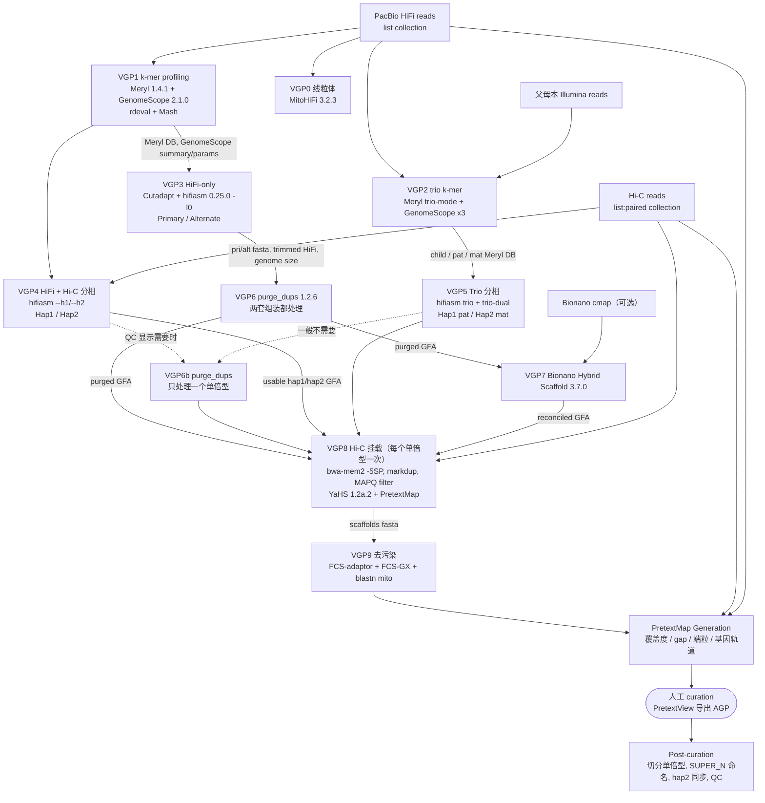

# VGP 基因组组装流程（Galaxy / IWC 版，VGP-assembly-v2）

> | 项目 | 内容 |
> |---|---|
> | 仓库 | https://github.com/galaxyproject/iwc ，目录 `workflows/VGP-assembly-v2`（历史背景：https://github.com/VGP/vgp-assembly ） |
> | 版本 | IWC 仓库没有整体 tag；本笔记基于 `main` 分支 commit `d9ec763d035e8ae637c8a135db5da93eb8982ca1`（2026-10-23）。每个 workflow 单独发版（`.ga` 的 `release` 字段 + CHANGELOG），并同步到 `github.com/iwc-workflows/<名称>` 打 tag，例如 VGP1 `v0.11`、VGP4 `v0.10`、VGP8 `v3.5`、VGP9 `v1.4`（用 `gh api repos/iwc-workflows/<名称>/releases/latest` 查到） |
> | 本地路径 | `/media/deyuan/18T_B/genome_assembly/pipelines/VGP_galaxy_iwc/workflows/VGP-assembly-v2/`（sparse checkout，下文记作 `IWC/`） |
> | 框架 | Galaxy workflow（`.ga` JSON，`format-version 0.1`）；用 planemo 测试（`*-tests.yml`）；发布到 Dockstore / WorkflowHub |
> | 许可证 | 每个 workflow 单独声明：大多数是 CC-BY-4.0；`hi-c-contact-map…` 和 `post-curation-processing` 是 MIT；VGP9 是 BSD-3-Clause；`Plot-Nx-Size` 没有声明；IWC 仓库本身在 GitHub API 中没有识别出整体许可证 |
> | 维护方 | Galaxy IWC（Intergalactic Workflow Commission）+ VGP；`.ga` 的 creator 包括 VGP、Galaxy、Delphine Lariviere、Patrik Smeds、Nadolina Brajuka 等 |
> | 更新时间 | 最新的 CHANGELOG 条目是 2026-10-19（VGP1 0.11、VGP3 0.3.9、VGP4 0.10、VGP5 0.9.13、VGP6 0.10.8、VGP6b 0.8.7、PretextMap 2.6、Post-curation 0.3） |

---

## 1. 一句话定位

VGP（Vertebrate Genome Project）把“HiFi 组装 → 去冗余 → Bionano/Hi-C 挂载 → 去污染 → 人工 curation 前后处理”拆成约十个编号的 Galaxy 子工作流（VGP0–VGP9，含 VGP6b），另有 3 个辅助 workflow（curation 前生成 PretextMap、curation 后处理、多组装 Nx 作图）。用户在网页上按自己有的数据类型选一条“分析轨迹”（trajectory），逐个运行这些子工作流。它是脊椎动物参考基因组的生产流程，以 HiFi 和 hifiasm 为核心（`IWC/README.md`；GTN 教程 `vgp_workflow_training`）。

## 2. 适用场景与输入数据

### 2.1 数据类型与是否必需

| 数据 | 是否必需 | 用在哪里 | 依据 |
|---|---|---|---|
| PacBio HiFi（fastq/fasta，Galaxy **list collection**） | **必需**（最低要求） | VGP0/1/2/3/4/5/6；curation 时算覆盖度轨道 | GTN 轨迹表；各 `.ga` 输入 |
| Hi-C（Illumina 双端，Galaxy **list:paired collection**），Arima / Dovetail | 可选。来自**同一个体**时既能用于 hifiasm 分相（VGP4），也能做挂载（VGP8）；来自同物种其他个体时**只能挂载，不能分相** | VGP4、VGP8、PretextMap、Post-curation | GTN `vgp_genome_assembly` 第 155 行；VGP8 输入注释 "Arima or Dovetail Hi-C data" |
| 父母本 Illumina 重测序（trio） | 可选 | VGP2（hapmer 库）+ VGP5（hifiasm trio） | `kmer-profiling-hifi-trio-VGP2.ga`、`Assembly-Hifi-Trio-phasing-VGP5.ga` |
| Bionano 光学图谱（`cmap`） | 可选 | VGP7 | `Scaffolding-BioNano-VGP7.ga` |
| ONT ultra-long | **不支持**：hifiasm wrapper 的 `ont_integration_selector` 在 VGP3/4/5 中都是 `blank`，即没有使用 | — | VGP3/4/5 `.ga` 的 hifiasm tool_state |

数据量建议：HiFi 至少 30×，Hi-C 至少 60×（都按二倍体覆盖度计）（GTN `vgp_workflow_training` 第 121 行）。

### 2.2 分析轨迹（trajectory）A–H（摘自 GTN 教程表格）

| 输入数据 | 轨迹 | 串联的 workflow（据 GTN 文字与各 README 整理） |
|---|---|---|
| HiFi | A | VGP1 → VGP3 → VGP6 →（VGP9） |
| HiFi + Hi-C | **B（VGP 最常用）** | VGP1 → VGP4 →（可选 VGP6b）→ VGP8（每个单倍型各跑一次）→ VGP9 |
| HiFi + Bionano | C | VGP1 → VGP3 → VGP6 → VGP7 |
| HiFi + Hi-C + Bionano | D | … → VGP7 → VGP8 |
| HiFi + 父母本 | E | VGP2 → VGP5 →（一般不需要 VGP6）… |
| HiFi + 父母本 + Hi-C | F | VGP2 → VGP5 → VGP8 |
| HiFi + 父母本 + Bionano | G | VGP2 → VGP5 → VGP7 |
| HiFi + 父母本 + Hi-C + Bionano | H | VGP2 → VGP5 → VGP7 → VGP8 |

GTN 原文：是否运行 VGP6 要根据 VGP3/4/5 的 QC 结果决定。trio 组装一般不需要 purge；Hi-C 分相的组装一般也不需要，确有必要时用 VGP6b 一次处理一个单倍型。VGP7/8/9 要对每个单倍型分别运行（GTN `vgp_workflow_training` 第 114–118 行）。表中具体串联顺序是我根据这段文字整理的（推测）。

### 2.3 “样本表”的等价物：Galaxy collection + planemo job YAML

Galaxy 没有 CSV 样本表。输入是 history 中的 dataset/collection：HiFi 建成 `list`，Hi-C 建成 `list:paired`。用 planemo 命令行运行时，要写一个 **job YAML**，格式和仓库里的 `*-tests.yml` 中 `job:` 一节相同。下面是参照 `IWC/kmer-profiling-hifi-VGP1/kmer-profiling-hifi-VGP1-tests.yml` 写的示例（路径是占位符）：

```yaml
# VGP1 job 文件示例（格式同 *-tests.yml 的 job 段；路径为占位）
Species Name: Platynereis_dumerilii
Assembly Name: pDum1
Collection of Pacbio Data:
  class: Collection
  collection_type: list
  elements:
  - class: File
    identifier: movie1
    path: /path/to/movie1.hifi_reads.fastq.gz
    filetype: fastqsanger.gz
K-mer length: 21
Ploidy: 2
```

> 输入标签必须和 `.ga` 中的 `label` 完全一致（例如 VGP1 是 `Species Name`、`Assembly Name`、`Collection of Pacbio Data`、`K-mer length`、`Ploidy`）。用 `planemo workflow_job_init <wf.ga> -o job.yml` 可以自动生成模板（planemo 文档 `_running_external.rst`）。

## 3. 流程步骤

### 3.1 子工作流清单与串联关系

| 编号 | `.ga` 名称（release） | 作用 | 主要输入（来自哪里） | 关键输出（流向） |
|---|---|---|---|---|
| VGP0 | Mitogenome Assembly VGP0（0.2.3） | 用 MitoHiFi 组装线粒体，可在任何时候独立运行 | HiFi collection、物种拉丁名、NCBI 邮箱、遗传密码表编号 | 线粒体 fasta/GenBank、覆盖度图和注释图 |
| VGP1 | K-mer profiling and reads statistics VGP1（0.11） | Meryl k-mer 库、GenomeScope2 基因组特征估计、reads QC | HiFi collection、k（默认 21）、ploidy（默认 2） | **Merged Meryl Database**、GenomeScope summary/model/model parameters、Estimated Genome Size、rdeval 报告、Mash 热图 → VGP3/4/6 |
| VGP2 | kmer-profiling-hifi-trio-VGP2（0.1.7） | trio 版 k-mer：子代 + 父 + 母 | HiFi、父本 reads、母本 reads（list） | child/paternal/maternal Meryl 库、3 套 GenomeScope → VGP5 |
| VGP3 | Genome Assembly from Hifi reads - VGP3（0.3.9） | 只用 HiFi，hifiasm 输出 primary/alternate | HiFi、Meryl DB、GenomeScope summary 和 model params、Compleasm 库与谱系 | Primary/Alternate 的 fasta 和 GFA、去接头后的 HiFi（tag `trimmed_hifi`）、Estimated genome size → VGP6 |
| VGP4 | Genome Assembly from Hifi reads with HiC phasing - VGP4（0.10） | HiFi + Hi-C，hifiasm 分相为 hap1/hap2 | 同上，再加 Hi-C `list:paired`、是否修剪 Hi-C | Hap1/Hap2 的 fasta（tag `hifiasm_Assembly_Haplotype_1/2`）、usable GFA → VGP6b/VGP8 |
| VGP5 | Genome Assembly … Trio data for phasing - VGP5（0.9.13） | hifiasm trio 模式，Hap1=父本，Hap2=母本 | HiFi、父母本 reads、VGP2 的 3 个 Meryl 库 | Hap1(pat)/Hap2(mat) 的 fasta/GFA → VGP7/8 |
| VGP6 | Purge duplicate contigs from a diploid assembly VGP6（0.10.8） | purge_dups：先从第一套组装去除重复，被去掉的序列并入第二套，再去第二套的重复 | 修剪后的 HiFi、两套 fasta、Meryl DB、GenomeScope model params、基因组大小 | 去冗余后两套组装的 fasta/GFA → VGP7/8 |
| VGP6b | Purging duplicates in one haplotype VGP6b（0.8.7） | 只对一个单倍型去冗余 | 同上，但一套组装要去冗余、另一套保持不变 | 去冗余后的组装 |
| VGP7 | Scaffolding-BioNano-VGP7（0.1.5） | Bionano Hybrid Scaffold | `cmap`、GFA、基因组大小 | scaffold 的 fasta/GFA/AGP → VGP8 |
| VGP8 | Scaffolding with Hi-C data VGP8（3.5） | Hi-C 比对、去重、按 MAPQ 过滤后用 YaHS 挂载；**每次只处理一个单倍型** | GFA（gfa1.2，需要有 P 行和序列）、单倍型名称、Hi-C、MAPQ 阈值、酶、基因组大小 | scaffold fasta/GFA（名称带 `_H1` 等后缀）、挂载前后的 Pretext 图 → VGP9 |
| VGP9 | Assembly decontamination VGP9（1.4） | NCBI FCS-adaptor/FCS-GX 去除外源污染，blastn 找出线粒体 scaffold | scaffold fasta、NCBI taxid、物种名、FCS-GX 库 | Final Decontaminated Assembly → PretextMap |
| — | PretextMap Generation from 1 or 2 haplotypes（2.6）（目录 `hi-c-contact-map-for-assembly-manual-curation`） | 生成 Pretext 接触图供人工 curation，带 HiFi 覆盖度、覆盖度缺口、gap、端粒、Compleasm 基因轨道 | hap1/hap2 fasta、Hi-C、HiFi | `.pretext` 文件（MAPQ 过滤版和不过滤的 multimapping 版）、合并后的 fasta |
| — | Post-curation assembly processing and evaluation（0.3） | 读取 PretextView 导出的 AGP，切分单倍型、按大小命名染色体（`SUPER_N`）、用 mashmap 把 hap2 重命名并对齐方向到 hap1，再做全套 QC | curated AGP、含两个单倍型的 fasta、Hi-C、HiFi | curated hap1/hap2、染色体分配表、JBrowse2、Pretext 图 |
| — | Generate Nx and Size plots for multiple assemblies（0.1.9） | 比较多套组装的 Nx 图和 size 图 | fasta collection | Nx/Size 图 |

> 顶层 `IWC/README.md` 仍写着“5 个主流程 + 2 个 custom purge + 4 个 AWS export workflow”，但当前目录里没有 export 工作流，这份 README 已经过时，以各子目录为准（VGP9 CHANGELOG 1.2 提到为 “export and report workflows” 添加了 tag，所以 export 工作流可能在别处维护，推测）。

### 3.2 各子工作流内部的关键步骤

下表中的版本号都是 Galaxy ToolShed **wrapper 版本**。`+galaxyN` 之前的部分一般就是上游软件版本（推测）。参数值全部从 `.ga` 的 `tool_state` 中解析得到（脚本用 `python3 -I` 读 JSON，没有执行仓库中的任何代码）。

| 步骤 | 工具（wrapper 版本） | 作用 | 关键参数 / 默认值（来自 `.ga`） |
|---|---|---|---|
| **VGP1** k-mer 计数 | Meryl 1.4.1+galaxy0（count → union-sum → histogram） | 对每个 HiFi 文件分别计数后合并 | k = 输入 `K-mer length`（默认 21） |
| VGP1 基因组特征 | GenomeScope 2.1.0+galaxy0 | 拟合 k-mer 谱，估计大小、杂合度、重复比例 | ploidy 默认 2；输出 model 和 model parameters（`testing: true`） |
| VGP1 派生参数 | 文本工具（grep/cut） | 从 GenomeScope summary 的 `Haploid` 行取第 3 列作为 Estimated Genome Size（即 max 值，推测）；从 model 中 `kmercov` 行解析出名为 “Homozygous Read Coverage” 的值 | 见 §7 关于 ×2 的坑 |
| VGP1 reads QC | rdeval 0.0.9+galaxy2；Mash 2.3（sketch/paste/dist）+ heatmap2 | reads 统计；多个 HiFi 文件之间的 Mash 距离热图（判断是否同一物种） | Mash k=21、sketch 1000；Mash QC 只在样本多于 1 个时运行（CHANGELOG 0.6） |
| **VGP2** | Meryl 1.4.1 / Meryl 1.3+galaxy6 `trio-mode`；GenomeScope 2.1.0 ×3 | 子代 k-mer 库 + 父本/母本 hapmer 库 | k 默认 21、ploidy 默认 2（两个参数都是可选输入） |
| **VGP3/4/5** 去接头 | Cutadapt 5.2+galaxy2 | 把含 PacBio 接头的 HiFi read **整条丢弃**（`discard_trimmed: true`），而不是修剪 | 两条 anywhere adapter（`ATCTCTCTCAACAACAACAACGGAGGAGGAGGAAAAGAGAGAGAT` 及其反向互补序列），`error_rate 0.1`、`overlap 35`、`revcomp true`；输出带 tag `trimmed_hifi` |
| VGP3/4/5 hom-cov | Compute（`c3*2`）+ Pick parameter value | 用户没填 `Homozygous Read Coverage` 时，取 GenomeScope model parameters 第 3 列 ×2，传给 hifiasm `hom_cov` | 测试文件里第 3 列约为 10.86，第 5 列约为 2,217,407（基因组长度），因此第 3 列应为 kcov（推测） |
| **VGP3** 组装 | hifiasm 0.25.0+galaxy3（standard 模式） | 产生 primary/alternate | `purge_level 0`（即 `-l0`，不在 hifiasm 内部去冗余，交给 VGP6，推测）；bloom filter bits 默认 37（大基因组用 38/39）；`hifiasm_kmer_length 51`、`window_size 51`、`correction_rounds 3`、`cleaning_rounds 4` 等都写在 wrapper 中 |
| **VGP4** 组装 | hifiasm 0.25.0+galaxy3（`hic_partition` = set） | 用 Hi-C 分相，产生 hap1/hap2 | `--h1/--h2` 接收 Hi-C 正/反向 reads（多对 reads 先用 Collapse Collection 5.1.0 合并成一对）；`l_msjoin 500000`；purge 选项未设置（`purge_selector: blank`，推测即使用 hifiasm 默认值）；`bins_out true`（输出 bin 文件便于排错） |
| VGP4 Hi-C 修剪（可选） | Cutadapt 5.2 | 切掉每条 read 开头 5 bp（`cut 5 / cut2 5`），用于“图看起来很 noisy”的 Arima 数据 | 输入 `Trim Hi-C reads?` |
| **VGP5** 组装 | hifiasm 0.25.0+galaxy3（`mode_selector: trio`） | 父本 reads 作为 hap1，母本 reads 作为 hap2 | wrapper 字段 `yak_kmer_length 31`、`min_kmers 5`、`max_kmers 2`；`--trio-dual` 默认开启 |
| VGP3/4/5 图 → 序列 | gfastats 1.3.11+galaxy2 | GFA 转 fasta，生成“usable GFA”和不含序列的轻量 GFA，统计组装指标 | VGP4 再用 sed 去掉序列名中的 `_path` |
| VGP3/4/5 QC | Compleasm 0.2.10+galaxy0（busco 模式）；Merqury 1.3+galaxy4；Bandage Image 2022.09；MultiQC 1.35；ggplot2（Nx/size 图）；ImageMagick montage | 完整性、QV/完整度、spectra-cn 图、原始 unitig 图图片 | VGP3 0.3.5、VGP4 0.4 起用 Compleasm 替换了 BUSCO；**VGP5 仍同时运行 BUSCO 6.1.0+galaxy0（metaeuk）和 Compleasm**；VGP5 的 Merqury 用 trio 模式（输入子代 + 父母本 hapmer 库） |
| **VGP6** 比对 | minimap2 2.31+galaxy1 | ① reads 比对到组装（预设 `asm5`，输出 PAF）；② 组装 split 后自比对（`self-homology`，`-A1 -B19 -O39,81 -E3,1 -z200 -m40`） | 参数按 `.ga` 原样列出 |
| VGP6 去冗余 | purge_dups 1.2.6+galaxy1（split_fa、pbcstat+calcuts、purge_dups、get_seqs） | 识别 haplotig 和 overlap | **calcuts 阈值由 GenomeScope 推出**：`transition = 1.5×kcov`，`upper_depth = 3×transition`（= 4.5×kcov）；`low_depth 1`、`min_depth 0.1`、`ploidy "-d 0"`；get_seqs 设 `end_trim true`、`length 10000`、`min_gap 10000` |
| VGP6 第二套组装 | Concatenate → 同一套 purge_dups | 从第一套去掉的 haplotig 并入第二套，再对第二套去冗余；最后由 “Rename and unify fasta” 子流程重命名第二套的序列（CHANGELOG 0.10.5/0.10.6），后缀由 `map_param_value` 按组装名映射：Primary→pri、Alternate→alt、Hap1→H1、Hap2→H2、Maternal→mat、Paternal→pat | 组装名称只能从 `Hap1/Hap2/Primary/Alternate/Maternal/Paternal` 中选 |
| **VGP6b** | 同 VGP6，另用 grep `-v REPEAT` | 只处理一个单倍型；get_seqs 之前先从 BED 中去掉 `REPEAT` 行 | — |
| **VGP7** | Bionano Hybrid Scaffold 3.7.0+galaxy3；gfastats | 光学图谱挂载，再与 GFA 合并（reconcile） | `configuration: vgp`、`enzyme: CTTAAG`（DLE-1）、`conflict_filter_genome/sequence 3`、`trim_cut_sites true` |
| **VGP8** Hi-C 覆盖度 | FastQC 0.74 + 计算 | 估算原始 Hi-C 覆盖度 = Total Sequences × 150 / 基因组大小（读长**固定按 150 bp 计**） | — |
| VGP8 比对 | bwa-mem2 2.3+galaxy0 | Hi-C reads 比对到 contigs | `-5 -S -P`（跳过 mate rescue 和 pairing）、`-T 30`、`-h 5`、`k19 w100 …`；输出按 read name 排序 |
| VGP8 去重 | samtools fixmate -m（1.22）→ samtools sort → samtools merge → **samtools markdup 1.22（`remove: true`）**；pairtools parse/dedup 1.1.3（只用于统计） | 去除 PCR/光学重复（3.5 起真正删除，而不只是标记） | markdup `odist 2500`；pairtools `min_mapq 1`、`max_molecule_size 2000`、`walks_policy mask` |
| VGP8 过滤 | bamtools filter 2.5.3 | 按 MAPQ 过滤 | 输入 `Minimum Mapping Quality`，`.ga` 默认 **10**（README 写的是 20，见 §7） |
| VGP8 挂载 | YaHS 1.2a.2+galaxy3 | Hi-C scaffolding | 酶从输入 `Restriction enzymes` 取预设（测试中为 `arima2`；GTN 教程中无酶时选 “Dovetail Omni-C: enzyme-free prep”）；`no_contig_ec: true`（关闭 contig 纠错），scaffold 纠错开启 |
| VGP8 QC | gfastats（reconcile 成 GFA/fasta，名称加 `_H1` 等后缀）；PretextMap 0.2.3 + Pretext Snapshot 0.0.5（挂载前后各一张）；samtools stats；Compleasm 0.2.6+galaxy3；MultiQC 1.33 | 挂载效果对比 | 挂载前 PretextMap `map_qual 20`；`high_res false` |
| **VGP9** | NCBI FCS-adaptor 0.5.0（`--euk`）→ 把位于序列中部的接头从修剪改为 mask → NCBI FCS-GX 0.5.5（clean）→ dustmasker 2.16.0 软屏蔽 → FCS-GX screen（taxid + 物种名 + 库）→ FCS-GX clean → sed 硬屏蔽 → 按长度过滤 → blastn 2.16.0 比对 `refseq_mitochondrion` → parse_mito_blast 1.0.2 → gfastats 剔除线粒体 scaffold | 去除外源污染和线粒体序列 | blastn `evalue 0.001`；输入 `Maximum length … for mitochondrial scaffolds`（0 表示检查全部序列）；1.0 起用 FCS-GX **替代了 Kraken** |
| **VGP0** | MitoHiFi 3.2.3+galaxy2（`find_reference` → `mitohifi`） | 先按物种名从 NCBI 找参考线粒体（`min_length 15000`），再用 HiFi reads 组装 | `organism_selection: animal`；遗传密码表由输入指定（测试用 `'2'`） |
| **PretextMap** | bwa-mem2 2.3、samtools 1.22（fixmate/sort/merge/markdup）、pairtools 1.1.3、PretextMap 0.2.4、PretextGraph 0.0.9、Pretext Snapshot 0.0.9、minimap2 2.31（`map-hifi`）、deeptools bamCoverage 4.0.0、samtools depth、Teloscope 0.1.6、Compleasm 0.2.10、bedtools merge 2.31.1 | 生成带轨道的接触图 | MAPQ 默认 10；端粒 canonical `TTAGGG`，explore `TTAGGG,CCCTAA`；bigwig bin 100；高分辨率图默认 **true**；Hi-C 去重默认 true；HiFi 去接头默认 false |
| **Post-curation** | vgp_split_agp 1.1、vgp_sak_generation 1.1、vgp_chromosome_assignment 1.1、mashmap 3.1.3、JBrowse2 3.7.0、bwa-mem2 2.3 / bwa-mem 0.7.19、Teloscope、PretextMap、Compleasm | AGP → 单倍型序列 → 染色体命名 → hap2 同步 → QC | 基因组 >10 GB 时改用 BWA-MEM；支持标注 Z/W 性染色体 |

### 3.3 流程图（workflow 级串联）



## 4. 如何运行

### 4.1 在公共 Galaxy 服务器上运行（官方推荐方式）

1. **获取 workflow**：IWC README 写明，所有 IWC workflow 都会自动安装到 usegalaxy.org、usegalaxy.eu、usegalaxy.org.au，可以在各服务器的 “published workflows” 列表中找到。也可以在 Galaxy 中点 Workflows → Import → TRS search，输入 `organization:iwc-workflows`（Dockstore）或 `organization:iwc`（WorkflowHub）来导入（IWC 根目录 `README.md`）。GTN 教程每一节都提供 “Launch … (View on Dockstore)” 链接，例如 `github.com/iwc-workflows/kmer-profiling-hifi-VGP1/main`。
2. **上传数据并建 collection**：HiFi 建成 list，Hi-C 建成 list:paired。数据类型要选 `fastqsanger(.gz)`，**不要选 `fastqcssanger`**（GTN 警告）。数据也可以直接从 GenomeArk 导入（GTN）。
3. **按轨迹依次运行**：以轨迹 B 为例：VGP1（k=21 或 31、ploidy=2）→ VGP4（在表单中按 tag 选 GenomeScope summary、Meryl DB、model parameters）→ 看 Merqury、Compleasm 结果，决定是否运行 VGP6b → VGP8（hap1、hap2 各运行一次，输入 `usable hap1 gfa` 和 `estimated_genome_size`）→ VGP9 → PretextMap → 用 PretextView 人工 curation → Post-curation。
4. 每个 workflow 都内置 Galaxy Markdown **workflow report**（`.ga` 中的 `report` 字段，例如 VGP4 报告包含 Merqury QV/完整度、Compleasm、统计表、Nx 图）。

### 4.2 命令行 / 本地（planemo）

planemo 官方文档（`docs/_running_intro.rst`、`docs/_running_external.rst`）给出以下命令：

```bash
# 生成 job 文件模板，然后填入数据路径/URL 和参数
planemo workflow_job_init Assembly-Hifi-HiC-phasing-VGP4.ga -o vgp4-job.yml
planemo workflow_lint Assembly-Hifi-HiC-phasing-VGP4.ga

# A. 提交到远程 Galaxy（如 usegalaxy.eu），计算在服务器上进行
planemo run Assembly-Hifi-HiC-phasing-VGP4.ga vgp4-job.yml \
    --engine external_galaxy --galaxy_url https://usegalaxy.eu --galaxy_user_key <API_KEY> \
    --history_name pDum1_VGP4 --download_outputs --output_directory ./out --output_json out.json
# 也可以先建 profile：planemo profile_create eu --galaxy_url ... --galaxy_user_key ... --engine external_galaxy
#                  planemo run wf.ga job.yml --profile eu

# B. 本地临时启动一个 Galaxy（默认 engine=galaxy；或用 Docker 化的 Galaxy）
planemo run wf.ga job.yml --engine docker_galaxy --ignore_dependency_problems

# C. 跑仓库自带的测试（自动读取同名 -tests.yml）
planemo test --galaxy_url <server> --galaxy_user_key <API_KEY> Scaffolding-HiC-VGP8.ga
```

本地方式 B 需要本机 Galaxy 能安装全部 ToolShed 工具，并配置好 Compleasm 谱系库、FCS-GX 库、BLAST `refseq_mitochondrion` 等参考数据，对大基因组来说相当重（推测：仓库中没有本地部署所需资源的说明）。IWC 的 CI 会在 GitHub Actions 上临时启动 Galaxy 来跑测试（`workflows/README.md`）。

### 4.3 测试数据（各 `*-tests.yml`）

| workflow | 测试数据 |
|---|---|
| VGP1 | 5 个 HiFi movie（Zenodo 17246010），k=21，ploidy=2 |
| VGP3/4/5/6/6b | 酵母 `yeast_reads_sub1.fastq.gz` + 预先算好的 Meryl DB/GenomeScope（Zenodo 8371053、10068595）；bloom bits=32；Compleasm `v5` / `vertebrata_odb10`；VGP5 父母本为 `hap1_1/2.fq`、`hap2_1/2.fq` |
| VGP8 | 斑胸草雀 bTaeGut2 的 Arima Hi-C 子集（9 对 reads，Zenodo 17190637），`Restriction enzymes: arima2`，MAPQ 10；断言 scaffold 总长 5,788,676 |
| VGP7 | Bionano cmap + GFA（Zenodo 10063794） |
| VGP9 | 人类示例 `taxid 9606`，FCS-GX 库 `test-only`（Zenodo 16999526/17296714） |
| VGP0 | `pacbio_01.fasta.gz`（Zenodo 10454765），物种 *Theretra latreillii lucasii*，遗传密码表 `'2'` |
| GTN 教程 | 合成酵母 HiFi 50×（Zenodo 6098306）+ Hi-C SRR7126301（Zenodo 5550653） |

### 4.4 关键参数速查

- VGP1：`K-mer length`（默认 21；GTN 指出 VGP 一般用 21，教程里用 31；单倍体大小超过 10 Gb 或重复很多的基因组建议加大 k）、`Ploidy`（默认 2）。
- VGP3/4/5：`Bits for bloom filter`（默认 37；比人类大得多的基因组用 38/39 以节省内存）、`Homozygous Read Coverage`（留空则自动估计）、Compleasm 库（如 `v5`）和谱系（如 `vertebrata_odb10`）、单倍型名称（不能含空格）。VGP4 另有 `Trim Hi-C reads?`；VGP5 另有 `--trio-dual`。
- VGP6/6b：组装名称（受限列表）、“What sequences are you purging?”（contig/scaffold）。
- VGP8：`Haplotype`（Haplotype 1/2、Maternal、Paternal、Primary、Alternate，决定 scaffold 名称后缀）、`Trim Hi-C Data?`、`Minimum Mapping Quality`（默认 10）、`Restriction enzymes`。
- VGP9：`Taxonomic Identifier`、`Species Binomial Name`、`Database for NCBI FCS GX`、mito 长度上限。
- PretextMap/Post-curation：端粒模式、MAPQ、bin size、是否生成基因轨道（大基因组建议关闭）、是否生成高分辨率图、`Genome larger than 10GB`。

### 4.5 资源需求

仓库中**没有给出 CPU/内存/时间数字**。在公共服务器上，资源由服务器端的作业配置决定（各服务器的配额本笔记未核实）。文档中能找到的资源相关提示：hifiasm bloom bits 37→38/39 可以省内存；大基因组可能因内存不足而无法生成基因轨道；基因组 >10 GB 时改用 BWA-MEM；GTN 中酵母数据的 VGP1 大约运行 15 分钟。

## 5. 主要输出

Galaxy 没有“结果目录”，输出是 history 中带 **label + tag** 的数据集，下一步 workflow 靠 tag 识别输入。用 planemo 的 `--download_outputs --output_directory` 可以下载到本地。

| workflow | 关键输出（`workflow_outputs` label / tag） |
|---|---|
| VGP1 | `Merged Meryl Database`（tag `meryl_db`）；`GenomeScope summary / Model / Model Parameters`（tag `genomescope_summ/params`）以及线性/对数/转换后的图；`Estimated Genome Size File`；`Homozygous Read Coverage`；`Reads Statistics`、`Rdeval report`；`HeatMap`（Mash） |
| VGP3 | `Hifiasm Primary/Alternate assembly`（fasta）、`Hifiasm Primary/Alternate gfa`、`Usable GFA …`（含/不含序列）、`raw unitig graph image`、`Estimated Genome size`（tag `estimated_genome_size`）、`Compleasm …`、`Merqury …`、`Assembly statistics`、`Nx and Size plots`、`cutadapt multiqc stats`；去接头 HiFi 带 tag `trimmed_hifi` |
| VGP4 | `Hifiasm Hi-C hap1/hap2`（tag `hifiasm_Assembly_Haplotype_1/2`）、`usable hap1/hap2 gfa`、`No sequences hap1/hap2 gfa`、`HiFi reads without adapters`、`Trimmed Hi-C reads`、`Hi-C Forward/Reverse reads`、`Compleasm … hap1/hap2`、`Merqury QV/Stats/CN plots`、`Assembly statistics for Hap1 and Hap2`、`Montage Nx and size plots`、`Estimated Genome size` |
| VGP5 | `Hifiasm Trio hap1/hap2`、`usable hap1/hap2 gfa`、`Busco Summary Hap1/Hap2`、`Compleasm on Hap1 (paternal)/Hap2 (maternal) …`、`Merqury Trio Histogram` 等 |
| VGP6/6b | `Purged Primary/Alternate Assembly`（fasta + gfa）、`Cutoffs for …`、`Read Coverage and cutoffs calculation …: Histogram plot`、`Merqury on Phased assemblies: stats/Images`、`Compleasm on purged …`、`Assembly statistics for purged assemblies`；VGP6b 另有 `Removed haplotigs` |
| VGP7 | `Scaffolds: agp`、`Bionano scaffolds reconciliated: gfa/fasta`、`Assembly Statistics for s1`、Nx/Size 图 |
| VGP8 | `Reconciliated Scaffolds: fasta / gfa / gfa no sequence`、`Suffixed AGP`、`Pretext Map Before/After HiC scaffolding`、`Hi-C maps`、`Hi-C duplication stats on contigs/scaffolds`、`Hi-C Alignment Stats pre-scaffolding/scaffolds`、`Merged Alignment stats`、`Scaffolds Compleasm Summary`、`Scaffolding Plots`、`Raw Hi-C coverage` |
| VGP9 | `Final Decontaminated Assembly`（fasta.gz）、`Taxonomy Report`、`Contaminants report/sequences`、`Mitochondrial Scaffolds`、`Adaptor Report`、`Masking Action Report` |
| PretextMap | `Pretext All tracks`（以及 `- Multimapping` 版本）、`Pretext Snapshot With tracks`、`Assembly for curation`、`Both Haplotypes merged`、`Telomere Report`、`P/Q telomeres bed`、`Gaps Bed`、`BigWig Coverage`、`Coverage Gaps Track` 等 29 项（见该目录 README） |
| Post-curation | `Curated Hap1/Hap2`（含 gzip 版）、各类 AGP、`Chromosome mapping/assignment`（CSV）、`Sequence Assignment Stats`、`JBrowse2 …`、每个单倍型的 Pretext/端粒/gap/覆盖度/Compleasm 输出 |

## 6. 设计亮点（值得学习的地方）

1. **模块化 + 轨迹化**：按“手上有什么数据”组合 workflow，而不是写一个巨大的 if/else 流程。各 workflow 独立发版、独立测试，用户可以只重跑某一段（GTN 轨迹表；各 CHANGELOG）。
2. **用 k-mer profile 推导下游参数**：GenomeScope 的 kcov → hifiasm `--hom-cov`（kcov×2），以及 purge_dups calcuts 的 `transition=1.5×kcov`、`upper=4.5×kcov`；summary → 基因组大小，再传给 VGP7/8 和 rdeval。减少了手调的经验参数（VGP3/4/5/6 的 `.ga`）。
3. **HiFi 接头处理策略**：PacBio 接头可能出现在 read 的任意位置，所以含接头的 read 整条丢弃，而不是修剪（Cutadapt `discard_trimmed`；原理见 GTN `vgp_genome_assembly` 第 281 行）。
4. **每个阶段都做 QC，并且口径一致**：gfastats + Nx/Size 图、Compleasm、Merqury（spectra-cn）在组装、去冗余、挂载各阶段都有；VGP8 输出挂载前后的 Pretext 图和 pairtools/markdup 重复率统计。
5. **Hi-C 比对的工程细节**：bwa-mem2 `-5SP -T30`、fixmate、samtools markdup 真正删除重复（3.5 起）、按 MAPQ 过滤；多对 Hi-C 先合并；单对数据有专门的分支处理（“Test if collection has only one item”子流程；VGP4 0.3.11 修复了只用到第一对 reads 的 bug）。
6. **面向人工 curation 的完整闭环**：PretextMap 带覆盖度、覆盖度缺口、gap、端粒（Teloscope，支持 IUPAC 模式）、基因（Compleasm）轨道；Post-curation 自动完成 AGP 切分、`SUPER_N` 命名、hap2 方向与 hap1 同步（mashmap），并生成 JBrowse2。
7. **可复现与可维护**：所有工具版本写死在 `.ga` 中；机器人（planemo-autoupdate）定期升级 wrapper 并在 CHANGELOG 中记录；planemo 测试中用断言（如 `has_text`、`has_size`）而不是逐字节比对，以适应大文件（IWC `workflows/README.md`）。
8. **用 tag 串联数据**：例如 `trimmed_hifi`、`hifiasm_Assembly_Haplotype_1`、`estimated_genome_size`，在网页界面中能快速找到上一步的正确输入。

## 7. 局限与注意事项（坑）

1. **默认值面向脊椎动物**：Compleasm 谱系示例是 `vertebrata_odb10`，端粒默认 `TTAGGG`，bloom bits 37 按人类大小设定。做环节动物时需要改谱系：odb10 里没有冠轮动物谱系，只能用 `metazoa_odb10`；odb12 里有 `lophotrochozoa_odb12`，但 Compleasm 能否使用 odb12 库还没核实（以上两点已于 2026-10-26 查 BUSCO 的 file_versions.tsv 核实）。VGP0 的遗传密码表要按 NCBI 填：**环节动物线粒体是表 5 "Invertebrate Mitochondrial"**（已用 NCBI Taxonomy 核实：Annelida taxid 6340，MGCId=5）；端粒模式要根据文献确认（推测）。
2. **“Homozygous Read Coverage” 可能差 2 倍**：VGP1 输出的这个值是直接从 GenomeScope model 的 `kmercov` 行解析的（**没有 ×2**），而 VGP3/4/5 自动估计时用的是 model parameters 第 3 列 ×2。GTN 图注说 kcov 是“杂合位点的平均 k-mer 覆盖度”。所以如果把 VGP1 的值**手动**填进 VGP4 的可选参数，可能只有应填值的一半（推测，建议先对照 GenomeScope 图确认纯合峰位置）。GTN 也提醒 GenomeScope 和 hifiasm 都可能认错峰，这种情况要手动指定。
3. **文档与 `.ga` 不一致**：VGP8 README 说 `Minimum Mapping Quality` 默认 20，`.ga` 默认是 10（测试也用 10）；PretextMap README 说“去掉 Hi-C read **末端** 5 bp”，而同一 `.ga` 的输入注释和其他 workflow 都说去掉**开头** 5 bp（Cutadapt `cut: 5`）；顶层 README 已过时；多个 workflow 的输入标签仍叫 “Database for Busco Lineage”，实际用于 Compleasm。
4. **版本差异**：GTN 教程固定在测试过的旧版本（如 VGP1 v0.9、VGP4 v0.6），IWC 最新版本是 v0.11、v0.10。两者的输出（BUSCO 换成 Compleasm、Merqury 图拼接方式等）可能对不上。复现时应记录每个 workflow 的 release。另外 VGP4 0.3.10 被明确标为 “Broken, do not use”。
5. **VGP7/8/9 每个单倍型都要单独运行**：轨迹 B 至少要跑 2×(VGP8+VGP9)。VGP8 的输入必须是 gfa1.2 格式（有 P 行和序列），fasta 组装要先用 gfastats 转换。
6. **purge 的取舍**：hifiasm 在 VGP3 中用 `-l0` 关闭了内部去冗余，所以 pri/alt 路线基本都要跑 VGP6（推测）。VGP4/5 的 purge 参数留空、使用 hifiasm 默认值，GTN 认为通常不需要再 purge，应以 Merqury spectra-cn 和 Compleasm 重复率为准。VGP6 会把第一套去掉的 haplotig 并入第二套；如果你认为被去掉的序列不属于另一个单倍型，就用 VGP6b。
7. **Hi-C 分相需要同一个体的数据**；其他个体的 Hi-C 只能用于 VGP8 挂载（GTN）。
8. **不支持 ONT ultra-long**，也没有 Illumina/ONT polishing 步骤（hifiasm 的 HiFi contig 直接进入后续步骤）。
9. **VGP9 依赖服务器端数据库**：FCS-GX 库和 BLAST `refseq_mitochondrion` 要在服务器上已安装（测试用的是 `test-only` 库）。必须提供正确的 NCBI taxid；序列过长可能让 BLAST 失败，可以用长度上限参数限制。
10. **Bionano 只按 VGP 配置写死**：`configuration: vgp` + DLE-1 酶 `CTTAAG`，用其他酶/平台需要改 workflow（推测）。
11. **Hi-C 覆盖度估算假定读长 150 bp**（VGP8 的 `calculate_numeric_param` 中写死了 150）。
12. **Galaxy 本身的限制**：大量数据上传、配额、排队时间都取决于服务器（未核实）；本地部署 Galaxy 运维成本高。

## 8. 与 sanger-tol/genomeassembly 的对比

| 维度 | VGP Galaxy（IWC，VGP-assembly-v2） | sanger-tol/genomeassembly v1.0.1 |
|---|---|---|
| 框架 / 交互 | Galaxy 网页 + 多个独立 `.ga`；可以用 planemo 命令行提交 | Nextflow（nf-core 模板 4.1.0），一条命令运行 |
| 输入描述 | Galaxy collection（list / list:paired）+ 表单参数；命令行时用 job YAML | 两个 YAML/JSON：`genomic_data` + `assembly_specs` |
| 输入格式 | HiFi fastq/fasta；Hi-C fastq；trio 用 Illumina fastq；Bionano cmap | HiFi/ONT fastx；Hi-C 和 Illumina 为**未比对的 CRAM**；10X fastq |
| k-mer / 基因组特征 | Meryl + GenomeScope2（VGP1/2），并派生 hom-cov、purge 阈值、基因组大小 | FastK + GenomeScope2 |
| 组装器 | hifiasm 0.25.0：standard（pri/alt）、Hi-C 分相、trio | hifiasm（先做 overlap bin，再组装：pri/alt、Hi-C 分相、trio）；也调用 MitoHiFi/oatk |
| ONT ultra-long | 不支持 | 支持（assembly_specs 开关） |
| 去冗余 | purge_dups（VGP6 双套 / VGP6b 单套），阈值由 kcov 推导 | purge_dups（可选） |
| 抛光 | 无 | 10X Longranger + FreeBayes（可选，属于遗留功能） |
| Hi-C 比对 | bwa-mem2 `-5SP`，samtools fixmate/markdup，MAPQ 过滤 | 从 CRAM 分块比对（bwa-mem2 或 minimap2），samtools markdup |
| 挂载 | YaHS 1.2a.2（VGP8）；可选 Bionano（VGP7） | YaHS |
| 接触图 | PretextMap（挂载前后各一张，curation 版带覆盖度/gap/端粒/基因轨道） | PretextMap、Juicer `.hic`、cooler |
| QC | gfastats、Compleasm（VGP5 另有 BUSCO 6.1.0）、Merqury、rdeval、Mash、pairtools 统计 | asmstats、gfastats、BUSCO、MerquryFK（每个阶段） |
| 细胞器 | VGP0 MitoHiFi（线粒体，独立运行） | MitoHiFi、oatk（线粒体和质体） |
| 去污染 | **内置** VGP9（FCS-adaptor、FCS-GX、mito blast） | 不包含（由 sanger-tol/ascc、blobtoolkit 另行处理） |
| 人工 curation | 内置 curation 前的 PretextMap workflow 和 post-curation workflow | 不包含（由 sanger-tol/treeval、curationpretext 处理） |
| 复用与缓存 | 靠 Galaxy history 和 tag；每步人工串联 | 每个阶段用数据+参数的 MD5 标识，共享的上游阶段只算一次；每个阶段有 index.json 记录参数和版本 |
| 运行门槛 | 不需要命令行和集群，网页即可（适合初学者） | 需要 Nextflow + 容器；大基因组一般要在 HPC 上运行（推测） |
| 对 Annelida 的适配 | 要改脊椎动物默认值（谱系、端粒、遗传密码表） | 面向 Tree of Life 多类群（参考摘要中没有谱系配置的细节） |

## 9. 参考文献与链接

- Rhie A. et al. 2021. Towards complete and error-free genome assemblies of all vertebrate species. *Nature*. https://doi.org/10.1038/s41586-021-03451-0 （VGP 1.x 流程；见 VGP/vgp-assembly README）
- Formenti G. et al. 2021. Complete vertebrate mitogenomes reveal widespread repeats and gene duplications. *Genome Biology*. https://doi.org/10.1186/s13059-021-02336-9 （MitoVGP，同上）
- hifiasm：Cheng H. et al. 2021. *Nat Methods* 18:170–175. https://doi.org/10.1038/s41592-020-01056-5 ；Cheng H. et al. 2022. *Nat Biotechnol* 40:1332–1335. https://doi.org/10.1038/s41587-022-01261-x （书目信息取自 nf-core/genomeassembler 的 `CITATIONS.md`；GTN 引用为 Cheng2021）
- GTN 教程：
  - Using the VGP workflows to assemble a vertebrate genome with HiFi and Hi-C data：https://training.galaxyproject.org/training-material/topics/assembly/tutorials/vgp_workflow_training/tutorial.html
  - Vertebrate genome assembly using HiFi, Bionano and Hi-C data - Step by Step：https://training.galaxyproject.org/training-material/topics/assembly/tutorials/vgp_genome_assembly/tutorial.html
- IWC：https://github.com/galaxyproject/iwc ；IWC 网站 VGP 列表：https://iwc.galaxyproject.org/?filter=Vertebrate+Genome+Project/ （GTN 中给出）；Dockstore 组织：https://dockstore.org/organizations/iwc
- 历史仓库：https://github.com/VGP/vgp-assembly （README：VGP v2.0 起生产流程迁移到 Galaxy，与 Rhie 2021 相比主要是用 HiFi 替换了 CLR，并增加了 QC 和 Hi-C 挂载选项；v1.0–1.1 在 DNAnexus 上运行，还有 WDL/Docker 版的 scaffolding 流程和本地 Slurm 脚本）
- planemo 文档：https://planemo.readthedocs.io/en/latest/running.html
- 各工具：purge_dups https://github.com/dfguan/purge_dups ；YaHS https://github.com/c-zhou/yahs ；gfastats https://github.com/vgl-hub/gfastats ；Merqury https://github.com/marbl/merqury

## 本笔记依据（读过的文件列表）

本地文件（`IWC/` = `/media/deyuan/18T_B/genome_assembly/pipelines/VGP_galaxy_iwc/workflows/VGP-assembly-v2/`）：
- `IWC/README.md`
- 每个子目录的 `README.md`、`CHANGELOG.md`、`.dockstore.yml`、`*-tests.yml`（共 14 个子目录：Mitogenome-assembly-VGP0、kmer-profiling-hifi-VGP1、kmer-profiling-hifi-trio-VGP2、Assembly-Hifi-only-VGP3、Assembly-Hifi-HiC-phasing-VGP4、Assembly-Hifi-Trio-phasing-VGP5、Purge-duplicate-contigs-VGP6、Purge-duplicates-one-haplotype-VGP6b、Scaffolding-Bionano-VGP7、Scaffolding-HiC-VGP8、Assembly-decontamination-VGP9、hi-c-contact-map-for-assembly-manual-curation、post-curation-processing、Plot-Nx-Size）
- 全部 14 个 `.ga` 文件（用 `python3 -I` 解析 name/release/license/creator/inputs/steps/tool_state/input_connections/workflow_outputs/report）
- `IWC/Assembly-Hifi-only-VGP3/test-data/GenomeScope_Model_parameters.tabular`（及 VGP4/VGP5 中的同名文件）、`IWC/Plot-Nx-Size/test-data/primary_head.tabular`
- IWC 根目录 `README.md` 和 `workflows/README.md`（用 `git show HEAD:<path>` 读取，未 checkout）

在线文档（用 `gh api` 获取原文）：
- `VGP/vgp-assembly` README 及仓库元数据
- `galaxyproject/training-material`：`topics/assembly/tutorials/vgp_workflow_training/tutorial.md`（commit fe26b71，2026-09-23）、`topics/assembly/tutorials/vgp_genome_assembly/tutorial.md`（commit d1a375c，2026-09-22）
- `galaxyproject/planemo`：`docs/running.rst`、`docs/_running_intro.rst`、`docs/_running_external.rst`
- `iwc-workflows/{kmer-profiling-hifi-VGP1, Assembly-Hifi-HiC-phasing-VGP4, Scaffolding-HiC-VGP8, Assembly-decontamination-VGP9}` 的 latest release
- `galaxyproject/iwc` 仓库元数据（license 字段）
