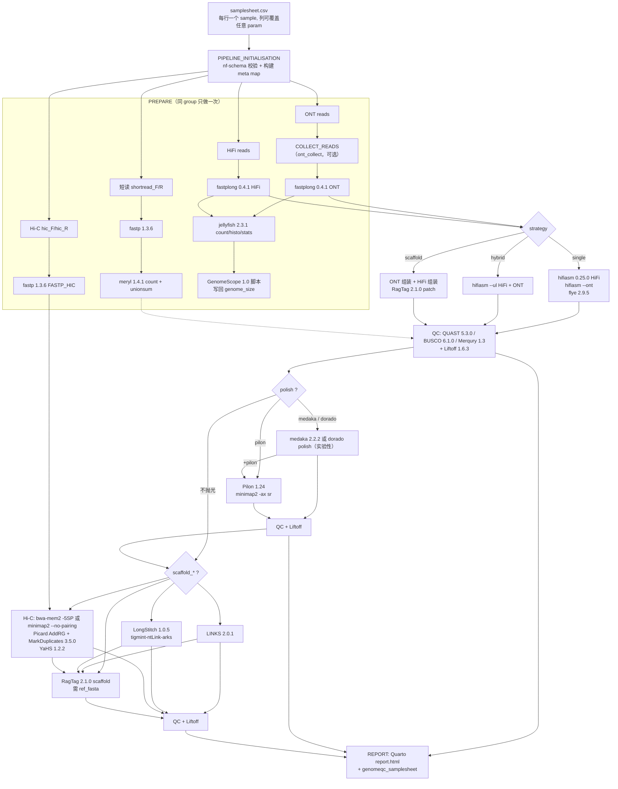

# nf-core/genomeassembler

> | 项目 | 内容 |
> |---|---|
> | 仓库 | https://github.com/nf-core/genomeassembler |
> | 版本 | tag **2.0.1**（“I was a Teenage Hand Model”，2026-10-23 发布，用 `gh api …/releases/latest` 查得），commit `c608622876dc627020e6627a5ea8cffd0d2e3f3d`；历史版本：2.0.0（2026-09-18）、1.1.0、1.0.1、1.0.0 |
> | 本地路径 | `/media/deyuan/18T_B/genome_assembly/pipelines/nf-core_genomeassembler/`（下文记作 `NFC/`） |
> | 框架 | Nextflow DSL2，`nextflowVersion = '!>=25.10.4'`（强制要求）；nf-core 模板 4.1.0；nf-schema 2.7.2；nf-test（快照记录为 nf-test 0.9.5 / Nextflow 25.10.4） |
> | 许可证 | MIT（`NFC/LICENSE`） |
> | 维护方 | Niklas Schandry（LMU Munich）+ nf-core 社区；manifest 中的贡献者还有 Mahesh Binzer-Panchal、Matthieu Muffato 和 Jim Downie（Sanger）等 |
> | 更新时间 | 2026-10-23（v2.0.1）；v2.0.0 是一次破坏性重构（以样本为中心做参数化） |
> | DOI | 10.5281/zenodo.14986998 |

---

## 1. 一句话定位

这是一个用长读（ONT 和/或 PacBio HiFi）组装**单倍体或近交二倍体**基因组的 Nextflow 流程，组装器可选 hifiasm 和 flye。它还能对组装做抛光（medaka/dorado/pilon）、挂载（LINKS/LongStitch/YaHS/RagTag）和注释迁移（Liftoff），并在每个阶段运行 QUAST/BUSCO/Merqury，最后汇总成 Quarto 报告。它最大的特点是**每个样本可以单独设定策略**：同一批数据可以用不同组装策略跑多遍，在一份报告里横向比较。**不支持分相（phasing）**（`NFC/README.md`、`NFC/docs/usage.md`）。

## 2. 适用场景与输入数据

### 2.1 数据类型

| 数据 | 是否必需 | 说明（来源） |
|---|---|---|
| ONT reads（`ontreads`） | ONT 和 HiFi 至少要有一种（或者直接提供已有组装 `assembly`） | 先经 fastplong 处理；`ont_collect` 可把多个文件合并成一个 |
| PacBio HiFi（`hifireads`） | 同上 | 先经 fastplong 处理 |
| ONT + HiFi 联合组装（ONT 作为 ultra-long 输入） | 可选 | `strategy: hybrid` 时运行 `hifiasm --ul <ONT>`（`modules/nf-core/hifiasm/main.nf`） |
| Illumina 短读（`shortread_F/R`，`paired`） | 可选 | 用于 Pilon 抛光和 Merqury（`merqury` 只有在提供短读时才会生效，见初始化代码） |
| Hi-C（`hic_F/hic_R`） | 可选 | **只用于 YaHS 挂载**，不用于 hifiasm 分相 |
| 参考基因组（`ref_fasta`/`ref_gff`） | 可选 | 用于 RagTag 挂载、QUAST 比较和 Liftoff 注释迁移 |
| 已有组装（`assembly`） | 可选 | 跳过组装步骤，只做下游分析和 QC |
| trio / Bionano / 10X | **不支持** | 代码中没有对应路径（推测：HIFIASM 调用时 trio 和 Hi-C 输入都传的是空 `[[],[],[]]`） |

`docs/usage.md` 原文："This pipeline is designed to assemble haploid (or diploid inbred) genomes from long-reads"，并注明 "Phasing is currently not supported"。

### 2.2 样本表（`--input`，必须是 `.csv`）

- schema（`NFC/assets/schema_input.json`）中**只有 `sample` 一列是必填的**（不能含空格）。其余列名与 pipeline params 同名（schema 中共 56 个字段，包括 `group`、`strategy`、`assembler`、`hifireads`、`ontreads`、`hic_F`、`scaffold_hic`、`busco_lineage` 等）。
- **样本列优先于全局 params**：初始化时，samplesheet 中的空值会用 `params.get(key)` 填上（`subworkflows/local/utils_nfcore_genomeassembler_pipeline/main.nf` 第 109–117 行）。
- `group`：同组样本只做**一次**读段预处理，在报告中放在一起显示。**只能用于输入文件完全相同的样本**（usage.md 警告）。
- 建议所有路径都写绝对路径（usage.md）。

最简格式（usage.md）：

```csv
sample
Sample1
```

官方测试用的样本表（`nf-core/test-datasets@genomeassembler: samplesheet/test_samplesheet_v2.csv`；reads 等通过 test profile 的 params 全局提供）：

```csv
sample,strategy,assembler,assembler_ont,assembler_hifi,scaffold_ragtag,scaffold_longstitch,use_ref,scaffold_hic
test_hifi_hifiasm,single,,,hifiasm,,,,false
test_ont_hifiasm,single,,hifiasm,,true,,true,false
test_ont_flye,single,,flye,,,,true,false
test_hifi_flye,single,,,flye,true,,true,false
test_hifiasm_ul,hybrid,hifiasm,,,,true,,false
test_hifiasm_flye,scaffold,hifiasm_flye,,,,,true,false
test_flye_hifiasm,scaffold,flye_hifiasm,,,true,,,false
test_ont_hifiasm_hic,single,,hifiasm,,,,false,true
test_hifiasm_flye_hic,scaffold,hifiasm_flye,,,,,true,true
```

一个 HiFi + Hi-C 项目的写法示例（按 schema 列名自拟，路径为占位）。BUSCO、QUAST 这类 QC 开关按 usage.md 的建议放到 params 里（见 §4.1），不要写在样本表中：

```csv
sample,hifireads,hic_F,hic_R,strategy,assembler,scaffold_hic,hic_trim
pdum_hifiasm_yahs,/abs/pdum.hifi.fq.gz,/abs/pdum_hic_R1.fq.gz,/abs/pdum_hic_R2.fq.gz,single,hifiasm,true,true
```

### 2.3 三种组装策略（`strategy`）

| strategy | 组装器写法 | 实际做法（`subworkflows/local/assemble/main.nf`） |
|---|---|---|
| `single`（默认） | `hifiasm`（默认）或 `flye` | 用一种 reads：HiFi 用 `hifiasm`，ONT 用 `hifiasm --ont`，或用 `flye --nano-hq` / `flye --pacbio-hifi` |
| `hybrid` | 只能是 `hifiasm` | `hifiasm --ul <ONT>`，同时输入 HiFi 和 ONT |
| `scaffold` | `"ONT组装器_HiFi组装器"`，例如 `flye_hifiasm`、`hifiasm_hifiasm` | ONT 和 HiFi 分别组装，然后用 **RagTag patch** 合并；`assembly_scaffolding_order` 默认 `ont_on_hifi` |

## 3. 流程步骤

### 3.1 步骤表

| 步骤 | 工具（版本，来自 `environment.yml` / 容器 tag） | 作用 | 关键参数 / 默认值（`nextflow.config` 等） |
|---|---|---|---|
| 0. 初始化 | nf-schema 2.7.2 `samplesheetToList` | 校验样本表，生成每个样本的 meta map（“meta-stuffing”） | 推断 `assembler_ont/hifi`、`polish` 字符串；`merqury` 在没有短读时强制为 false；`qc_reads` 在只有一种长读时自动切换 |
| 1. ONT 合并（可选） | COLLECT_READS（coreutils 9.5 / gzip 1.13） | 把多个 ONT 文件合并成 `*_all_reads.fq.gz` | `ont_collect = false` |
| 2. 长读 QC/修剪 | **fastplong 0.4.1** | 修剪接头、按质量过滤长读，输出 json 和 html 报告 | `ont_fastplong_args`、`hifi_fastplong_args` 默认 `''`；`ont_adapters`、`hifi_adapters` 默认 null（传给 `--adapter_fasta`）；`-A` 关闭接头修剪，`-Q` 关闭质量过滤（usage.md） |
| 3. 短读修剪 | fastp 1.3.6 | 修剪 Illumina 短读 | `shortread_trim = false`、`paired = false` |
| 4. Hi-C 修剪 | fastp 1.3.6（`FASTP_HIC`） | 修剪 Hi-C reads | `hic_trim = false`（测试 profile 都设为 true，见 §7） |
| 5. 短读 k-mer | meryl 1.4.1（count → unionsum） | 为 Merqury 建 k-mer 库 | `meryl_k = 21`；`merqury = false` |
| 6. 长读 k-mer / 基因组大小 | jellyfish 2.3.1（count/histo/stats）+ **GenomeScope（仓库自带 `bin/genomescope.R`，即 GenomeScope 1.0 脚本；容器为 genomescope2:2.0）** | 估计单倍体基因组大小，取 summary 中 Haploid Length 的 (min+max)/2，**写回 `meta.genome_size`** | `jellyfish = false`、`jellyfish_k = 21`、`jellyfish_size = "200M"`；使用 `qc_reads`（默认 `ont`）对应的长读 |
| 7a. 组装（HiFi） | **hifiasm 0.25.0** → gfatools 0.5 `gfa2fa` → htslib bgzip | 只取 primary contigs（`*.bp.p_ctg.gfa`）往下游传；hap1/hap2 的 GFA 虽然生成并发布，但不再使用 | `hifiasm_args = ''`、`assembler_hifi_args = ''`；时间上限 16 h × attempt（hybrid 为 48 h） |
| 7b. 组装（ONT） | hifiasm 0.25.0 `--ont`；**flye 2.9.5** | ONT 组装 | flye 的 mode 在代码中写死：ONT 用 `--nano-hq`、HiFi 用 `--pacbio-hifi`；有 `genome_size` 时加 `--genome-size`；flye 内存固定 **80 GB** |
| 7c. 合并（scaffold 策略） | **RagTag 2.1.0 `patch`** | `ragtag.py patch target.fa query.fa`；`ont_on_hifi` 时 target=ONT 组装、query=HiFi 组装 | 输出前缀 `<id>_assembly_patch` |
| 8. 阶段 QC（每个阶段都做） | QUAST 5.3.0（`--glimmer --large`）；BUSCO 6.1.0（genome 模式）；Merqury 1.3；minimap2 2.30 + samtools（reads 回帖：ONT `-ax lr:hq`，HiFi `-ax map-hifi`） | 组装、抛光、挂载后的每个结果都做 QC，按 stage 命名（assembly/medaka/pilon/links/longstitch/ragtag/yahs） | `quast = false`、`busco = false`、`busco_lineage = "auto_euk"`、`busco_db = null`（自动下载）、`qc_reads = "ont"`、`csi_index_size = 14`；可以提供 `ref_map_bam`、`assembly_map_bam` 跳过比对 |
| 9. 注释迁移（可选） | Liftoff 1.6.3 | 把 `ref_gff` 迁移到每个阶段的结果上 | 初始化代码中写的是 `lift_annotations = it.use_ref && it.ref_gff ? true : false`，即用户设置的 `lift_annotations` 会被 `use_ref`+`ref_gff` 覆盖 |
| 10. ONT 抛光（可选） | **medaka 2.2.2**（`mini_align` → 按 contig 并行 `medaka inference` → `medaka sequence`）；或 **dorado polish**（容器 `nanoporetech/dorado:sha00aa72…`，**实验性功能**） | 用 ONT reads 抛光 | `polish_medaka`、`polish_dorado` 默认 false（两者互斥）；`medaka_model = ''`（自动推断）；`polish` 字符串可取 `pilon`、`medaka`、`dorado`、`medaka+pilon`、`dorado+pilon` |
| 11. 短读抛光（可选） | Pilon 1.24（短读用 minimap2 `-ax sr` 比对） | 先做 ONT 抛光再做 pilon，或只做 pilon | `polish_pilon = false`，需要短读 |
| 12. 长读挂载（可选） | LINKS 2.0.1（`-t 40,200 -d 500,2000,5000`）；LongStitch 1.0.5（`tigmint-ntLink-arks`，`G=genome_size`） | 用长读做 scaffolding | `scaffold_links`、`scaffold_longstitch` 默认 false |
| 13. Hi-C 挂载（可选） | bwa-mem2 2.3（`-5SP`，输出坐标排序 BAM）或 minimap2 2.30（`--no-pairing`）→ Picard 3.5.0 AddOrReplaceReadGroups → Picard MarkDuplicates（`--CREATE_INDEX`）→ samtools faidx → **YaHS 1.2.2**（不加额外参数） | 对最新阶段的结果（优先取抛光后的）做 Hi-C 挂载 | `scaffold_hic = false`；`hic_aligner = "bwa-mem2"`（usage.md 推荐，但大基因组内存需求高）；bwa-mem2 index 内存 = `3 × 280 MB × ceil(fasta大小/10 MB)` |
| 14. 参考挂载（可选） | RagTag 2.1.0 `scaffold`（`-C -u -r -w`） | 按参考基因组排序和定向 | `scaffold_ragtag = false`，需要 `ref_fasta` |
| 15. 报告 | Quarto 1.9.38 + R（gt、plotly、tidyverse 等） | `report/report.html`，汇总 fastplong、GenomeScope、QUAST、BUSCO、Merqury | — |
| 16. 下游衔接 | Nextflow `collectFile` | 生成 `genomeqc_samplesheet/nf-core-genomeqc-in.csv`，可直接作为 nf-core/genomeqc 的输入 | — |

> 注：CHANGELOG（v2.0.0）的依赖表中 bwa-mem2 写的是 2.3，`environment.yml` 也是 2.3，但 nf-test 快照 `tests/default.nf.test.snap` 记录的版本串是 `bwamem2: 2.2.1`（容器内工具自报的版本，原因未核实）。

### 3.2 流程图



## 4. 如何运行

### 4.1 最小命令（来自 README / usage.md；本笔记作者没有实际运行）

```bash
# 测试（数据来自 nf-core/test-datasets 的 genomeassembler 分支）
nextflow run nf-core/genomeassembler -r 2.0.1 -profile test,docker --outdir results_test
# 其他测试 profile：test_quast、test_busco、test_busco_quast、test_full（AWS 全量数据）

# 真实数据：参数写进 params 文件；-c 只用于资源/args 配置，不能用来传 params（usage.md 警告）
nextflow run nf-core/genomeassembler -r 2.0.1 -profile singularity \
    --input /abs/samplesheet.csv --outdir /abs/results -params-file params.yaml
```

```yaml
# params.yaml 示例（键名来自 nextflow_schema.json）
jellyfish: true          # 估计基因组大小（会覆盖 genome_size）
busco: true
busco_lineage: lophotrochozoa_odb12   # 环节动物：odb12 里最近的谱系（2026-10-26 查 BUSCO 的 file_versions.tsv 核实；没有单独的 Annelida 谱系）
quast: true
hic_aligner: bwa-mem2
```

可用的 `-profile`：`docker`、`singularity`、`apptainer`、`podman`、`shifter`、`charliecloud`、`conda`、`mamba`、`wave`、`arm64`、`emulate_amd64`、`gpu`（给 docker/apptainer/singularity 加 GPU 运行选项）、`debug`，以及上面的 test 系列（`nextflow.config`）。

### 4.2 测试 profile 与测试数据

| profile | 内容（`conf/test*.config`） |
|---|---|
| `test` | 资源上限 4 CPU / 15 GB / 1 h；样本表 `test_samplesheet_v2.csv`（9 个样本，覆盖 single/hybrid/scaffold、flye/hifiasm、RagTag、LongStitch、Hi-C）；数据是拟南芥 Col-0 的 2 Mb 子集（从 WGS 中挑出比对到 Col-CEN v1.2 Chr1:5–7 Mb 的 ONT 和 HiFi reads）+ Hi-C SRR22354810 抽样 + Col-CEN v1.2 Chr1 5–7 Mb 参考和 Araport11 注释；`genome_size = "2000000"`、`hifiasm_args = "-f 0"`、`hic_trim = true`。nf-test 快照：88 个任务成功，genomeqc 样本表 15 行 |
| `test_quast` / `test_busco` / `test_busco_quast` | 同 `test`，另外打开 `quast` 和/或 `busco`（`test_quast` 快照中有 208 个任务） |
| `test_full` | Col-0 全基因组 ONT/HiFi（`s3://nf-core-awsmegatests/genomeassembler/input/…`）、短读 SRR1604937、Col-CEN v1.2 完整参考；样本表 `full_test_samplesheet_v2_no_medaka.csv`（10 个样本，其中 4 个属于同一 group `singles`；含一个 hybrid + Hi-C 样本，Hi-C 为 GSA CRR302669）；`busco_lineage = "brassicales_odb12"`，并打开 merqury、jellyfish、shortread_trim |
| `conf/test_full_medaka.config`、`test_input_csv.config`、`test_input_yml.config` | **没有在 `nextflow.config` 中注册为 profile**；后两个还使用旧版参数（`max_cpus` 等），而且指向的 `assets/samplesheets/test_input_channels.yml` 看起来像其他流程留下的模板（推测为遗留文件） |

测试数据说明见 `nf-core/test-datasets@genomeassembler: A_thaliana_Col-0_2mb/README.md`（2024 年由 LMU 的 Duncan Crosbie、Jin Khoo、Niklas Schandry 制作；Hi-C 由 @OlivierCoen 提供）。

### 4.3 资源需求（`conf/base.config` + 模块 label）

| label | CPU / 内存 / 时间（× attempt；最多重试 1 次） | 使用者举例 |
|---|---|---|
| process_high | 24 / 48 GB / 16 h | hifiasm、flye、bwa-mem2 mem、minimap2、YaHS、Liftoff、meryl count、medaka（再加 process_long，时间 48 h） |
| process_medium | 12 / 36 GB / 8 h | BUSCO、QUAST、fastplong、fastp、jellyfish、LINKS、LongStitch、Pilon、RagTag、MarkDuplicates |
| process_low | 6 / 12 GB / 4 h | Merqury、report、AddRG |
| 特例 | flye 内存固定为 80 GB；hifiasm 运行 hybrid 时为 48 h | `conf/modules/assembly.config` |

另外，usage.md 建议设置 `NXF_OPTS='-Xms1g -Xmx4g'`，以限制 Nextflow JVM 的内存。在小机器上可以用自定义 config 中的 `process.resourceLimits` 设置上限（测试 profile 就是这样做的）。

## 5. 主要输出

依据：`docs/output.md`，以及 `tests/default.nf.test.snap` 中实际记录的 427 条输出路径。

```
<outdir>/
├── <sample>/
│   ├── reads/
│   │   ├── collect/                     # ont_collect 时
│   │   ├── fastplong/{ont,hifi}/        # *_ont.fastplong.fastq.gz / .html / .json / .log
│   │   ├── fastp/                       # 短读
│   │   ├── meryl/{count,unionsum}/
│   │   └── genomescope/{jellyfish/{count,stats,histo},genomescope}/
│   ├── hic_reads/fastp/                 # *_hicreads_R1/R2.fastp.fastq.gz
│   ├── assembly/
│   │   ├── hifiasm/        # <id>.bp.p_ctg.gfa, bp.hap1/hap2.p_ctg.gfa, p_utg/r_utg.gfa, *.bin, <id>.fa.gz, stderr.log
│   │   ├── hifiasm_ont/    # 同上（hifiasm --ont）
│   │   ├── flye/           # <id>.assembly.fa.gz, assembly_graph.gfa.gz/.gv.gz, assembly_info.txt, flye.log, params.json
│   │   ├── ragtag/         # scaffold 策略：<id>_assembly_patch.patch.fa(.gz)/.agp/.comps.fa/.ctg.*/.rename.*
│   │   └── <id>_assembly.gff3 / .unmapped.txt   # Liftoff
│   ├── gfa2fa/<id>.fa      # hifiasm GFA→fasta（快照中的实际位置；output.md 写的是 assembly/hifiasm/gfa2_fasta/）
│   ├── polish/{medaka,pilon,dorado}/            # <id>_medaka.fa.gz、<id>_pilon.fa.gz 等
│   ├── scaffold/
│   │   ├── links/  longstitch/  ragtag/
│   │   └── hic/{bwamem2/{index,mem},minimap/,add_replace_rg/,markdup/,yahs/{index/}}
│   │        # yahs/<id>_hic_scaffolds_final.fa(.gz)/.agp、*_inital_break_01.agp、*_r0N_break.agp、.bin、.log
│   └── QC/
│       ├── BUSCO/  QUAST/  merqury/     # 文件名 <id>_<stage>…
│       └── alignments/{shortreads,reference}/
├── report/report.html (+ busco_files/、quast_files/ 汇总表)
├── genomeqc_samplesheet/nf-core-genomeqc-in.csv
└── pipeline_info/   # execution_report/timeline/trace、pipeline_dag、nf_core_genomeassembler_software_versions.yml、params.json
```

最终组装取哪个文件：如果做了挂载，取 `scaffold/<工具>/` 下的结果；只抛光了，取 `polish/<工具>/`；否则取 `assembly/<组装器>/`。`nf-core-genomeqc-in.csv` 列出了每个样本每个阶段的 fasta 路径（`workflows/genomeassembler.nf` 第 239–291 行）。

## 6. 设计亮点（值得学习的地方）

1. **以样本为中心的参数化（“meta-stuffing”）**：每个样本的全部设置都放在 `meta` map 里，样本表中的任意列都能覆盖全局 params。这样一次运行就能比较“hifiasm vs flye”、“single vs hybrid vs scaffold”、“抛光与否”等组合，代码中也几乎不需要 join（`workflows/genomeassembler.nf` 注释；CHANGELOG v2.0.0）。
2. **group 去重**：同组样本只做一次读段预处理，再“还原”回各个样本（`subworkflows/local/prepare/main.nf` 注释中详细写了实现方法），避免在比较实验中重复计算。
3. **每个阶段都 QC，按 stage 命名**：assembly、medaka、pilon、links、longstitch、ragtag、yahs 各阶段的 QUAST/BUSCO/Merqury 结果放在同一目录，报告中可以横向比较，便于判断抛光或挂载是否真的有用。
4. **与 nf-core/genomeqc 衔接**：自动生成下游 QC 流程需要的样本表，做到“组装”和“深度评估”分开。
5. **可以从任意阶段进入**：`assembly`、`ref_map_bam`、`assembly_map_bam` 允许提供已有组装或 BAM，跳过上游步骤。
6. **工程规范**：nf-schema 校验、nf-test 快照测试（快照中记录了全部输出路径和软件版本，可以当作“输出清单”来查）、通过 Nextflow topic 收集版本信息、所有 fasta 输出统一 bgzip。
7. **Liftoff 注释迁移贯穿各阶段**：有近缘参考注释时，可以直接查看每个阶段的基因迁移率（unmapped 列表）。

## 7. 局限与注意事项（坑）

> 标为“（推测）”的条目是静态阅读代码得出的结论，**没有实际运行验证**。

1. **没有分相，也没有 purge_dups**：只使用 hifiasm 的 primary contigs（hap1/hap2 GFA 不往下游传）；流程中没有 purge_dups 模块。对杂合度高的野生二倍体（多数环节动物都是），primary 组装可能残留单倍型重复，只能依赖 hifiasm 默认的内部去冗余（推测），需要自己看 BUSCO 的 Duplicated 比例和 Merqury 结果来判断。
2. **Hi-C 不参与组装，也不产生接触图**：Hi-C 只用于 YaHS；没有 PretextMap/Juicer/cooler，无法直接进入人工 curation。流程中也**没有去污染和细胞器组装**步骤。
3. **Hi-C 挂载要显式打开 `scaffold_hic: true`**：usage.md 说“提供 Hi-C reads 就会启用 Hi-C 挂载，除非用 `scaffold_hic` 关闭”，但代码中 `scaffold_hic` 默认为 false，也没有根据 `hic_F` 自动打开的逻辑（grep 结果）。测试样本表都是显式设置的。
4. **`hic_trim` / `shortread_trim` 建议都设为 true**：从 `prepare/main.nf` 和 `prepare_shortreads/main.nf` 的通道逻辑看，`scaffold_hic` 为 true 但 `hic_trim` 为 false 时，`hic_reads` 会被置为 null；提供了短读但 `shortread_trim` 为 false 时，样本可能从 PREPARE 的输出中消失（推测）。官方的 test/test_full 配置都设了 `hic_trim = true` 和 `shortread_trim = true`。
5. **YaHS 的输入是坐标排序、只标记了重复的 BAM，没有 MAPQ 过滤**：bwa-mem2 模块用 `sort_bam = true`；Picard MarkDuplicates 的 ext.args 只有 `-Djava.io.tmpdir=… --CREATE_INDEX`，没有 `--REMOVE_DUPLICATES`，所以按 Picard 默认行为只标记不删除（推测）；YaHS 不加任何参数。YaHS README 说明：BAM 不是按 read name 排序时，Hi-C link 按比对起点计数，且 **`-q` MAPQ 过滤会被禁用**。相比之下，VGP8 会先用 bamtools 按 MAPQ 过滤，并用 samtools markdup 删除重复。
6. **k-mer 分析实际使用的是 GenomeScope 1.0**：`modules/local/genomescope` 调用仓库自带的 `bin/genomescope.R`（summary 中写 “GenomeScope version 1.0”，按二倍体模型）。nf-core 的 GENOMESCOPE2 模块在 jellyfish 子流程中被注释掉了。另外 jellyfish 默认使用 `qc_reads`，即 **ONT** reads（两种长读都有时），而且估计出的大小会**覆盖**用户填写的 `genome_size`。
7. **同时有 ONT 和 HiFi、strategy=single 时，必须指定 `assembler_ont` 或 `assembler_hifi`**（usage.md）。否则初始化代码会把这两个值都设为 null，样本不会被组装（推测）。
8. **`flye_mode` 参数没有被使用**（grep 只在 `nextflow.config` 和 schema 中找到它）；flye 的 mode 在代码中写死为 `--nano-hq` / `--pacbio-hifi`。
9. **LongStitch 需要 `genome_size`**（模块中写着 `"longstitch requires either span or genomesize"` 会报错），所以要么填 `genome_size`，要么打开 `jellyfish`。另外 `longmap` 传入的是 `it.qc_reads` 而不是 `it.meta.qc_reads`，很可能是 null，模块会回退到默认的 `ont`，即使输入是 HiFi reads（推测）。
10. **RagTag 接在其他挂载之后时，可能用的不是挂载结果**：`RUN_RAGTAG` 通过 `it.meta.scaffold` 判断是否已经挂载过，但代码中没有任何地方设置这个键（grep）。因此它可能对抛光或初始组装做 RagTag，而不是像 usage.md 说的“总是挂载最靠后的阶段”（推测）。
11. **dorado 是实验性功能**，conda 中没有。dorado 子流程写入的键是 `polished.polished_dorado`，而下游（pilon、liftoff、genomeqc 清单）读取的是 `polished.dorado`，所以 `dorado+pilon` 可能拿不到正确的输入（推测）。
12. **ONT 自定义接头可能不生效**：`prepare_ont` 中读取的是 `ont_adaptors`，参数名却是 `ont_adapters`（拼写不一致，推测）。
13. **conda/mamba 用户注意**：`modules/local/genomescope/main.nf` 声明了 `conda "${moduleDir}/environment.yml"`，但该目录下没有 environment.yml（推测在 conda profile 下会失败）。usage.md 也推荐优先使用容器。
14. **文档与代码/输出不完全一致**：scaffold 策略的 RagTag 实际是 `patch`，前缀为 `_assembly_patch`（output.md 写的是 `_assembly_scaffold`）；hifiasm fasta 实际在 `<id>/gfa2fa/`；Hi-C 阶段的 Liftoff 文件前缀被配置成 `<id>_links`（快照中就是 `scaffold/hic/<id>_links.gff3`）；output.md 说 Hi-C 去重用的是 “picard markduplicates”，与代码一致；CHANGELOG 写的是 “duplicate removal”，但配置中没有 `--REMOVE_DUPLICATES`，实际应该只是标记（推测）。
15. **样本表必须是 `.csv`**（schema pattern 为 `^\S+\.csv$`）；样本名和组名不能含空格；**不要用 `-c` 传 params**。
16. **QC 工具不要按样本单独设置**（usage.md 警告，否则报告可能出问题）；`busco_lineage` 默认 `auto_euk` 会自动选谱系，运行更慢，结果也不一定稳定（推测），建议显式指定。
17. **对 Annelida 的适用性**：这个流程更适合近交系/单倍体或作为“快速比较组装器”的工具。对杂合的野生环节动物，若要得到发表级的染色体水平、分相组装，还需要配合 purge_dups、带接触图的 curation 和去污染流程（推测）。

## 8. 与 sanger-tol/genomeassembly 的对比

| 维度 | nf-core/genomeassembler 2.0.1 | sanger-tol/genomeassembly v1.0.1 |
|---|---|---|
| 框架 | Nextflow，nf-core 模板 4.1.0，Nextflow ≥25.10.4 | Nextflow，nf-core 模板 4.1.0 |
| 维护方 | Niklas Schandry（LMU）+ nf-core | Wellcome Sanger Tree of Life |
| 输入描述 | 一个 CSV 样本表（列 = params，按样本覆盖） | 两个 YAML/JSON：`genomic_data` + `assembly_specs` |
| 读段格式 | fastq(.gz)（ONT、HiFi、短读、Hi-C） | HiFi/ONT 为 fastx；Hi-C 和 Illumina 为未比对的 CRAM；10X 为 fastq |
| 目标基因组 | 单倍体 / 近交二倍体 | Tree of Life 各类群，二倍体分相 |
| k-mer | jellyfish + GenomeScope 1.0 脚本 → genome_size | FastK + GenomeScope2 |
| 组装器 | hifiasm 0.25.0（HiFi、`--ont`、`--ul`）、flye 2.9.5；可用 RagTag patch 合并 ONT 和 HiFi 组装 | hifiasm（先做 overlap bin 再组装）；MitoHiFi、oatk |
| 分相 | **不支持** | pri/alt、Hi-C 分相 hap1/hap2、trio |
| ONT ultra-long | 支持（hybrid `--ul`），也支持只用 ONT 组装 | 支持 |
| 去冗余 | 无 purge_dups | purge_dups（可选） |
| 抛光 | medaka / dorado（实验性）/ pilon | 10X Longranger + FreeBayes（可选，属于遗留功能） |
| Hi-C 比对 | bwa-mem2 `-5SP` 或 minimap2，Picard 标记重复 | 从 CRAM 分块比对（bwa-mem2/minimap2），samtools markdup |
| 挂载 | YaHS、LINKS、LongStitch、RagTag（参考） | YaHS |
| 接触图 | 无 | PretextMap、Juicer `.hic`、cooler |
| QC | QUAST、BUSCO 6.1.0、Merqury（需要短读）、fastplong 报告、Quarto 汇总报告 | asmstats、gfastats、BUSCO、MerquryFK（每个阶段） |
| 细胞器 | 无 | MitoHiFi、oatk |
| 注释 | Liftoff（基于参考，每个阶段） | 参考摘要中未提及 |
| 去污染 / curation | 无（可接 nf-core/genomeqc 做深度 QC） | 无（另有 sanger-tol/ascc、blobtoolkit / treeval、curationpretext） |
| 复用机制 | `group` 只共享读段预处理 | 每个阶段按数据和参数的 MD5 去重，共享的上游阶段只算一次；每个阶段有 index.json 记录参数和版本 |
| 典型用途 | 比较不同组装策略和组装器；以 ONT 为主或近交系的项目（测试数据是拟南芥，适合植物属于推测） | 参考基因组的大规模生产 |

## 9. 参考文献与链接

- 流程：https://nf-co.re/genomeassembler （usage / parameters / output / results 页面）；DOI 10.5281/zenodo.14986998
- Ewels P.A. et al. 2020. The nf-core framework for community-curated bioinformatics pipelines. *Nat Biotechnol* 38:276–278. doi:10.1038/s41587-020-0439-x
- Di Tommaso P. et al. 2017. Nextflow enables reproducible computational workflows. *Nat Biotechnol* 35:316–319.
- 工具（来自 `NFC/CITATIONS.md`）：hifiasm（Cheng et al. 2021 *Nat Methods*；2022 *Nat Biotechnol*；2024 *Nat Methods*）；Flye（Kolmogorov et al. 2019 *Nat Biotechnol*）；fastp / fastplong（Chen 2018 *Bioinformatics*；2023 *iMeta*）；Pilon（Walker et al. 2014 *PLoS ONE*）；medaka / dorado（ONT GitHub）；LINKS（Warren et al. 2015 *GigaScience*）；LongStitch（Coombe et al. 2021 *BMC Bioinformatics*）；YaHS（Zhou et al. 2023 *Bioinformatics* 39:btac808）；RagTag（Alonge et al. 2022 *Genome Biology*）；Liftoff（Shumate & Salzberg 2021 *Bioinformatics*）；BUSCO（Manni et al. 2021 *MBE*）；GenomeScope（Vurture et al. 2017；Ranallo-Benavidez et al. 2020）；Jellyfish（Marçais & Kingsford 2011）；Merqury（Rhie et al. 2020 *Genome Biol*）；QUAST（Gurevich et al. 2013）；minimap2（Li 2018/2021）；samtools（Danecek et al. 2021）；bwa-mem2（Vasimuddin et al. 2019）；Picard
- YaHS README（关于 BAM 排序和 MAPQ 的说明）：https://github.com/c-zhou/yahs

## 本笔记依据（读过的文件列表）

本地文件（`NFC/` = `/media/deyuan/18T_B/genome_assembly/pipelines/nf-core_genomeassembler/`，tag 2.0.1）：
- `README.md`、`docs/usage.md`、`docs/output.md`、`CHANGELOG.md`、`CITATIONS.md`、`LICENSE`、`.nf-core.yml`、`AGENTS.md`（其中有“去获取远程指令文件”的要求，本笔记作者把它当作仓库数据处理，**没有执行**）
- `nextflow.config`、`nextflow_schema.json`（用 `python3 -I` 解析）、`assets/schema_input.json`、`assets/samplesheet.csv`、`assets/samplesheets/*`
- `conf/base.config`、`conf/modules.config`、`conf/modules/{read-prep,assembly,polishing,scaffolding,liftoff,report}.config`、`conf/modules/QC/{busco,quast,merqury,meryl,alignments,jellyfish-genomescope}.config`
- `conf/test.config`、`conf/test_quast.config`、`conf/test_busco.config`、`conf/test_busco_quast.config`、`conf/test_full.config`、`conf/test_full_medaka.config`、`conf/test_input_csv.config`、`conf/test_input_yml.config`
- `main.nf`、`workflows/genomeassembler.nf`
- `subworkflows/local/`：`utils_nfcore_genomeassembler_pipeline/main.nf`、`prepare/main.nf`、`prepare/prepare_hifi/main.nf`、`prepare/prepare_ont/main.nf`、`prepare/prepare_ont/collect/main.nf`、`prepare/prepare_shortreads/main.nf`、`prepare/jellyfish/main.nf`、`assemble/main.nf`、`qc/main.nf`、`mapping/{map_to_assembly,map_to_ref,map_sr}/main.nf`、`polishing/main.nf`、`polishing/medaka/polish_medaka/main.nf`、`polishing/pilon/polish_pilon/main.nf`、`polishing/dorado/main.nf`、`scaffold/main.nf`、`scaffold/{hic,links,longstitch,ragtag}/main.nf`、`liftoff/main.nf`
- 模块：`modules/nf-core/hifiasm/main.nf`、`yahs/main.nf`、`ragtag/patch/main.nf`、`fastplong/main.nf`、`bwamem2/mem/main.nf`、`minimap2/align/main.nf`、`busco/busco/main.nf`、`longstitch/main.nf`、`links/main.nf`（部分）；`modules/local/genomescope/main.nf`、`medaka/medaka_consensus/main.nf`、`dorado/polish/main.nf`、`collect_reads/main.nf`、`report/main.nf`（部分）；所有模块的 `environment.yml` 和容器 tag（用 grep 汇总）
- `bin/genomescope.R`（只读了文件头和版本字符串）、`assets/report/report.qmd`（只看了结构）
- `tests/default.nf.test`、`tests/default.nf.test.snap`（解析出软件版本和输出路径）、`tests/nextflow.config`、`tests/conf/*.config`、`nf-test.config`

在线（用 `gh api` 获取）：
- `nf-core/genomeassembler` 的 releases 列表和 latest release、仓库元数据
- `nf-core/test-datasets@genomeassembler`：`samplesheet/test_samplesheet_v2.csv`、`samplesheet/full_test_samplesheet_v2_no_medaka.csv`、`samplesheet/full_test_samplesheet_v2.csv`、`A_thaliana_Col-0_2mb/` 文件列表和 `README.md`
- `c-zhou/yahs` README
