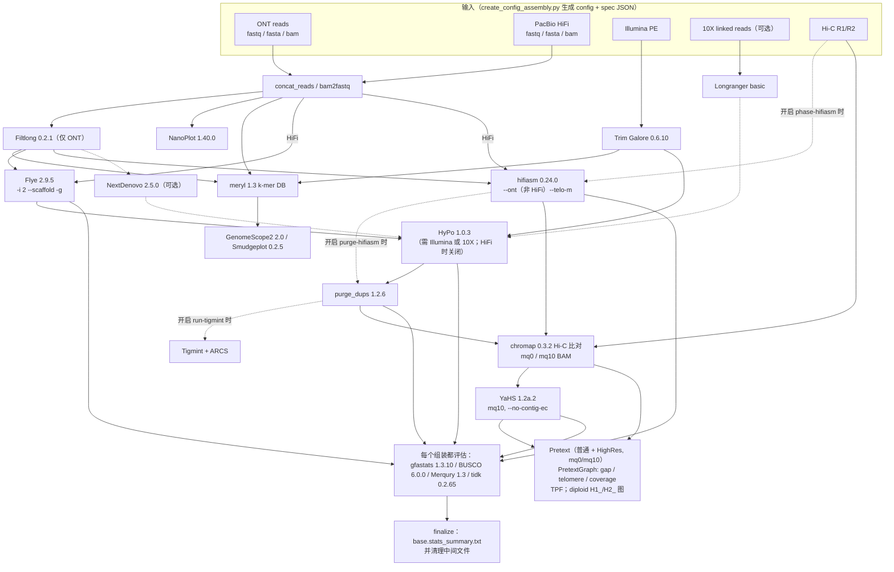

# CNAG CLAWS（CNAG's Long-read Assembly Workflow in Snakemake）

> **仓库** https://github.com/cnag-aat/CLAWS（`cnag-aat/assembly_pipeline` 现重定向到此仓库，同一 repo id 385208935）
> **版本** tag `v3.2`，commit `b7af1567c1a7f7024f299e771571eb41d476f131`（2026-02-25，提交信息 "release v3.2"）
> **本地路径** `/media/deyuan/18T_B/genome_assembly/pipelines/cnag_CLAWS`（`git clone --depth 1 --branch v3.2`）
> **框架** Snakemake（README 第 2 行："developed for Snakemake v6.0.5"）；用到 Snakemake 的 `module` / `use rule ... with:` 语法
> **许可证** MIT（`LICENSE`：Copyright (c) 2021 jesgomez）
> **维护方** CNAG Assembly and Annotation Team（GitHub org `cnag-aat`，主页 https://denovo.cnag.cat/）；Snakefile 作者为 Jessica Gomez-Garrido（`bin/assembly_pipeline.smk:6-8`）
> **更新时间** v3.2 打 tag 于 2026-02-25；仓库最近一次推送 2026-07-22
> **WorkflowHub** CLAWS v3 = workflow 2094，DOI `10.48546/workflowhub.workflow.2094.1`（creators：Jessica Gomez-Garrido、Francisco Camara Ferreira、Fernando Cruz、Tyler Alioto）；旧版 CLAWS（assembly_pipeline v2.x）= workflow 567，DOI `10.48546/workflowhub.workflow.567.2`

**版本说明**
- GitHub 的 "Latest release" 对象是 `v3`（名为 "CLAWS v3.0"，2025-11-10 发布），但 tag 列表里最新的是 `v3.2`（没有对应的 Release 对象）。本笔记以 `v3.2` 为准。
- `main` 比 `v3.2` 多 3 个 commit，都没打 tag：2026-07-16 的 "add_telo_scan"（从 `v3.3` 分支合并，即 PR #25）。它新增了 `scripts/telo_scan.py`，并改动了 `assembly_evaluation.smk`、`evaluate_assemblies.rules.smk`、`hic.rules.smk`、`postpolishing.smk`、`preprocess_reads.smk` 和 `create_config_assembly.py`。本笔记**不涵盖**这部分改动。
- 下文的 `path:line` 都是相对上面本地克隆根目录的路径。标了 **（推测）** 的是我读代码后推断出来的，没有实际运行验证过。

---

## 1. 一句话定位

CLAWS 是 CNAG 生产环境用的长读长组装流程，特点是"多组装器并行，每个阶段都统一评估"。先由 Python 配置生成器 `bin/create_config_assembly.py` 把 ONT / HiFi / Illumina / 10X / Hi-C 的输入和各种开关写成两份 JSON：config（参数）和 spec（Slurm 资源）。默认**同时**跑两条路线：① **Flye → HyPo → purge_dups → YaHS**，② **hifiasm → YaHS**。每个中间组装和最终组装都会跑 gfastats、BUSCO、Merqury、tidk，最后汇总成一张对比表，并产出带 gap、端粒、覆盖度轨道的 PretextMap 和 TPF，供人工整理（curation）用（README.md:1-4、222-225）。

## 2. 适用场景与输入数据

**适用场景**：在 Slurm 集群上用 ONT（默认 `nano-hq`）或 HiFi 做从头组装，适合想同时比较多个组装器和多个处理阶段的场景。README 的两个示例分别是 5 Gb 的蜘蛛 *Chaetopelma olivaceum*（ONT + Illumina + Hi-C）和 1 Gb 的蛾 *Eumannia arenbergeri*（HiFi + Hi-C）（README.md:177-270）。

### 2.1 输入数据类型（都通过 `create_config_assembly.py` 参数提供）

| 数据 | 提供方式 | 格式 | 在流程中的用途 | 依据 |
|---|---|---|---|---|
| ONT | `--ont-dir DIR`（收集目录下全部 `*.fastq.gz` 并合并；`--ont-list` 可只选部分 basename）；`--ont-reads FILE`；`--ont-filt FILE`（已用 Filtlong 过滤过的文件） | fastq(.gz) / fasta / bam（bam 先用 `samtools fastq` 转换） | 经 Filtlong 过滤后用于组装、HyPo（`-B` 长读）、purge_dups、meryl | README.md:28-44；`modules/preprocess_reads.smk:34-72` |
| PacBio HiFi | `--hifi-dir DIR`（`*.fastq.gz`）；`--hifi-reads FILE` | fastq / fasta / bam | 组装、purge_dups、meryl（v3.0 起） | README.md:46-60、631-641 |
| Illumina PE | `--illumina-dir`（Trim Galore 修剪后合并）；`--processed-illumina`；`--pe1/--pe2`（已修剪） | 后缀可以是 `.1.fastq.gz`、`_1.fastq.gz`、`.R1.fastq.gz`（v3.0 起） | meryl 数据库、HyPo / NextPolish polishing | README.md:62-80、639 |
| 10X linked reads | `--raw-10X '{"mkfastq-dir":"s1,s2"}'`（跑 longranger basic）；`--processed-10X`；`--10X` | barcoded fastq.gz | polishing（有 10X 时 HyPo 用它代替 PE）；Tigmint/ARCS scaffolding（`--run-tigmint`） | README.md:86-100；`modules/polish_assemblies.v04.smk:127` |
| Hi-C | `--hic-dir DIR`（找 `*.1.fastq.gz` / `*.2.fastq.gz`，有多对时合并） | `<name>.1.fastq.gz` + `<name>.2.fastq.gz` | hifiasm phasing（`--phase-hifiasm`）、YaHS、Pretext；Hi-C 文库 QC（`--hic-qc`） | README.md:82-84；`bin/create_config_assembly.py:1205-1211` |
| 已有组装 | `--assembly-in`（从 polishing 开始）、`--postpolish-assemblies`（从 purge/scaffold 开始）、`--curated-assemblies`（只做评估和 Pretext） | fasta | 从中间阶段切入流程 | README.md:102-115、762-768 |

- `--lr-type` 可选：`pacbio-raw`、`pacbio-corr`、`pacbio-hifi`、`nano-raw`、`nano-corr`、`nano-hq`，**默认 `nano-hq`**（`bin/create_config_assembly.py:660`）。这个值会直接拼成 Flye 的读段类型参数 `flye --{lr_type}`（`modules/assemble_genomes.rules.smk:36`）。
- **是否必须 Hi-C**：不是必须的。Hi-C 相关规则都包在 `if config['Inputs']['HiC_dir'] ...` 条件里（`modules/postpolishing.smk:60, 220`）；没有 Hi-C 就不跑 YaHS 和 Pretext。
- **是否必须 Illumina**：默认 `--hypo-rounds 1`，非 HiFi 数据时会调用 `require_illumina()`，缺 Illumina 就直接退出（`bin/create_config_assembly.py:1020-1022, 91-95`）。只有 ONT、没有 Illumina 时要加 `--hypo-rounds 0`。
- **trio**：不支持（仓库里没有 yak/trio 相关代码）。**ONT ultra-long**：没有专门支持（仓库里没有 hifiasm `--ul`），HiFi 和 ONT 也不会做混合组装：组装只用 `lr_type` 对应的那一种读段（`modules/run_assemblies.smk:28-34`）。
- **必填参数**：`--basename`、`--species`、`--genome-size`（必须带 `m` 或 `g`，例如 `615m`、`2.6g`）（`bin/create_config_assembly.py:928-951`）。
  - `--telo`：README 写的是 "You need to provide a telomeric motif"（README.md:145）。代码里 `tidk_search` 规则无条件地把 `config["Parameters"]["telo_repeat"]` 拼进字符串（`modules/assembly_evaluation.smk:446-454`），不给时值为 None，**（推测）会在 Snakemake 解析阶段报 TypeError**。
  - 要得到最终汇总表，`--busco-lin` 和 `--merqury-db`（数据库不存在时还要 `--meryl-k`）实际上也是必需的。**（推测）** `finalize` 调用 `get_final_tbl_mult.py -s ... -b ... -m ...`，而 `-b`、`-m` 都是 `nargs="+"`（`scripts/get_final_tbl_mult.py:12-14`），列表为空时会报参数错误。

### 2.2 配置怎么写

CLAWS **不建议手写配置**，而是用生成器同时生成 config（参数）和 spec（Slurm 资源），需要 NextDenovo 时再加一个 `nextdenovo.config`（README.md:5-13；`bin/create_config_assembly.py:2443-2447`）。

下面是 README 示例 2（HiFi + Hi-C，并对 hifiasm 结果也跑 purge_dups）的原样命令（README.md:230）：

```bash
CLAWS/bin/create_config_assembly.py --configFile configs/ilEumAren.config --specFile configs/ilEumAren.spec \
  --basename ilEumAren --species "Eumannia arenbergeri" --genome-size 1g \
  --merqury-db ilEumAren.meryl --meryl-k 19 --hifi-reads reads/hifi/reads.bam \
  --busco-lin busco_downloads/lineages/lepidoptera_odb12/ --lr-type pacbio-hifi \
  --hic-dir reads/hic/ --telo TTAGG --purge-hifiasm
```

README 示例 1（ONT + Illumina + Hi-C，并让 hifiasm 用 Hi-C 做 phasing）（README.md:180）：

```bash
CLAWS/bin/create_config_assembly.py --configFile configs/qqChaOliv.config --specFile configs/qqChaOliv.spec \
  --basename qqChaOliv --species "Chaetopelma olivaceum" --genome-size 5g --ont-dir reads/ont/ \
  --busco-lin busco_downloads/lineages/arachnida_odb12/ --illumina-dir reads/illumina/ \
  --merqury-db qqChaOliv.meryl --meryl-k 20 --filtlong-opts " --target_bases 300000000000" \
  --hic-dir reads/hic/ --telo ACCCCG --phase-hifiasm
```

**生成的 config JSON 结构示意**（顶层键来自脚本里的 `store*Parameters` 函数，值为默认值；这是整理出来的示意，不是实际运行生成的文件）（`bin/create_config_assembly.py:1503-1604, 1707-2280`）：

```json
{
  "Parameters": {"lr_type": "nano-hq", "base_name": "...", "genome_size": "1g", "ploidy": 2,
                 "telo_repeat": "TTAGG", "run_flye": true, "run_hifiasm": true, "run_nextdenovo": false,
                 "hypo_rounds": 1, "run_purgedups": true, "run_yahs": true, "run_tigmint": false,
                 "run_kraken2": false, "run_smudgeplot": true, "genomescope_additional_options": " -m -1 ", "...": "..."},
  "Inputs":   {"ONT_dir": null, "Hifi_dir": null, "illumina_dir": null, "HiC_dir": null, "ONT_filtered": "...",
               "Assemblies for polishing": {}, "Assemblies for postpolishing": {}, "Curated Assemblies": {}, "...": "..."},
  "Outputs":  {"base_dir": "...", "flye_dir": "...", "hifiasm_out": ["..."], "eval_dir": "...", "stats_out": "..."},
  "Filtlong": {}, "Trim_Galore": {}, "Kraken2": {}, "Flye": {}, "Nextdenovo": {}, "Hypo": {},
  "Hifiasm":  {"Hifiasm cores": 50, "options": " --ont ", "external_purging": false, "phase": false},
  "Purge_dups": {}, "scaffolding_10X": {},
  "HiC":      {"deepseq": true, "get_pretext": true, "yahs_mq": 10, "yahs_contig_ec": false, "MQ": [0, 10], "align_opts": "  ", "...": "..."},
  "Finalize": {"final Evaluations": true, "BUSCO lineage": "...", "Merqury db": "...", "Meryl K": 19, "Meryl reads": "hifi", "...": "..."},
  "Wildcards": {"ONT_wildcards": null, "hifi_wildcards": null, "illumina_wildcards": null, "10X_wildcards": null, "HiC_wildcards": "..."}
}
```

**spec JSON**：键是规则名，每条规则配 `name`、`qos`、`time`、`queue`、`mem`。例如默认的 `"flye": {"qos": "marathon_assembly", "time": "100:00:00", "queue": "general", "mem": "950G"}`（`bin/create_config_assembly.py:353-356, 1551-1560`）。线程数不在 spec 里，由规则的 `threads:` 从 config 读取。

生成器自动做的几件事：
- Flye 参数里没有 `-g` 时自动补上 `-g {genome_size}`（`:1119-1120`）。
- hifiasm：`--ploidy` 不等于 2 时追加 `--n-hap {ploidy}`；`lr_type` 不是 `pacbio-hifi` 时自动加 `--ont`，是 HiFi 时去掉 `--ont`（`:1122-1129`）。
- `lr_type == pacbio-hifi` 时 HyPo 和 NextPolish 的轮数强制设为 0（`:1005-1008`）。
- 按基因组大小（>500 Mb、>1 Gb、>3 Gb、≤100 Mb）自动放大或缩小各规则的线程、内存和时长（`:1414-1499`，见 4.4 节）。

## 3. 流程步骤

| # | 步骤 | 工具（版本，取自 `envs/*.yaml`） | 作用 | 关键参数 / 默认值 |
|---|---|---|---|---|
| 1 | 读段合并 / 格式转换 | zcat + pigz 2.6（`ass_base`）；samtools 1.21 | 合并多个文件；bam 转 fastq | `zcat {fastqs}`，经管道交给 `pigz -p {threads}`；`samtools fastq`（`modules/process_reads.rules.smk:28-58`） |
| 2 | ONT 过滤（仅 ONT） | Filtlong 0.2.1 | 按长度和质量过滤 | `--min_length 1000 --min_mean_q 80`，额外参数用 `--filtlong-opts`（例如 `--target_bases`）（`process_reads.rules.smk:163-182`；`create_config_assembly.py:291-293`） |
| 3 | 长读 QC | NanoPlot 1.40.0 | 分别统计 raw_ont、filtered_ont、hifi | `NanoPlot --plots dot --{fastq\|fasta}`（`process_reads.rules.smk:184-205`） |
| 4 | Illumina 修剪 | Trim Galore 0.6.10（cutadapt 1.18） | 去接头和低质量碱基 | `--max_n 0 --gzip -q 20 --paired --retain_unpaired`（`create_config_assembly.py:308`） |
| 5 | 10X 处理（可选） | Longranger basic（默认路径指向 2.2.2，需自行安装） | 处理 barcode | `longranger basic --id --sample --fastqs --localcores`（`process_reads.rules.smk:142-161`） |
| 6 | 读段分类（可选 `--run-kraken2`） | Kraken2 2.1.2 + Bracken 2.7 | 筛查读段污染 | 需要 `--kraken2-db` 和 `--kraken2-kmer`；`est_abundance.py -l S -t 10`（`process_reads.rules.smk:207-229`） |
| 7 | k-mer 数据库 | meryl 1.3（`merqury1.3` env） | 建库；有多个子库时合并 | `meryl k={--meryl-k} count`，多个库再 `union-sum` + `histogram`；`--meryl-reads` 默认 `ont illumina`，HiFi 时默认 `hifi`（`process_reads.rules.smk:60-101`；`create_config_assembly.py:1067-1071`） |
| 8 | 基因组概况 | GenomeScope2 2.0；Smudgeplot 0.2.5 | 估计基因组大小、杂合度、倍性 | `genomescope2 -p {ploidy} -k {K} -m -1`；smudgeplot 流程：`cutoff L/U` → `meryl print` → `hetkmers` → `plot`；`--no-smudgeplot` 可关闭（`process_reads.rules.smk:103-140`） |
| 9a | 组装（默认开） | Flye 2.9.5 + Bandage 0.8.1 | 长读组装 | `flye --{lr_type} -i 2 --scaffold -g {gsize}`；默认 128 线程（`assemble_genomes.rules.smk:10-39`；`run_assemblies.smk:41-63`） |
| 9b | 组装（默认开） | hifiasm 0.24.0（env 文件名带 `r702`） | ONT（`--ont`）或 HiFi 组装；可选 Hi-C phasing | `hifiasm {opts} --telo-m {telo} [--h1 R1 --h2 R2] -o {base}.hfsm.asm`。不 phasing 时输出 `bp.p_ctg`（primary）+ `bp.hap1` + `bp.hap2` 三套；加 `--phase-hifiasm` 时输出 `hic.p_ctg` + `hic.hap1..N`（N = ploidy）（`run_assemblies.smk:73-99`；`create_config_assembly.py:1050-1057`） |
| 9c | 组装（可选 `--run-nextdenovo`） | NextDenovo 2.5.0（envmodule） | ONT 组装 | 生成器自动写 `nextdenovo.config`：`seed_depth 45`、`sort_options -m 400g -t 20` 等（`create_config_assembly.py:2283-2324`） |
| 10 | Polishing（默认只对 Flye/NextDenovo 组装；HiFi 时关闭） | HyPo 1.0.3；NextPolish 1.4.1（可选，envmodule） | 用短读（+长读）polishing | `--hypo-rounds 1`；`hypo -r @short_reads.list.txt -d -b {bwa.bam} -c {cov} -s {gsize} -p 6 -B {minimap2.bam}`；短读覆盖度默认由 `scripts/get_cov.py` 估算（`polish.rules.smk:7-32`；`polish_assemblies.v04.smk:115-144`） |
| — | 比对（给 polishing、purge、覆盖度轨道用） | bwa-mem2 2.2.1；minimap2 2.24 | 短读和长读回贴 | `bwa-mem2 mem -Y`；minimap2 preset 只有 `lr_type=nano-raw` 时用 `map-ont`，**其余类型（包括默认的 nano-hq）都用 `map-hifi`**；`gsize ≥ 4000 Mb` 时加 `--split-prefix`（`assembly_evaluation.smk:205-232`；`evaluate_assemblies.rules.smk:157-173`） |
| 11 | 去冗余（默认只对 Flye/NextDenovo；hifiasm 需 `--purge-hifiasm`） | purge_dups 1.2.6 | 去掉 haplotig 和重叠片段 | `split_fa` → `minimap2 -xasm5 -DP` 自比对 → `pbcstat` → `calcuts {--purgedups-calcuts-opts}` → `purge_dups -2 -T cutoffs -c PB.base.cov` → `get_seqs -e`（`purging.rules.smk:5-33`） |
| 12 | 10X scaffolding（可选 `--run-tigmint`） | Tigmint 1.2.6 + ARCS 1.2.4 + LINKS 2.0.1 | 纠错并挂载 | `tigmint-make arcs draft= reads= t=`（`scaffolding_rules.smk:15-40`） |
| 13 | Hi-C 比对（v3.2 起用 chromap 替代 pairtools） | chromap 0.3.2 + samtools 1.23（`assembly_prepare` 仍会建 bwa-mem2 索引、faidx 和 `.genome`，`hic.rules.smk:6-25`） | Hi-C 比对、去 PCR 重复 | `chromap -i -r asm`（基因组 >1 Gb 时加 `-k 21 -w 30`）；`chromap --preset hic -q 0 --remove-pcr-duplicates --SAM`；`samtools view -F 4` 得到 mq0 BAM，再 `-q 10` 得到 mq10 BAM（`evaluate_assemblies.rules.smk:199-240`；README.md:615-617） |
| 14 | Hi-C scaffolding（默认开） | YaHS 1.2a.2 | 挂载到染色体级 | 输入是预先按 MAPQ 过滤的 `*.CM.mq{yahs_mq}.bam`（默认 mq10）；默认 `--no-contig-ec`，加 `--yahs-contig-ec` 才允许打断 contig（`hic.rules.smk:27-50`；`postpolishing.smk:238-259`） |
| 15 | 接触图与 curation 材料 | PretextMap 0.1.9、PretextSnapshot 0.0.4、PretextGraph 0.0.9；gfastats；tidk 0.2.65；bedtools 2.30.0；`rapid_split.pl` | 对 scaffolding 前后的组装各出普通和 `--highRes` 两种 Pretext（mq 0 和 10），叠加 gap、telomere、长读覆盖度轨道；生成 TPF | `--mq 0 10`；`--sort-pretext` 默认 nosort；hap1 和 hap2 加 `H1_`/`H2_` 前缀合并成 diploid 图，只出 mq0（`hic.rules.smk:52-142`；`evaluate_assemblies.rules.smk:465-567`；`assembly_evaluation.smk:123-147`） |
| 16 | 评估（每个组装都跑） | gfastats 1.3.10；BUSCO 6.0.0；Merqury 1.3；tidk 0.2.65 | 连续性；基因完整性；QV、k-mer 完整度、false duplications；端粒 | `gfastats --nstar-report`（hifiasm 的 GFA 再加 `--discover-paths`）；`busco -m genome --offline -l {lineage}`；hap1 和 hap2 放在同一次 merqury 里跑；`tidk search -s {telo}`（`assembly_evaluation.smk:446-553`） |
| 17 | 汇总与清理 | `get_final_tbl_mult.py` | 汇总表 `{base}.stats_summary.txt` | 列：assembly、cN50、cL50、sN50、sL50、total_len、total_seq、BUSCOv6、QV、Merqury_completeness、False_duplications。没加 `--keep-intermediate` 时删除 mappings、tmp_meryl 等中间文件（`scripts/get_final_tbl_mult.py:30`；`assembly_evaluation.smk:556-616`） |
| QC 模式 | Hi-C 文库 QC（`--hic-qc`，不能和 YaHS 同时开） | pairtools 1.1.3、preseq 2.0.2、BLAST 2.12.0 | 用浅测数据评估 Hi-C 文库 | pairtools parse/sort/dedup/split；`preseq lc_extrap`；取未比对读段中的**前** 100 条（`--hic-readsblast`）做 megablast 比对 nt（`evaluate_assemblies.rules.smk:454-457`）；`--subsample-hic` 取前 6,000,000 行（`evaluate_assemblies.rules.smk:291-463`；`process_reads.rules.smk:231-248`；`create_config_assembly.py:962-965`） |



## 4. 如何运行

### 4.1 安装与环境

- **Snakemake**：README 写明为 v6.0.5 开发。启动命令依赖 `--cluster` 和 `--cluster-conf`（spec JSON）。Snakemake 官方文档对 cluster configuration 已注明 "not supported anymore"（被 profile 取代）；v8 的迁移文档把 `--cluster CMD` 改成了 `--executor cluster-generic --cluster-generic-submit-cmd CMD`（需要另装插件）。在 v7.32.4 里，`--cluster-config` 还存在，但已标注 deprecated。因此**应使用 Snakemake 6.x 或 7.x**（7.x 能否直接跑通 **（推测）**，未验证）。
- **软件**：大多数工具由 `--use-conda` 按 `envs/*.yaml` 自动创建环境，可以用 `--conda-prefix` 指定共享目录（README.md:17, 185）。以下工具不能用 conda 装：NextDenovo 2.5.0、NextPolish 1.4.1（通过 envmodules 或 PATH 提供，只在启用时需要）（README.md:17-22）；Longranger（只在 `--raw-10X` 时需要，默认路径是 CNAG 内部的 `/scratch/project/devel/aateam/src/10X/longranger-2.2.2`）。
- **envmodules 的坑**：`flye` 和 `hifiasm` 的基础规则都声明了 `envmodules: 'Mesa/21.1.7-GCCcore-11.2.0'`（`assemble_genomes.rules.smk:30-31, 85-86`），按 `use rule` 的继承语义会被沿用。**（推测）** 在非 CNAG 集群上带着 `--use-envmodules` 运行，加载这个模块会失败，需要去掉该参数或修改规则。
- **集群投递**：README 的命令用的是 `--cluster "python3 Snakemake-CNAG/sbatch-cnag.py {dependencies}"`。这个脚本不在 CLAWS 仓库里，而在作者的另一个仓库 https://github.com/jesgomez/Snakemake-CNAG（最后提交 2022-10-26）。脚本读取 spec 里的 `name/time/queue/qos/mem/threads`，其中 `queue` 映射为 `--partition`；把规则的两个 log 路径当作 `--output/--error`，所以 log 文件名里带 `.j%j.` 这种 Slurm 作业号占位符；并用 `--dependency afterok:` 串起依赖（README 里的 `--is` 即 `--immediate-submit`，必须靠它才行）。spec 里的 qos 名（`test/vshort/short/normal/long/vlong/marathon_assembly/eternal`）和分区 `general` **（推测）** 是 CNAG 集群专用的，换集群要改。
- **BUSCO**：需要提前下载 lineage，用 `--busco-lin` 指向 lineage 目录（README 示例用 `*_odb12`；env 是 BUSCO 6.0.0；规则里带 `--offline`）（`evaluate_assemblies.rules.smk:115-136`）。

### 4.2 最小命令

```bash
# 1) 生成 config + spec（参数见 2.2 节）
CLAWS/bin/create_config_assembly.py --configFile sp.config --specFile sp.spec --basename spXX \
  --species "Genus species" --genome-size 1g --lr-type pacbio-hifi --hifi-reads reads.bam \
  --hic-dir reads/hic/ --telo TTAGG --busco-lin lineages/xxx_odb12/ --merqury-db spXX.meryl --meryl-k 19

# 2) dry-run（README.md:185, 235 的写法）
snakemake --notemp -j 999 --snakefile CLAWS/bin/assembly_pipeline.smk --configfile sp.config \
  --cluster-conf sp.spec --cluster "python3 Snakemake-CNAG/sbatch-cnag.py {dependencies}" \
  --is --use-conda --use-envmodules --conda-prefix conda/assembly_pipeline_envs/ -np

# 3) 确认 DAG 无误后去掉 -np 正式运行。只想评估已整理好的组装时，可直接把汇总表
#    $PWD/evaluations/<base>.stats_summary.txt 作为目标（README.md:279）
```

各参数含义（据 Snakemake v7.32.4 源码）：`--notemp/--nt` 忽略 `temp()` 声明；`--is` 即 `--immediate-submit`，一次性提交全部作业，由 `{dependencies}` 让集群处理依赖（不能用于含 checkpoint 的流程）；`--cluster-config/-u` 指定 JSON/YAML 资源文件，v7 已标 deprecated。README 写的是 `--cluster-conf`，**（推测）** 是靠 argparse 的前缀缩写匹配才生效。

### 4.3 示例数据

仓库**没有附带测试数据**，也没有 CI。README 给了 3 个示例的完整生成命令和 dry-run 作业统计，对理解 DAG 很有帮助：
- 示例 1：ONT + Illumina + Hi-C，加 `--phase-hifiasm`，共 152 个作业。
- 示例 2：HiFi + Hi-C，加 `--purge-hifiasm`，共 155 个作业。
- 示例 3：只评估已整理的组装，共 15 个作业。

以示例 1 为例：4 个 `run_yahs`（Flye 路线 1 个 + hifiasm 的 `hic.p_ctg/hap1/hap2` 3 个）；17 个 `generate_pretext`，即 8 个组装（4 个 scaffolding 前 + 4 个 scaffolding 后）× 2 个 MAPQ，再加 1 个 diploid 的 mq0（README.md:177-300）。

### 4.4 关键参数与资源需求

**常用开关**：`--no-flye`、`--no-hifiasm`、`--run-nextdenovo`、`--hypo-rounds N`、`--nextpolish-ont-rounds/--nextpolish-ill-rounds N`、`--no-purgedups`、`--purge-hifiasm`、`--phase-hifiasm`、`--no-yahs`、`--yahs-mq`、`--yahs-contig-ec`、`--mq 0 10`、`--no-pretext`、`--run-tigmint`、`--run-kraken2`、`--keep-intermediate`、`--ploidy`、`--other-flye-opts`（默认 ` --scaffold `）、`--other-hifiasm-opts`（README.md:302-613）。

**spec 默认资源**（`create_config_assembly.py:266-553`，再按基因组大小自动调整，见 `:1414-1499`）：

| 规则 | 线程 | 内存 | 时长（qos） | 按基因组大小的调整 |
|---|---|---|---|---|
| flye | 128 | 950G | 100h（marathon_assembly） | >500 Mb：100 线程 / 700G；>1 Gb：150h；>3 Gb：500h（eternal）；≤100 Mb：20 线程 / 100G |
| hifiasm | 50 | 500G | 48h（vlong） | >3 Gb：128 线程 / 950G / 150h；≤100 Mb：12h |
| smudgeplot | 2 | 750G | 7 天（marathon_assembly） | — |
| align_lr（minimap2） | 32 | 500G | 12h | >1 Gb：80 线程 / 24h；>3 Gb：48h |
| align_illumina（bwa-mem2） | 16 | 100G | 6h | >1 Gb：48 线程 / 300G / 24h |
| hypo | 24 | 250G | 6h | >1 Gb：32 线程 / 12h；>3 Gb：500G / 24h，`-p 2` |
| purge_dups | 8 | 200G | 1h | >3 Gb：12h |
| align_hic_chromap | 16（取 `BWA_cores`） | 100G | 12h | >1 Gb：线程随 `BWA_cores` 变为 48，300G / 24h |
| run_yahs | 48 | 50G | 12h | >1 Gb：100G / 24h |
| generate_pretext | 2 | 200G | 10h | — |
| run_busco | 32 | 50G | 6h | >1 Gb：64 线程 / 24h；>3 Gb：100 线程 / 150G / 48h；≤100 Mb：2h |
| run_merqury | 4 | 100G | 3h | >1 Gb：6h；≤100 Mb：2h |

> ⚠️ 这一段按基因组大小调整的代码是**无条件赋值**。例如基因组 >500 Mb 时直接执行 `args.flye_cores = 100`；>1 Gb 时直接执行 `args.hic_map_opts = " -k 21 -w 30"`（`:1414-1420`）。结果是用户在命令行给的 `--flye-cores`、`--busco-cores`、`--hic-map-opts` 等值**会被覆盖**。另外，内存、时长、qos 在命令行里**没有对应选项**，只能在生成后手工编辑 spec JSON。

## 5. 主要输出

> 目录名由 `create_config_assembly.py` 的步骤编号逻辑推导，以"ONT + Illumina + Hi-C，默认路线"为例（`:1032-1197`；`postpolishing.smk:87-113`）。**未实际运行**，编号细节可能有出入。命名规律是 `s<步骤号>_p<上游步骤号>_<名称>/`。

```
<pipeline_workdir>/                         # 默认是运行生成器时的 cwd
├── logs/                                   # rule all、meryl、genomescope、finalize 的日志
├── s02.1_p01.1_Preprocess_LR/              # reads.ont.fastq.gz、ont.filtlong.fastq.gz、*_bam.fastq
│   └── nanostats/{raw_ont,filtered_ont,hifi}/NanoStats.txt …
├── s02.2_p01.1_preprocess_illumina_reads/  # trim/（Trim Galore 输出）+ reads.illumina.{1,2}.fastq.gz
├── s02.3_p01.1_Concat_HiC/                 # reads.hic.{1,2}.fastq.gz（多对 Hi-C 时）
├── <meryl db 所在目录>/                     # <base>.meryl、meryl.hist、genomescope2_k<K>/、smudgeplot_k<K>/
├── s03.1_p02.1_flye/                       # <base>.fl.asm.fasta、out/、*.gfa、assembly_graph.gfa.png
├── s03.3_p02.1_hifiasm/                    # <base>.hfsm.asm.{bp|hic}[.hapN].fa、.gfa、.gfa.png
├── s04.1_p03.1_polishing/hypo/             # <base>.fl.asm.hyp1.fasta（加上 mappings/）
├── s05.1_p04.1_run_purgedups/              # <base>.fl.asm.hyp1.pgd.fa、*.PB.cov.png
├── s06.1_p05.1_HiC_scaffolding/            # <name>.yhs_mq10.fa、.agp、.fa.tpf、run_yahs/
│   ├── in_pretext/                         # scaffolding 前：mappings/*.CM.mq{0,10}.bam、*_mq{0,10}[.HR].pretext、
│   │                                       #   *.extensions[.HR].pretext、snapshots/
│   └── out_pretext/                        # scaffolding 后的同类文件
├── s04.3_p03.3_HiC_scaffolding/ …          # hifiasm 每套输出各占一个目录（s04.3/s04.4/s04.5，推导）
└── evaluations/
    ├── <各步骤目录名>/{stats,busco,merqury,telomeres}/ 以及 diploid/
    └── <base>.stats_summary.txt            # ★ 最终对比表
```

关键文件：
- `evaluations/<base>.stats_summary.txt`：每个组装一行，列出 N50、BUSCO、QV 等，用来挑选最佳组装。
- `*.yhs_mq10.fa` 和 `.agp`：YaHS 的 scaffold 结果。
- `*_mq{0,10}.extensions.HR.pretext`：带轨道的高分辨率接触图，用于 PretextView 人工整理。
- `*.fa.tpf`：GRIT rapid curation 流程用的 TPF 文件。
- Snakefile 声明了 `report:`，许多规则的输出也包了 `report()`（`bin/assembly_pipeline.smk:10`），可以用 Snakemake 的报告功能汇总。`evaluate_assemblies.rules.smk:29-39` 里有一条注释掉的 `--report` 规则。

## 6. 设计亮点（值得学习的地方）

1. **配置生成器 + 校验层**：用一个 argparse 脚本把几百个参数收拢起来，能自动扫描目录生成 wildcards、检查输入文件是否存在和参数是否冲突（例如 YaHS 与 `--hic-qc` 互斥），还能按基因组大小自动设定资源，比手写 YAML 更不容易出错（`create_config_assembly.py:908-1499`）。
2. **多路线并行，用同一套评估比较**：Flye 和 hifiasm（可加 NextDenovo）并行跑，原始组装、polish 后、purge 后、scaffold 后的每个版本都进同一套 gfastats、BUSCO、Merqury、tidk 评估，最后一张表横向比较。这种"用数据选组装"的思路适合在新物种上摸索最佳方案。
3. **用目录编号记录来源**：`sXX.Y_pAA.B_name` 同时标出本步骤号和上游步骤号，看目录名就能还原每个组装是怎么一步步得到的。
4. **规则模板复用**：通用规则写在 `*.rules.smk` 里，再用 `module ... snakefile:` 加 `use rule X from M with:` 按场景覆盖 input、output、params（例如 `run_assemblies.smk:8-9, 41, 73`），是 Snakemake 6 以后的模块化写法。
5. **多个切入点**：`--assembly-in`、`--postpolish-assemblies`、`--curated-assemblies` 可以从 polishing、purge/scaffold 或整理后评估的任一阶段开始，便于整理后回炉重新评估。
6. **现成的 curation 材料**：普通和 HighRes 两种 Pretext，mq0 和 mq10 两个阈值；叠加 gap（gfastats）、telomere（tidk）、长读覆盖度（bedtools）轨道；TPF（`rapid_split.pl`）；hap1+hap2 合成 diploid 图。
7. **Merqury 成对评估 hap1/hap2**（README.md:167, 723），能得到单倍型合并后的 completeness 和 false duplication。
8. **Hi-C 文库 QC 模式**：深测之前先用浅测数据跑 preseq 外推、文库统计、未比对读段 BLAST，判断文库是否值得深测（`evaluate_assemblies.rules.smk:400-463`）。
9. **日志和计时**：每条规则都有带作业号的 `.out/.err` 和 `benchmark:` 文件，方便排查问题和估算资源。

## 7. 局限与注意事项（坑）

1. **Snakemake 版本被锁死在旧版**：依赖 `--cluster` + `--cluster-config`，Snakemake 8 以后都不支持（见 4.1）。要迁移到新版，得把 spec 改写成 profile 加 executor 插件的 resources。
2. **强依赖 CNAG 集群环境**：
   - 投递脚本在外部仓库（jesgomez/Snakemake-CNAG）。
   - qos 和分区名是 CNAG 的。
   - envmodules 写死了模块名（`Mesa/...`、`NextDenovo/2.5.0`、`NextPolish/1.4.1-GCC-11.2.0`）。
   - NextPolish 的路径直接写死在规则里，不能通过配置修改：`/software/assembly/easybuild/software/NextPolish/1.4.1-GCC-11.2.0`（`polish_assemblies.v04.smk:163, 181`）。
   - BLAST 数据库默认路径是 `/scratch_isilon/groups/assembly/data/blastdbs`（`create_config_assembly.py:466`）。
   - README 里 `--pipeline-workdir` 的"默认值"其实是作者生成帮助文本时的 cwd；代码里的默认是 `os.getcwd()`（`:251`）。
3. **默认资源很大**：Flye 950G / 128 线程，smudgeplot 750G / 7 天，hifiasm 500G。小集群上必须改 spec。
4. **`--lr-type` 默认是 `nano-hq`**：HiFi 数据必须显式写 `--lr-type pacbio-hifi`。否则生成器会走 `require_ont()`，在没有 ONT 输入时报 "ONT reads are needed" 退出（`:85-89, 26-40`）；hifiasm 也会被加上 `--ont`。
5. **ONT（nano-hq）的回贴 preset**：除 `nano-raw` 外，长读回贴一律用 `map-hifi`（`assembly_evaluation.smk:216`），这是否是有意设计仓库里没有说明。另外 hifiasm 官方 README 说明 `--ont` 模式"requires input reads in FASTQ format"，所以 ONT 用 FASTA 输入时 **（推测）** hifiasm 那一步会失败。
6. **README 有过时内容**：
   - `--hic-map-opts` 的帮助文本还写着 bwa 的 "-5SP -T0"，但 v3.2 用的是 chromap，默认值是空白，基因组 >1 Gb 时是 `-k 21 -w 30`（`:461, 1420`）。
   - README 说 purge_dups 用自动 cutoff 后会"再按 0.75×cov 重跑一次"，并说用的是集群 module 里的版本（README.md:161）。v3.2 代码里两样都找不到：除 README 外全仓库没有 `0.75`，`purging.rules.smk` 只调一次 `calcuts`，用的也是 conda env `purge_dups1.2.6.yaml`。
   - `--hifi-dir` 段落里写的是 "ONT_wildcards"，属于笔误，代码用的是 `hifi_wildcards`。
7. **疑似 bug（读代码发现，未运行验证，均为（推测））**：
   - `--hic-qc` 模式里，pairtools 和 BLAST 规则需要 `*.full_hic.bam`、`*.unmapped_hic.bam`，这两个文件原本由 bwa-mem2 的 `align_hic` 规则产生。但 v3.2 只导入了 `align_hic_chromap`（`assembly_evaluation.smk:236`），没有任何规则产出它们，QC 模式可能跑不通。
   - `--hypo-rounds ≥ 2` 时，`polish_assemblies.v04.smk:53` 把键写成了 `".yp"`（应为 `".hyp"`），第 2 轮以后可能 KeyError。
   - `--run-kraken2` 时，生成器用到了不存在的 `args.basename`（`create_config_assembly.py:1724`），可能报 AttributeError。
8. **没有去污染和细胞器组装**：仓库里找不到 FCS、BlobToolKit、MitoHiFi、Oatk。去污染只有可选的 Kraken2 读段分类和 QC 模式下的 BLAST。线粒体组装 CNAG 另有 FOAM 仓库（cnag-aat/FOAM："Flye ONT Assembly of Mitogenomes"）。
9. **单倍型处理**：Flye 路线产出的是 purge 后的 collapsed/primary 组装，不分单倍型。只有 hifiasm 路线有 hap1/hap2，且不加 `--phase-hifiasm` 时只是 bp 模式下"部分 phasing"的结果（hifiasm README 指出 `bp.hap*` 可能有 switch error）。
10. **运行细节**：
    - 多条规则末尾有 `sleep 3m/4m/5m`（例如 `evaluate_assemblies.rules.smk:62, 86, 513`），会白白增加墙钟时间，**（推测）** 是为了应对文件系统延迟。
    - `finalize` 默认会删除 mappings 等中间文件；需要回溯的话请加 `--keep-intermediate`。
    - env 文件是带 build string 的完整导出，并含 `defaults` channel，**（推测）** 在其他平台或较新的 conda 上可能解析很慢或解析失败。
11. **仓库里有没用到的旧文件**：`modules/polish_assemblies.v03*.smk`（含 racon、medaka、pilon）、`postpolishing.v2.py`（0 字节）等都没有被主 Snakefile include（`bin/assembly_pipeline.smk:108-112`）。阅读时不要被它们误导。

## 8. 与 sanger-tol/genomeassembly（v1.0.1）的对比

| 维度 | CNAG CLAWS v3.2 | sanger-tol/genomeassembly v1.0.1 |
|---|---|---|
| 引擎 / 模板 | Snakemake 6/7（`module` + `use rule`）；cluster-config + 自定义 sbatch 脚本 | Nextflow（nf-core 模板 4.1.0） |
| 输入声明 | argparse 生成器生成 config JSON + spec JSON（+ nextdenovo.config） | 两个 YAML/JSON：`genomic_data` + `assembly_specs` |
| 数据类型 | ONT（默认 nano-hq）、HiFi、Illumina PE、10X、Hi-C（fastq/fasta/bam） | HiFi、ONT（fastx）、Hi-C 和 Illumina（unaligned CRAM）、10X（fastq） |
| 基因组概况 | meryl + GenomeScope2 + Smudgeplot | FastK + GenomeScope2 |
| 组装器 | **Flye + hifiasm 并行**（可加 NextDenovo） | hifiasm（另有 mitohifi/oatk 等 assembler 选项） |
| phasing | hifiasm `--phase-hifiasm`（Hi-C），支持 `--n-hap`；不支持 trio / UL | Hi-C phasing、trio、ONT ultra-long 都支持 |
| polishing | HyPo（默认 1 轮，非 HiFi）/ NextPolish | 10X Longranger + FreeBayes（可选，legacy） |
| purge_dups | 默认对 Flye/NextDenovo 开，hifiasm 可选 | 可选 |
| Hi-C 比对 | chromap（v3.2），MAPQ 过滤得到 mq0/mq10 | 从 CRAM 分块比对（bwa-mem2 或 minimap2）+ samtools markdup |
| scaffolding | YaHS（默认 `--no-contig-ec`）；可选 Tigmint/ARCS（10X） | YaHS |
| 接触图 | PretextMap（普通 + HighRes，mq0/10）+ PretextGraph 轨道 + TPF | PretextMap、Juicer .hic、cooler |
| QC | gfastats、BUSCO 6、Merqury、tidk；**所有中间版本**汇总成一张表 | asmstats、gfastats、BUSCO、MerquryFK（逐阶段） |
| 去污染 | 无（只有可选的 Kraken2 读段分类） | 无（另用 sanger-tol/ascc、blobtoolkit） |
| 细胞器 | 无（CNAG 另有 FOAM） | MitoHiFi、oatk |
| 人工整理 | 提供 Pretext + 轨道 + TPF + diploid 图 | 不含（另用 treeval、curationpretext） |
| 复用 / 溯源 | 目录编号 `sXX_pYY` 记录来源；多个切入点 | 每个阶段按数据+参数的 MD5 哈希识别，可共享上游；每个阶段有 index.json 记录参数和版本 |
| 可移植性 | 低（CNAG 的 qos、模块、路径） | 高（nf-core 规范，容器化） |

一句话：CLAWS 偏"探索型"，同一份数据跑多种组装器和处理步骤，再用统一指标挑最好的；sanger-tol 偏"规范型"，以 hifiasm 为核心，强调可复现、阶段缓存和跨平台。另一个 Snakemake 流程 EBP-Nor 见 `05_EBP-Nor_GenomeAssembly.md`。

## 9. 参考文献与链接

- 仓库：https://github.com/cnag-aat/CLAWS（tag v3.2：https://github.com/cnag-aat/CLAWS/tree/v3.2）
- WorkflowHub：CLAWS v3，https://workflowhub.eu/workflows/2094 ，DOI 10.48546/workflowhub.workflow.2094.1；CLAWS（v2.x），https://workflowhub.eu/workflows/567 ，DOI 10.48546/workflowhub.workflow.567.2
- CNAG 集群投递脚本：https://github.com/jesgomez/Snakemake-CNAG（`sbatch-cnag.py`）
- CNAG AAT 的相关仓库（据 org 仓库列表描述）：cnag-aat/FOAM（线粒体）、cnag-aat/Annotation_AAT（注释）、cnag-aat/EARs（ERGA Assembly Reports）
- hifiasm 官方 README（核对了 `--ont`、`--h1/--h2`、`--telo-m`、`-l0`、`bp.hap*` 输出的含义）：https://github.com/chhylp123/hifiasm
- Snakemake 文档：cluster configuration 已不再支持（`docs/snakefiles/configuration.rst`）；v8 迁移指南（`docs/getting_started/migration.rst`）：https://github.com/snakemake/snakemake
- 各工具版本以 `envs/*.yaml` 中的 bioconda/conda-forge 包为准（见第 3 节）。本笔记**没有**逐一核对各工具的原始论文，引用时请到各工具主页确认。

## 本笔记依据

本地文件（`/media/deyuan/18T_B/genome_assembly/pipelines/cnag_CLAWS/`）：
- `README.md`（全文）、`LICENSE`
- `bin/assembly_pipeline.smk`（全文）、`bin/create_config_assembly.py`（第 1–1500 行和 2220–2447 行全读；中间的 store 函数按键名 grep 过）
- `modules/preprocess_reads.smk`、`process_reads.rules.smk`、`run_assemblies.smk`、`assemble_genomes.rules.smk`、`polish_assemblies.v04.smk`、`polish.rules.smk`、`postpolishing.smk`、`purging.rules.smk`、`scaffolding_rules.smk`、`hic.rules.smk`、`evaluate_assemblies.rules.smk`、`assembly_evaluation.smk`（全文）
- `envs/*.yaml`（提取关键包版本）、`report/*.rst`
- `scripts/get_final_tbl_mult.py`、`get_cov.py`、`gap_bed2bedgraph.sh`、`rapid_split.pl`（开头部分）
- 未细读：`modules/polish_assemblies.v03*.smk`（只确认没被 include，含 racon/medaka/pilon 规则名）、其余 scripts

在线来源（2026-10-26 读取）：
- `gh api repos/cnag-aat/CLAWS`、`/releases/latest`、`/tags`、`/commits/<sha>`、`/compare/v3.2...main`、`/commits/2d5aa721`、`/contributors`；`gh api orgs/cnag-aat`、`orgs/cnag-aat/repos`
- `gh api repos/jesgomez/Snakemake-CNAG`（README.md、sbatch-cnag.py）
- `gh api repos/chhylp123/hifiasm/readme`
- `gh api repos/snakemake/snakemake`：`docs/getting_started/migration.rst`、`docs/snakefiles/configuration.rst`、`src/snakemake/cli.py`（main）、`snakemake/__init__.py@v7.32.4`
- WorkflowHub JSON API：https://workflowhub.eu/workflows/2094 、https://workflowhub.eu/workflows/567
