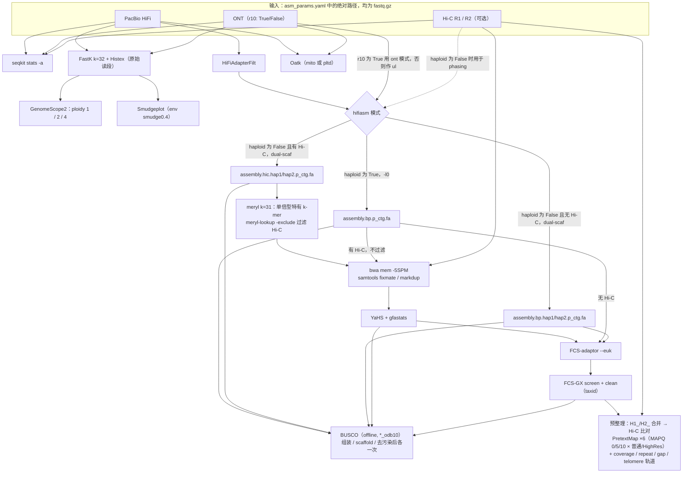

# EBP-Nor GenomeAssembly

> **仓库** https://github.com/ebp-nor/GenomeAssembly
> **版本** 仓库**没有任何 tag 或 Release**，因此使用默认分支 `main` 的 HEAD：commit `d31bbeec1aeb772d4b4eb30e29138b5a610a95dc`（2026-05-07，Ole K. Tørresen，"Merge branch 'main' of https://github.com/ebp-nor/GenomeAssembly"）
> **本地路径** `/media/deyuan/18T_B/genome_assembly/pipelines/ebp-nor_GenomeAssembly`（`git clone --depth 1`）
> **框架** Snakemake 7（`workflow/envs/asm_pipeline.yaml` 锁定 `snakemake=7`；profile 使用 `cluster:`、`cluster-status:` 这类 v7 写法）
> **许可证** MIT（`LICENSE.md`：Copyright (c) 2023, EBP-Nor）
> **维护方** GitHub org `ebp-nor`。GitHub contributors 统计：bramdanneels 30 次、olekto 5 次；commit 署名主要是 Bram Danneels 和 Ole K(ristian) Tørresen。EBP-Nor 即挪威的 Earth BioGenome Project（名称展开来自任务说明，仓库内没有展开）
> **更新时间** `main` 最后一次提交在 2026-05-07；仓库最近一次推送在 2026-10-24（推送到 `elixir_update` 分支，见下）
> **WorkflowHub** workflow 740 "EBP-Nor Genome Assembly Pipeline"，**没有 DOI**。登记的 version 1 对应 commit `6d5595d1`（2024-01），比当前 HEAD 旧很多

**分支说明（重要）**
- 仓库共有 5 个分支：`main`（默认）、`master`、`Dev`、`dev_uni`、`elixir_update`。
- **`elixir_update` 比 `main` 多 67 个 commit**，时间是 2026-09-29 到 2026-10-24，且仍在活跃开发。从 commit 信息看几乎是重写：
  - "starting almost from scratch"、"started modulerisation"：开始模块化，新增 `workflow/rules/*.smk`；
  - "added several containers"：引入容器；
  - "changed from bwa to minibwa"：bwa 换成 minibwa；
  - "removing hifiadapterfilt"、"removing references to r10"：去掉 HiFiAdapterFilt 和 r10 相关逻辑；
  - "run oatk on error corrected reads from hifiasm"：改为用 hifiasm 纠错后的读段跑 Oatk；
  - "not getting it to work properly with FCS-GX, going back to running it outside the workflow"：FCS-GX 改回在流程外运行；
  - "time -> runtime"：资源字段改名。
- 本笔记**只描述 `main` HEAD**。`main` 很可能会被大幅改写，采用前请先查看最新状态。
- 下文 `path:line` 都相对本地克隆根目录。标 **（推测）** 的是读代码后的推断，没有实际运行验证。

---

## 1. 一句话定位

这是 EBP-Nor 自用的**单文件** Snakemake 流程，约 980 行，面向 Slurm 集群。输入是 PacBio HiFi 和/或 ONT 长读，可选 Hi-C。流程依次做：k-mer 基因组概况（FastK、GenomeScope2、Smudgeplot）→ HiFiAdapterFilt 去接头 → hifiasm 组装 → 用 meryl 做单倍型特异的 Hi-C 读段过滤 → YaHS 挂载 → NCBI FCS-adaptor 和 FCS-GX 去污染 → Oatk 组装细胞器 → 用 GRIT rapid-curation 容器生成带轨道的 Pretext，供人工整理。主要用于"二倍体真核生物的单倍型分辨组装"（README.md:3-5）。

## 2. 适用场景与输入数据

### 2.1 数据类型与格式

- 支持 PacBio HiFi、ONT、成对 Hi-C。**所有输入都必须是 `fastq.gz`**，配置里填**绝对路径**；至少要有一种长读（README.md:58-69）。
- 每种数据**只能填一个文件**：`pacbio`、`ont`、`hicF`、`hicR` 各一个路径（`config/asm_params.yaml:1-9`）。Snakefile 在解析阶段就把它们软链接为 `input/pacbio.fastq.gz` 等（`workflow/Snakefile:11-22`）。有多个 run 时 **（推测）** 需要事先自己合并。
- **Hi-C 不是必需的**：2025-02-28 的 commit "introduce support for ONT-only and HiC-less assemblies" 加入了无 Hi-C 的支持。没有 Hi-C 时不做 scaffolding 和 curation（`Snakefile:115-126, 156-164`）。
- **trio 不支持**：没有 yak 相关逻辑。2025-03-17 的 commit 信息是 "changed dip to bp since we don't have much trio data"。
- **ONT ultra-long**：没有单独的参数。同时给了 HiFi 和 ONT、且 `r10: False` 时，ONT 会以 hifiasm `--ul` 的方式参与组装（见 2.2）。

### 2.2 不同数据组合怎么组装：hifiasm 命令如何决定

README 的说明：只给 HiFi 或只给 ONT 时就用该数据；两者都给时，ONT 是 R10 就用 ONT 组装，否则用 HiFi 组装、ONT 作为辅助（README.md:63-67）。代码里的实际实现见 `hifiasm_mode()`、`gen_linkread_cmd()`、`assembly_out()`（`Snakefile:81-126`）：

| 配置 | hifiasm 读段参数 | 规则 / 输出 |
|---|---|---|
| 只有 HiFi | `pacbio.filt.fastq.gz`（HiFiAdapterFilt 处理后） | 见下面 3 行，取决于 `haploid` 和是否有 Hi-C |
| HiFi + ONT，`r10: False` | `--ul ont.fastq.gz pacbio.filt.fastq.gz` | 同上 |
| 有 ONT 且 `r10: True`（不管有没有 HiFi） | `--ont ont.fastq.gz`，HiFi 不参与组装 | 同上 |
| 只有 ONT，`r10: False` | `hifiasm_mode()` 没有对应分支，返回 None | **（推测）** 命令不完整导致失败 |
| `haploid: False` + 有 Hi-C | 再加 `--dual-scaf --h1 hicF.fastq.gz --h2 hicR.fastq.gz` | `assembly_hifiasm`，输出 `assembly.hic.hap{1,2}.p_ctg.fa`（`:328-369`） |
| `haploid: False` + 无 Hi-C | 再加 `--dual-scaf` | `assembly_hifiasm_nohic`，输出 `assembly.bp.hap{1,2}.p_ctg.fa`（`:371-405`） |
| `haploid: True`（**模板默认值**） | 再加 `-l0`；没有 `--dual-scaf`，Hi-C 不参与组装 | `assembly_hifiasm_haploid`，输出 `assembly.bp.p_ctg.fa`；有 Hi-C 时只用于 YaHS（`:407-438, 552-573, 645-665`） |

各参数含义据 hifiasm 官方 README：`--ont` 用于 ONT simplex R10 读段（v0.21.0 起），且要求 FASTQ；`--ul` 整合 ultra-long ONT；`--h1/--h2` 用 Hi-C 做单倍型分辨；`--dual-scaf` 让两个单倍型互相补洞做 self-scaffolding；`-l0` 关闭 duplication purging，适用于近交或纯合基因组。

### 2.3 配置示例（`config/asm_params.yaml` 节选；值是原文，行尾中文注释为笔者所加，只有 `oatk_c` 行的英文注释是原文）

```yaml
### Input data ###
pacbio: ""          # PacBio HiFi 读段的绝对路径
hicF: ""            # Hi-C 正向读段
hicR: ""            # Hi-C 反向读段
ont: ""             # ONT 读段；没有就留空字符串
r10: False
#Define if the species is haploid or not
haploid: True       # ⚠️ 模板默认是 True，二倍体物种通常应改为 False（见第 7 节）

adapterfilt_install_dir: "/cluster/projects/nn8013k/opt/HiFiAdapterFilt"
FastK_k: "32"
GS_ploidy_range: ["1", "2", "4"]
smudgeplot_conda_env: "smudge0.4"
hifiasm_threads: "10"
hifiasm_mem_per_cpu: "15G"
hifiasm_cluster_time: "96:00:00"
busco_db_dir: "/cluster/projects/nn8013k/opt/busco_dbs/lineages"
busco_lineage: "aves"
meryl_k: "31"
oatk_db: "/cluster/projects/nn8013k/opt/OatkDB/v20230921"
oatk_lineage: "aves"
oatk_isPlant: False
oatk_k: "1001"
oatk_c: "150"       # syncmer coverage threshold (+- 5-10 times nuclear coverage)
fcs_path: "/cluster/projects/nn8013k/opt/fcs/dist"
fcs_gx_db: "/cluster/projects/nn8013k/opt/fcs/gxdb"
taxid: "76058"
curation_install_dir: "/cluster/projects/nn8013k/opt/rapid-curation/rapid_hic_software/"
curation_telomere_rep: "TTAGGG"
```

参数有三种改法：直接改 `asm_params.yaml`；在命令行用 `--config key=value` 覆盖；或者用 `--configfile` 换一个 YAML（README.md:115-118）。

## 3. 流程步骤

除 snakemake 外，conda 环境里的工具**都没有锁版本**（`workflow/envs/asm_pipeline.yaml`），实际版本由 `print_versions` 规则写进 `software_versions.txt`（`Snakefile:961-982`）。所以下表的"版本"一栏写的是来源，不是具体版本号。

| # | 步骤 | 工具（来源） | 作用 | 关键参数 / 默认值 |
|---|---|---|---|---|
| 0 | 输入链接 | `shell("ln -sf ...")` | 在**解析阶段**创建 `input/*.fastq.gz` 软链接 | `Snakefile:11-22` |
| 1 | 读段统计（localrule） | seqkit（conda） | 统计 hicF/hicR/pacbio/ont 各文件 | `seqkit stats -a`，输出 `results/stats/{tech}.stats`（`:217-225`） |
| 2 | HiFi 去接头 | HiFiAdapterFilt（手动安装） | 过滤 HiFi 读段中的接头污染（规则注释："Filter PacBio HiFi reads"），输出 `*.filt.fastq.gz` | `pbadapterfilt.sh -t 16 -o filtered`；需把 `{installdir}/DB` 加进 PATH（`:228-253`） |
| 3 | k-mer 计数 | FastK + Histex（conda） | 对**原始**长读建 k-mer 表和直方图 | `FastK -v -t1 -T10 -k32 -M32`；`Histex -G`；结果标记为 `temp()`（`:256-284`） |
| 4 | 基因组概况 | GenomeScope2（conda） | 按 ploidy 1、2、4 各跑一次 | `genomescope2 -k 32 -p {1,2,4}`（`:287-306`） |
| 5 | 倍性 | Smudgeplot（独立 env `smudge0.4`，含 fastk） | 推断倍性 | `smudgeplot.py hetmers -L 10 -t 10`，再 `smudgeplot.py all`（`:309-325`） |
| 6 | 组装 | hifiasm（conda） | 见 2.2 节 | `-t10`；资源 15G/CPU、96h；GFA 用 awk 转 FASTA；成功后删除 `*.bin`（`:328-438`） |
| 7 | 完整性评估 | BUSCO（conda） | 分别评估组装、scaffold、去污染后的结果 | `busco -m genome --offline -l {busco_db_dir}/{lineage}_odb10 -c 10 --download_path /tmp`（`:441-464`） |
| 8 | 单倍型特异 Hi-C 过滤（仅在 hap1/hap2 + Hi-C 时） | meryl、meryl-lookup（**（推测）** 来自 conda 的 merqury 依赖） | 去掉含"另一单倍型特有 k-mer"的 Hi-C 读段 | 对两个单倍型各建 `meryl k=31 count` → 用 `meryl difference` 得到 only_hap1、only_hap2 → `meryl-lookup -exclude`（`:467-526`） |
| 9 | Hi-C 比对与去重 | bwa、samtools（conda） | 比对 Hi-C 并标记、去除重复 | `bwa mem -5SPM -R '@RG...'` → `samtools sort -n` → `fixmate -mr` → `sort` → `markdup -rs` → `sort -n`（`:529-620`） |
| 10 | 挂载 | YaHS、gfastats（conda） | 挂载到染色体级 | `yahs {asm} {bam} -o results/scaffolding/{hap}`（用默认参数），然后 `gfastats` 出统计（`:623-665`） |
| 11 | 去接头 | NCBI FCS-adaptor（singularity） | 去除接头和载体污染 | `run_fcsadaptor.sh --euk --container-engine singularity --image {fcs_path}/fcs-adaptor.sif`（`:668-690`） |
| 12 | 去污染 | NCBI FCS-GX（singularity） | 去除外源污染 | `fcs.py screen genome --gx-db --tax-id {taxid}`，再 `clean genome --action-report`；资源 60G/CPU × 10、`bigmem` 分区、2h（`:693-727`；`asm_params.yaml:63-74`） |
| 13 | 细胞器 | Oatk + OatkDB（手动安装） | 从**原始**读段组装 mito（`oatk_isPlant: True` 时为 pltd） | `oatk -k 1001 -c 150 -t 8 --nhmmscan nhmmscan -m {lineage}_mito.fam [-p {lineage}_pltd.fam]`；失败时 `\|\| touch {output}`（`:729-784`） |
| 14 | 预整理：接触图 | bwa、samtools、PretextMap（pretext-suite） | hap1 和 hap2 加 `H1_`/`H2_` 前缀合并成 `ref.fa` 后比对 Hi-C | MAPQ 0、5、10 各出普通和 `--highRes` 两种，共 6 张，`--sortby length --sortorder descend`（`:786-840`） |
| 15 | 预整理：轨道 | minimap2 + deeptools `bamCoverage`；rapid-curation 的 `runRepeat.sif`、`runGap.sif`、`runTelo.sif`；PretextGraph；`bigWigToBedGraph` | 给接触图叠加 coverage、repeat density、gaps、telomere 四条轨道 | coverage 用 `minimap2 -ax map-hifi/map-ont`，再 `samtools view -F 256`；telomere 默认 `TTAGGG`，值 ×1000 后写入；整段 `set +e`，单条轨道失败也不终止（`:842-958`） |
| 16 | 版本记录（localrule） | `conda list -e` 等 | 生成 `software_versions.txt` | 还记录 HiFiAdapterFilt、FCS 的 `DEFAULT_VERSION`、`oatk --version`（`:961-982`） |

**不包含的步骤**：Merqury（虽然 env 里装了 merqury，Snakefile 里没有调用，grep 为 0）、purge_dups（没有规则）、短读 polishing、BlobToolKit。



## 4. 如何运行

### 4.1 安装与环境（README.md:7-56）

1. 主环境：`conda create -n asm_pipeline --file=worfklow/envs/asm_pipeline.yaml`（这是 README 原文，`worfklow` 是笔误）。对 YAML 格式的环境文件，通常的写法是 `conda env create -n asm_pipeline -f workflow/envs/asm_pipeline.yaml` **（推测）**。
2. Smudgeplot 独立环境：`conda create -c bioconda -c conda-forge -n smudge0.4 smudgeplot fastk`。流程会按 `smudgeplot_conda_env` 参数自动激活它（README.md:25-31；`Snakefile:319-320`）。
3. 需要手动安装的软件：HiFiAdapterFilt、Oatk、OatkDB、NCBI FCS-adaptor、NCBI FCS-GX（含 gx 数据库），并且需要 **singularity**。做 curation 还要 GRIT rapid-curation 的 `.sif` 镜像，而且必须用 commit `65fa1512...` 那一版，README 明确说 2024-03-04 之后的版本没有所需镜像（README.md:33-45）。
4. BUSCO：计算节点通常不能联网，要先 `busco --download eukaryota`（README.md:47-56）。但 Snakefile 写死了 `{busco_db_dir}/{lineage}_odb10`（`:446`），所以**必须保证目录里有对应的 `*_odb10` lineage**。
5. 修改 `config/config.yaml`：这是 Snakemake profile，里面写死了 `sbatch --account=nn8013k` 和默认分区 `normal`。修改 `config/asm_params.yaml`：所有 `/cluster/projects/nn8013k/...` 路径；分区参数 `hifiasm_partition: "normal"`、`fcs_gx_partition: "bigmem"`；以及 `taxid`、`busco_lineage`、`oatk_lineage`、`oatk_isPlant`、`haploid`、`curation_telomere_rep`。

### 4.2 最小命令（README.md:103-127）

```bash
conda activate asm_pipeline        # README 写的是 asm_assembly，和上面创建的环境名不一致
cd /path/to/GenomeAssembly         # 结果写到当前目录下的 results/
# 先 dry-run（-n 为 Snakemake 7 的 --dry-run）
snakemake --profile config/ --configfile config/asm_params.yaml --snakefile workflow/Snakefile -n all
# 正式运行；运行模式必须放在命令最后
snakemake --profile config/ --configfile config/asm_params.yaml --snakefile workflow/Snakefile all
```

运行模式就是 Snakefile 里的目标规则（`Snakefile:170-215`）：

| 模式 | 内容 |
|---|---|
| `all`（默认） | pre-assembly、组装、scaffolding、去污染、预整理、细胞器、读段统计、版本记录 |
| `all_nocuration` | 同 `all`，但不做预整理 |
| `pre_assembly` | 只跑 GenomeScope2 和 Smudgeplot |
| `assembly` | hifiasm + BUSCO；有 Hi-C 时还包括 scaffolding |
| `decontamination` | 组装、scaffolding、FCS 去污染 |
| `organelles` | 只跑 Oatk |

profile `config/config.yaml` 里的默认设置：`jobs: 50`、`keep-going: True`、`rerun-incomplete: True`、`latency-wait: 60`、`scheduler: greedy`、`use-conda: True`、`max-jobs-per-second: 10`；作业状态用 `status-sacct.sh` 查询（它基于 `sacct`，报错信息提到 smk-simple-slurm）。`--profile` 的作用是读取该目录下的 `config.yaml`，作为命令行选项的默认值（Snakemake v7 CLI 帮助）。

### 4.3 示例数据

仓库**没有附带测试数据**，也没有 CI。相关的教学材料是 EBP-Nor workshop 2024 仓库 https://github.com/ebp-nor/workshop-2024（CC-BY-SA-4.0，含 `data/`、`day1_genome_assembly/` 等目录）。据 ELIXIR TeSS 的条目描述，它讲的工具链是 GenomeScope2、Smudgeplot、HiFiAdapterFilt、hifiasm、YaHS、gfastats、BUSCO、Merqury、FCS-GX、GRIT Rapid Curation、PretextView，和本流程基本一致。它是否直接调用本流程我**没有核实**。

### 4.4 资源（`config/config.yaml`、`config/asm_params.yaml`）

- 默认资源：`partition="normal"`、`time="48:00:00"`、`ntasks="10"`、`mem_per_cpu="4500M"`、`cpu_per_task="1"`。sbatch 写法是 `--nodes=1 --cpus-per-task={cpu_per_task} --ntasks-per-node={ntasks} --mem-per-cpu={mem_per_cpu}`。线程是以 *tasks* 而不是 cpus-per-task 申请的，这种写法比较少见。

| 步骤 | 线程（ntasks） | 内存 | 时长 | 估算总内存（**（推测）** 按 Slurm 的 mem-per-cpu × CPU 数计算） |
|---|---|---|---|---|
| hifiasm | 10 | 15G/CPU | 96h | ≈150G |
| FCS-GX | 10 | 60G/CPU，`bigmem` 分区 | 2h | ≈600G |
| FCS-adaptor | 默认 10 | 3G/CPU | 6h | ≈30G |
| BUSCO | 10 | 8G/CPU | 默认 48h | ≈80G |
| meryl | 10 | 进程内存参数 `memory=38g` | 默认 | — |
| YaHS / Hi-C 比对 | 16 | 默认 4500M/CPU | 72h（YaHS） | ≈72G |
| Oatk | 8 | 10G/CPU | 默认 | ≈80G |
| 预整理比对 | 16 | 5G/CPU | 48h | ≈80G |
| FastK | 10 | `-M32` | 6h | — |

## 5. 主要输出（`Snakefile` 各规则的 output；README.md:129-144）

```
<运行目录>/
├── input/                       # 解析阶段创建的软链接：pacbio / ont / hicF / hicR .fastq.gz
├── logs/{rule}/                 # sbatch 的 .out/.err（由 profile 的 cluster 命令创建）
├── software_versions.txt
└── results/
    ├── stats/{hicF,hicR,pacbio,ont}.stats            # seqkit stats -a
    ├── pacbio/pacbio.filt.fastq.gz                    # HiFiAdapterFilt
    ├── pre_assembly/
    │   ├── genomescope/{tech}_genomescope_ploidy{1,2,4}.out + {tech}_ploidy{p}/
    │   └── smudgeplot/{tech}_smudgeplot.pdf
    ├── assembly/
    │   ├── assembly.{hic|bp}.hap{1,2}.p_ctg.{gfa,fa}  # 或 haploid 模式的 assembly.bp.p_ctg.fa
    │   └── busco_<assembly>_<lineage>/
    ├── scaffolding/
    │   ├── meryl/hic{F,R}_hap{1,2}.fastq.gz           # 按单倍型过滤后的 Hi-C
    │   ├── {hap|haploid}_scaffolds_final.fa + .stats(gfastats) + yahs_*.out/err + *_hic_markdup.stats
    │   └── busco_{hap}_scaffolds_final_<lineage>/
    ├── decontamination/{hap1,hap2 | haploid}/
    │   ├── adaptor_output/  gx_output/  contam.fasta
    │   ├── {hap}_final.clean.fa                        # FCS-adaptor 之后
    │   ├── {hap}_final.decon.fa                        # ★ FCS-GX 之后：最终组装
    │   └── busco_{hap}_final.decon_<lineage>/
    ├── organelles/{pacbio,ont}/oatk.{mito|pltd}.ctg.fasta
    └── curation/
        ├── data/ref.fa                                 # 带 H1_/H2_ 前缀的两套单倍型
        ├── HiC_BotHapScaff.markdup.sort.bam  hic_markdup.stats
        ├── Scaff_HiC.mapping[.q5|.q10][.hr].pretext → *.final.pretext   # ★ 6 张带轨道的接触图
        ├── Scaff_coverage.bw
        └── out/Scaff_repeat_density.bw  Scaff_gap.bedgraph  Scaff_telomere.bedgraph
```

注意：`temp()` 标记的中间文件（FastK 表、两个单倍型的 meryl 库、Hi-C 中间 BAM）会被自动删除（`Snakefile:258-260, 469, 531, 554, 577`）。

## 6. 设计亮点（值得学习的地方）

1. **简单直观**：一个 Snakefile，加一个 profile（`config.yaml`）和一个参数文件（`asm_params.yaml`），用目标规则充当"运行模式"，很适合作为学习 Snakemake 组装流程的入门范例。
2. **按数据类型自动选择 hifiasm 模式**：根据 HiFi、ONT、R10、Hi-C、`haploid` 的组合自动拼出 `--ul`、`--ont`、`--h1/--h2`、`--dual-scaf`、`-l0`（2.2 节）。这个思路值得借鉴，但要注意它的边界情况（第 7 节）。
3. **单倍型感知的 Hi-C 过滤**：先用 meryl 求出 hap1、hap2 各自特有的 k-mer，在 scaffold hap2 时剔除含 hap1 特有 k-mer 的 Hi-C 读段，hap1 同理。目的是减少等位基因串扰对 YaHS 的干扰（`Snakefile:467-526`）。
4. **把提交 NCBI/ENA 前必须做的去污染放进流程**：FCS-adaptor 加 FCS-GX，并输出 `contam.fasta`，便于复查。
5. **从读段直接组装细胞器**：Oatk 配合 OatkDB 的 lineage HMM，同时支持动物（mito）和植物（plastid）。
6. **两个单倍型放在一张图里整理**：hap1 和 hap2 加 `H1_`/`H2_` 前缀合并后，出 MAPQ 0、5、10 × 普通/HighRes 共 6 张 Pretext，自动叠加 coverage、repeat、gap、telomere 四条轨道，可以直接进 PretextView。
7. **基因组概况更全面**：GenomeScope2 同时按 ploidy 1、2、4 拟合，并配合 Smudgeplot，适合对倍性不确定的新物种。
8. **记录软件版本**：`software_versions.txt` 记录了 conda 包和手工安装软件的版本，弥补了 env 里不锁版本的缺点。

## 7. 局限与注意事项（坑）

1. **⚠️ 模板默认 `haploid: True`**（`config/asm_params.yaml:11-12`），而 README 完全没提这个参数。在这个模式下：
   - hifiasm 用 `-l0`，按 hifiasm 官方说明是"关闭 duplication purging，用于近交/纯合基因组"；
   - 只输出 primary contigs（`bp.p_ctg`）；
   - Hi-C 不参与 phasing，只用于 YaHS。

   **（推测）** 二倍体、杂合度高的物种如果沿用默认值，组装里很可能残留 haplotig 和重复，而且整个流程里也没有 purge_dups 补救。这类物种应该设 `haploid: False`。
2. **只有 ONT、且 `r10: False` 时会失败（推测）**：`hifiasm_mode()` 没有这个分支，会返回 None（`Snakefile:93-101`）。README 说支持"只用 ONT"，实际上需要设 `r10: True`，这也符合 hifiasm `--ont` 面向 R10 读段的定位。
3. **两个运行模式与 haploid 模式不兼容（推测）**：`all_nocuration` 和 `decontamination` 两个目标写死了 `hap1/hap2`（`:187, 209`）。在 `haploid: True` 时，`fcs_input()` 对 hap1 和 hap2 都返回同一个 haploid 组装，**（推测）** 会对同一组装重复做两次去污染，产生名为 hap1/hap2、内容却相同的结果。`all` 使用的 `decontam_out()` 没有这个问题。
4. **`fcs_adaptor_image` 参数没有被使用**：规则里写死的是 `--image {fcs_path}/fcs-adaptor.sif`（`:687`），所以 `fcs-adaptor.sif` 必须放在 `fcs_path` 目录下。FCS-GX 使用的 `fcs_gx_image` 则是正常生效的。
5. **BUSCO 的 lineage 后缀写死为 `_odb10`**（`:446`），而 BUSCO 本身不锁版本。**（推测）** 换用较新的 BUSCO 或 odb 版本时，lineage 路径或数据集可能对不上。
6. **只能用 Snakemake 7**：profile 里的 `cluster:`、`cluster-status:`、`cluster-cancel:` 在 Snakemake 8 中已改成需要 `cluster-generic` 插件的 `--cluster-generic-*-cmd` 选项（据 Snakemake 官方迁移文档）；env 里也锁定了 `snakemake=7`。
7. **写死了 Sigma2/NRIS 的项目信息**：sbatch 的 `--account=nn8013k`，以及 `/cluster/projects/nn8013k/...` 下的各种路径。**（推测）** 这些是挪威 Sigma2 集群的项目账号和路径，在其他集群上全部要改。
8. **文档和代码不同步**：
   - README 里的环境名（`asm_assembly`）和创建命令里的环境名（`asm_pipeline`）不一致；有 `worfklow` 笔误；README 写的是 `asm_parameters.yaml`，实际文件名是 `asm_params.yaml`。
   - `workflow/documentation.md` 是旧版说明，还写着"必须有 HiFi + Hi-C"、需要 KMC、用 `species_dir/genomic_data/` 目录结构，这些都与当前代码不符。
   - `workflow/WorkflowOverview.svg` 是旧的 DAG，里面有当前已不存在的 `concatenate_filtered_reads` 规则，规则名还拼错成 `assembly_hifiams`，也没有 Oatk 和 curation。
9. **失败可能被静默掩盖**：Oatk 和三个 rapid-curation 步骤失败时会 `|| touch {output}`，`update_pretext` 开头还有 `set +e`（`:755, 783, 883, 905, 928, 943`）。产物可能只是空文件，跑完后**务必检查文件大小**。
10. **评估比较单薄**：没有 Merqury（得不到 QV 和 k-mer 完整度），没有 contig 级的连续性统计（gfastats 只对 scaffold 跑），没有 purge_dups。要做数据驱动的组装选择，需要自己补上。
11. **解析阶段就有副作用**：每次调用 Snakemake（包括 dry-run）都会执行 `mkdir -p input` 和创建软链接（`:11-22`）。
12. **小的不一致（推测）**：
    - 同时给了 HiFi 和 ONT 且 `r10: True` 时，覆盖度轨道用的读段是 ONT（`prio_reads()`），但 minimap2 的 preset 仍是 `map-hifi`（`minimap_mode()` 只看有没有 HiFi）（`:103-113`）。
    - k-mer 分析和 Oatk 用的是**未去接头**的原始读段。
    - `run_oatk_plant` 的资源字段写成了 `tasks`（应为 `ntasks`），线程没有真正申请到（`:735`）。
13. **`main` 可能即将被重写**：见开头的分支说明。

## 8. 与 sanger-tol/genomeassembly（v1.0.1）的对比

| 维度 | EBP-Nor GenomeAssembly（main@d31bbee） | sanger-tol/genomeassembly v1.0.1 |
|---|---|---|
| 引擎 / 结构 | Snakemake 7，单个 Snakefile；Slurm profile | Nextflow（nf-core 模板 4.1.0），模块化 |
| 输入声明 | YAML：每种数据填一个 fastq.gz 路径；`haploid`、`r10` 两个开关 | `genomic_data` + `assembly_specs` 两个 YAML/JSON；一次可以定义多套组装方案 |
| 数据类型 | HiFi、ONT（R10 或作为 UL）、Hi-C（全部 fastq.gz） | HiFi、ONT、Hi-C 和 Illumina（CRAM）、10X |
| 基因组概况 | FastK + GenomeScope2（ploidy 1/2/4）+ Smudgeplot | FastK + GenomeScope2 |
| 组装 | hifiasm：`--ul`、`--ont`、`--h1/--h2`、`--dual-scaf`、`-l0`（haploid） | hifiasm：pri/alt、Hi-C phased、trio、ONT UL；先做 overlap bin |
| trio | 不支持 | 支持 |
| purge_dups | 无 | 可选 |
| polishing | 无 | 10X + FreeBayes（可选，legacy） |
| Hi-C 处理 | **按单倍型用 meryl k-mer 过滤 Hi-C**，再 bwa mem -5SPM + samtools markdup | 从 CRAM 分块比对（bwa-mem2 或 minimap2）+ samtools markdup |
| scaffolding | YaHS（默认参数） | YaHS |
| 接触图 | PretextMap ×6（MAPQ 0/5/10 × 普通/HighRes），hap1+hap2 合并成一张 | PretextMap、Juicer .hic、cooler |
| QC | BUSCO（组装、scaffold、去污染后各一次）、seqkit、gfastats（只对 scaffold） | asmstats、gfastats、BUSCO、MerquryFK（逐阶段） |
| 去污染 | **内置 FCS-adaptor + FCS-GX** | 不内置（另用 sanger-tol/ascc、blobtoolkit） |
| 细胞器 | Oatk（mito/pltd） | MitoHiFi、oatk |
| 人工整理准备 | 内置 rapid-curation 轨道（coverage/repeat/gap/telomere） | 不内置（另用 treeval、curationpretext） |
| 复用 / 溯源 | 只有 `software_versions.txt` | 阶段 MD5 哈希缓存 + 每阶段 index.json 记录参数和版本 |
| 可移植性 | 中等偏低：写死了 Sigma2 账号和路径，多个工具需手动安装，env 不锁版本 | 高（容器化，nf-core 规范） |

一句话：EBP-Nor 覆盖了"从读段到可提交、可整理"的完整链条，包括去污染、细胞器和预整理，而且结构简单易读，但评估（无 Merqury）和健壮性比较弱。sanger-tol 在组装模式（trio、UL、多方案）和可复现性上更强，但把去污染和整理拆成了独立流程。另一个 Snakemake 流程 CLAWS 见 `04_CNAG_CLAWS.md`。

## 9. 参考文献与链接

- 仓库：https://github.com/ebp-nor/GenomeAssembly（重写中的分支：https://github.com/ebp-nor/GenomeAssembly/tree/elixir_update）
- WorkflowHub：https://workflowhub.eu/workflows/740 （无 DOI）
- 教学材料：EBP-Nor workshop 2024，https://github.com/ebp-nor/workshop-2024（TeSS 条目：https://tess.elixir-europe.org/materials/genome-assembly-annotation-and-comparative-genomics-ebp-nor-workshop-2024）
- README 中给出的外部软件链接：HiFiAdapterFilt https://github.com/sheinasim/HiFiAdapterFilt ；Oatk https://github.com/c-zhou/oatk ；OatkDB https://github.com/c-zhou/OatkDB ；NCBI FCS-adaptor https://github.com/ncbi/fcs/wiki/FCS-adaptor ；NCBI FCS-GX https://github.com/ncbi/fcs/wiki/FCS-GX ；GRIT rapid-curation（指定 commit）https://gitlab.com/wtsi-grit/rapid-curation/-/tree/65fa15125dbcce025d02471f30fc093170f48bf7
- hifiasm 官方 README（核对了 `--ont`、`--ul`、`--h1/--h2`、`--dual-scaf`、`-l0` 的含义）：https://github.com/chhylp123/hifiasm
- Snakemake v8 迁移指南（`--cluster` 改为插件）：https://github.com/snakemake/snakemake/blob/main/docs/getting_started/migration.rst
- 本笔记**没有**核对各工具的原始论文。仓库里没有给出 EBP-Nor 流程本身的论文或 DOI。

## 本笔记依据

本地文件（`/media/deyuan/18T_B/genome_assembly/pipelines/ebp-nor_GenomeAssembly/`，共 9 个文件，**全部读完**）：
- `README.md`、`LICENSE.md`、`workflow/documentation.md`、`workflow/Snakefile`（1-982 行）、`workflow/envs/asm_pipeline.yaml`、`config/config.yaml`、`config/asm_params.yaml`、`config/status-sacct.sh`
- `workflow/WorkflowOverview.svg`（只提取了文字标签，它是 graphviz 生成的 snakemake DAG）

在线来源（2026-10-26 读取）：
- `gh api repos/ebp-nor/GenomeAssembly`、`/releases`、`/tags`（都为空）、`/branches`、`/commits`（main，30 条）、`/commits?sha=<branch>`、`/compare/main...elixir_update`、`/commits/1439aeda`、`/contributors`；`gh api orgs/ebp-nor`
- `gh api repos/chhylp123/hifiasm/readme`
- Snakemake：`docs/getting_started/migration.rst`、`docs/snakefiles/configuration.rst`（main）、`snakemake/__init__.py@v7.32.4`（`--profile`、`-n`）
- WorkflowHub JSON API：https://workflowhub.eu/workflows/740
- TeSS JSON：上面的 workshop 条目；`gh api repos/ebp-nor/workshop-2024/contents`（只看了顶层目录）
