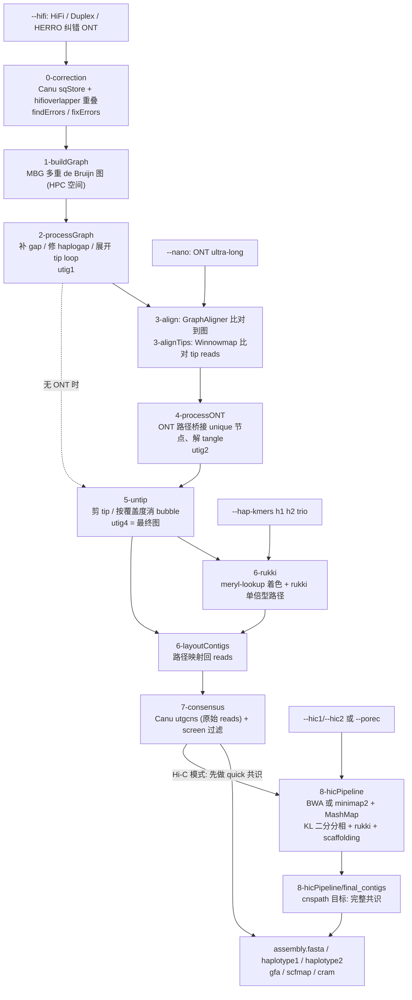

# Verkko

> **仓库** https://github.com/marbl/verkko ｜ **版本** `v2.3.2`（tag → commit `39e9fb22816da30b22426ad1914034bc3a2d0cfa`；GitHub Release 发布于 2026-03-11；`src/main.mk` 中 `VERSION := snapshot v2.3.2`）｜ **本地路径** `/media/deyuan/18T_B/genome_assembly/pipelines/marbl_verkko`（`git clone --depth 1 --branch v2.3.2`，**未拉取子模块**）｜ **框架** Snakemake 7（POSIX `sh` 启动脚本 `src/verkko.sh` 先解析参数，再生成 `verkko.yml` 和 `snakemake.sh`，最后调用 Snakemake）｜ **许可证** Public Domain（"United States Government Work"，见 `README.licenses`；GitHub 未识别 SPDX）｜ **维护方** marbl（NHGRI/NIH；Rautiainen、Nurk、Walenz、Antipov、Phillippy、Koren 等，见 README 引文）｜ **更新时间** v2.3.2 发布于 2026-03-11；`master` 最新提交为 `cb69f96`（2026-08-25，"update tag"），相对 v2.3.2 只是 11 个文件的小改动，见 §7

文中路径默认相对于上面的本地路径。行号以 v2.3.2 为准。

---

## 1. 一句话定位

Verkko 是 marbl 开发的 **T2T 级二倍体混合（hybrid）组装流程**。它分四步工作：

1. 用高准确长读建 **MBG 多重 de Bruijn 图**。高准确长读包括 PacBio HiFi、ONT Duplex，以及经 HERRO 或 hifiasm 纠错的 ONT Simplex。
2. 把 **ONT ultra-long** 比对到图上，借此解开重复和 tangle。
3. 用 trio（亲本 hapmer）、Hi-C 或 Pore-C 给图节点着色，再由 **rukki** 走出单倍型路径。
4. 用 **Canu 的共识模块**生成分相的 contig/scaffold。

依据：`README.md:3-11, 65`。README 明确说明不生成 primary 或 pseudo-haplotype 组装（`README.md:65`）。

## 2. 适用场景与输入数据

| 数据 | 参数 | 是否必须 | 格式 / 要求 | 依据 |
|---|---|---|---|---|
| 高准确长读：HiFi、ONT Duplex，或 HERRO/hifiasm 纠错的 ONT Simplex | `--hifi` | **必须** | FASTA/FASTQ，可为未压缩或 gz/bz2/xz，文件数不限。**不要**提供已做 homopolymer-compressed（HPC）的 reads，buildStore 会检测并报错。read ID 必须唯一 | `src/verkko.sh:836-838, 1008-1013`；`src/Snakefiles/c1-buildStore.sm` |
| ONT（ultra-long 最佳） | `--nano` | 可选，但 README "strongly recommend" | FASTA/FASTQ/SAM/BAM，ID 必须唯一（`3-splitONT.sm` 会检查）。HERRO 场景下，纠错后的 reads 给 `--hifi`，**原始** reads 给 `--nano` | `README.md:65`；`src/verkko.sh:1014-1018` |
| Trio 亲本 hapmer | `--hap-kmers h1 h2 trio` | 可选 | 用 merqury 的 `trio/hapmers.sh` 生成，必须是 **homopolymer-compressed、k=30** 的 meryl 库（`meryl count compress k=30`）。子代库可选。启动脚本会用 `meryl print` 检查库是否为 HPC | `README.md:70-108`；`src/verkko.sh:503-507, 844-874` |
| Hi-C 双端 | `--hic1` / `--hic2` | 可选 | 左右文件顺序必须一致，不接受 interleaved 文件；格式可为 FASTA/FASTQ/SAM/BAM | `src/verkko.sh:1028-1033, 960-963` |
| Pore-C | `--porec` | 可选 | 与 Hi-C 互斥 | `src/verkko.sh:981-983` |
| 同种或近缘种参考 | `--ref` | 可选 | 只在 scaffolding 中作引导，"It is _not_ reference-based assembly" | `README.md:134` |
| 污染序列 | `--screen <name> <fasta>`（可多次）/ `--screen-human-contaminants` | 可选 | 内置人类 rDNA、mito、EBV 序列（`src/data/*.fasta.gz`） | `README.md:185-187`；`src/verkko.sh:663-673` |

**组合约束**
- 不能同时给 Hi-C（或 Pore-C）和 `--hap-kmers`（trio）（`src/verkko.sh:984-986`）。Hi-C 与 Pore-C 也互斥（`:981-983`）。
- Hi-C/Pore-C 的 scaffolding 依赖二倍体结构，**不兼容 `--haploid`**，这种情况下 README 推荐改用 YaHS。多倍体的 scaffolding 和分相"not supported yet"（`README.md:136-138`）。
- Hi-C/Pore-C 集成"tested mostly on human and primate genomes"。组装远离人类的物种或覆盖度不均时，需关注 rDNA tangle 开关、`--uneven-depth` 和 `--haplo-divergence`（`README.md:126`）。README 写的是 `--rdna-tangle`，代码里实际的选项是 `--no-rdna-tangle`（`src/verkko.sh:652`）。

**对环节动物项目的提示（推测）**
- 只有 HiFi + Hi-C、没有 ONT UL 时，Verkko 仍可运行（`--nano` 可选），但会跳过 3-align 和 4-processONT（`5-untip.sm` 的输入在无 ONT 时直接用 `2-processGraph` 的图），重复解析能力下降。
- 杂合度明显高于人类时，应调大 `--haplo-divergence`（默认 0.05，上限 0.2）。
- 端粒基序默认是脊椎动物的 `CCCTAA`（正反向都会搜索）。请自行核实目标物种的端粒基序后再决定是否用 `--telomere-motif` 修改，本笔记未查证。

## 3. 流程步骤

Snakemake 有三个目标（`src/verkko.sh:1381-1393`）：
- 普通运行：`verkko`。
- Hi-C/Pore-C：`HiC_rdnascaff`。`rdna_scaff="True"` 在代码中写死，没有命令行开关（`:340`）。
- `--paths` 重共识：`cnspath`。

每个 rule 先把实际命令写成阶段目录下的 `*.sh` 再执行，例如 `0-correction/buildStore.sh` 和 `3-align/aligned0001.sh`，便于排错或手动重跑（见各 `src/Snakefiles/*.sm`）。

| 步骤（目录） | 工具（版本） | 作用 | 关键参数 / 默认值 |
|---|---|---|---|
| **0-correction**：buildStore | Canu `sqStoreCreate`（canu 子模块 `9fefd83`） | 建 HiFi seqStore（`-homopolycompress`）。检查输入是否已 HPC、read 名是否重复 | `-minlength 4000`（`--correct-min-read-length`） |
| 0-correction：prepareOverlaps / computeOverlaps | hifioverlapper `matchchains_index` / `matchchains_matchindex`（子模块 `f0ef4d3`）+ Canu `overlapImport` | 在 HPC 空间做 minimizer 索引和 read-read 重叠，分批并行 | `--hpc -k 425 -w 19 --max-coverage 1000 --tmp-file-count 16`；32 个重叠批次；`--min-match-length 1000`；`overlapImport -maxerror 0.01` |
| 0-correction：combineOverlaps | Canu `ovStoreConfig` / `ovStoreBuild` | 合并重叠为 ovlStore | ovs 默认 1 CPU / 128 GB / 12 h，内存按 config 自动估计 |
| 0-correction：findErrors / fixErrors，产出 `hifi-corrected.fasta.gz` | Canu `findErrors` / `fixErrors`（OEA 纠错） | 基于重叠做碱基纠错。`--no-correction` 时用 `sqStoreDumpFASTQ -corrected -compressed` 直接导出 | `findErrors -l 1000 -e 0.01 -m 0.003 -s -p 5`；red 4 CPU / 32 GB |
| **1-buildGraph** | MBG（子模块 `2e1d44b`） | 用纠错后的 HiFi 建多重 de Bruijn 图，输出 `hifi-resolved.gfa` 和 `paths.gaf` | `-k 1001 -r 15000 -R 4000 -w 100 --kmer-abundance 1 --unitig-abundance 2 --error-masking=collapse-msat --hpc-variant-onecopy-coverage 25 --do-unsafe-guesswork-resolutions` |
| **2-processGraph** | Verkko Python 脚本：`insert_aln_gaps.py` ×3、`fix_haplogaps.py`、`unroll_tip_loops.py`、`unitigify.py` | 用 HiFi 路径补 gap、修 haplogap、展开 tip loop 后做 unitig 化，得到 **utig1** | 无用户参数 |
| **3-align** | `fasta_partition.py` + **GraphAligner**（release notes 要求 ≥ v1.0.19） | 把 ONT 切片（每片 ≤ 3 Gbp 或 15 万条），比对到 utig1 图，输出 GAF | `--seeds-mxm-length 30 --seeds-mem-count 10000 --bandwidth 15 --multimap-score-fraction 0.99 --precise-clipping 0.85 --min-alignment-score 5000 --clip-ambiguous-ends 100 --overlap-incompatible-cutoff 0.15 --max-trace-count 5 --seeds-mxm-windowsize 5000 --hpc-collapse-reads --discard-cigar`；非 `--haploid` 时加 `--diploid-heuristic 21 31` |
| **3-alignTips** | `find_tips.py` + **Winnowmap**（`-x map-ont -I40G`） | 挑出比对在图端点（tip）附近的 ONT reads，再用 Winnowmap 比对到 unitig 序列 | 过滤条件：MAPQ ≥ 20、比对长度 > 5000、identity ≥ 0.90 |
| **4-processONT** | Verkko Python 脚本：`select_best_alignment` / `chop_misassemblies` / `insert_aln_gaps` / `estimate_unique_local` / `find_bridges` / `remove_crosslink_paths` / `fix_diploid_paths` / `forbid_unbridged_tangles` / `connect_uniques` / `resolve_triplets_kmerify` 等 | 在 GraphAligner 与 Winnowmap 的比对中择优，切掉错连，用 ONT 补 gap，识别 unique 节点，用 ONT 路径桥接 unique 节点以解开 tangle，做三元组解析，得到 **utig2** | `pop_min_allowed_cov=5`；`resolve_steps="20 10 5"`；pop 默认 16 CPU / 64 GB / 48 h |
| **5-untip** | `untip_relative.py`、`pop_bubbles_coverage_based.py`、`unroll_simple_loops.py`、`unitigify.py` | 剪 tip、按 HiFi 覆盖度消 bubble、展开简单环，做两轮，得到 **utig4**（最终图 `5-untip/unitig-unrolled-unitig-unrolled-popped-unitig-normal-connected-tip.gfa`），并计算 HiFi/ONT 覆盖度表 | `untip_relative.py 15000 5000 0.1` |
| **6-rukki**（仅 `--hap-kmers`） | `meryl-lookup` + **rukki**（子模块 `ff4a636`） | 按两套 hapmer 给每个节点计数并着色，rukki 输出单倍型路径（TSV 给 Bandage，GAF 给共识） | 着色阈值 `ruk_fract=0.9`；trio 时 `--marker-ratio 5 --tangle-prevent-reassign`，其他类型 `--marker-ratio 3`；`--trusted-len 325000`、`--max-homozygous-len=25000000` 等 |
| **6-layoutContigs** | `get_layout_from_mbg.py`、`merge_layouts.py` | 把（rukki 或逐节点的）路径映射回 read 位置，生成 layout 和 `*.scfmap` | lay 默认 1 CPU / 64 GB；`--no-consensus-bam` 时 lay 内存减半 |
| **7-consensus** | Canu `sqStoreCreate -raw` / `layoutToPackage` / **`utgcns`**；samtools；`screen-assembly.pl` + MashMap；`circularize_ctgs.py` | 用**原始（非 HPC）** HiFi 和 ONT reads 打包，按包跑 `utgcns` 共识后合并。随后按单倍型标签拆分，移出"短且在图中孤立"的 contig 和污染序列，可选输出 reads 回贴的 CRAM | `utgcns -I 2 -C 2 -maxcoverage 50 -e 0.05 -em 0.10`；`--discard-short 100000`；`layoutToPackage -partition 0.8 1.5 0.04`；cns 默认 8 CPU，内存按 packages.report 自动估计 |
| **8-hicPipeline**（仅 Hi-C/Pore-C） | MashMap、**BWA mem**（Hi-C）/ **minimap2**（Pore-C）、samtools、`seqtk telo`、networkx（Kernighan–Lin）、rukki、`scaffolding/scaffold_graph.py` | 分六步，见本表下方说明 | `--haplo-divergence 0.05`（MashMap `--pi 95`）；`--telomere-motif CCCTAA`；ahc 24 CPU / 64 GB / 48 h；shc 8 CPU / 128 GB / 24 h |

8-hicPipeline 的六个子步骤：
1. 先用 quick 共识（1 轮，不出 BAM）得到 unitig 序列。
2. 用 MashMap 找同源节点对。
3. Hi-C reads 用 `bwa mem -5 -S -P` 比对并预过滤；Pore-C 用 `minimap2 -ax map-ont`。
4. `cluster.py` 做 **KL 二分分相**：同源边取负权，Hi-C 链接为正权，100 个随机起点，每次 10000 次迭代。输出 `hicverkko.colors.tsv`，再交给 rukki 出路径。
5. `launch_scaffolding.py` 结合 Hi-C、端粒、rDNA 和可选的 `--ref` 做 scaffolding。
6. `verkko.sh` 在 `8-hicPipeline/final_contigs/` 里用 `cnspath` 目标**再跑一次完整共识**。

各步依据（全部在 `src/Snakefiles/` 下）：`c1-buildStore.sm`、`c2-findOverlaps.sm`、`c4-findErrors.sm`、`1-buildGraph.sm`、`2-processGraph.sm`、`3-splitONT.sm`、`3-alignONT.sm`、`3-alignTips.sm`、`4-processONT.sm`、`5-untip.sm`、`6-rukki.sm`、`6-layoutContigs.sm`、`7-*.sm`、`8-hicPipeline.sm`。另外参考了 `src/scripts/cluster.py`（常量 `KLIN_STARTS=100`、`KLIN_ITER=10000`、`MIN_LEN=200000`）、`src/main.mk`（子模块产出哪些二进制）和 `.gitmodules`。



## 4. 如何运行

### 4.1 安装与环境
- **conda（推荐）**：`conda create -n verkko -c conda-forge -c bioconda -c defaults verkko`（`README.md:21-22`）。
- **源码编译**：需要 GCC ≥ 9 和 Rust ≥ 1.74。用 `git clone` 获取源码后执行 `cd verkko/src && make -j32`，产物在 `verkko/bin` 和 `verkko/lib/verkko`。**不要下载 GitHub 自动打包的 .zip**，里面缺少子模块，无法编译（`README.md:29-55`）。Makefile 会自动执行 `git submodule update --init` 拉取 canu、rukki、MBG、hifioverlapper（`src/Makefile:46-67`）。
- **运行依赖**：README 与 v2.3.2 release notes 的要求有出入，以 release notes 为准较稳妥。

| 依赖 | README（`README.md:35-46`） | v2.3.2 release notes |
|---|---|---|
| Python | ≥ 3.5 | ≥ 3.10，需 biopython、parasail、networkx |
| Snakemake | ≥ 7.0, < 8.0.1 | ≥ 7.0, < 8.0 |
| GraphAligner | 未写版本 | ≥ v1.0.19 |
| MashMap | 未写版本 | ≥ 2.0 |
| Winnowmap | 未写版本 | 未写版本 |
| bamtools | 未列出 | ≥ 2.5.2 |
| Hi-C/Pore-C 额外依赖 | BWA（Hi-C）、minimap2（Pore-C）、samtools、seqtk、networkx（≥ 2.6, ≤ 3.5） | 同左，但 networkx 只写 ≥ 2.6 |

- 脚本还会 `import pysam`（`hic_prefilter.py`、`bam_rename.py`、`scaffolding/*.py`）。CI 用 `mamba install ... 'snakemake-minimal>7,<8' GraphAligner mashmap winnowmap samtools seqtk` 加 `pip install networkx pysam` 搭环境，Python 3.11（`.github/workflows/makefile.yml`）。
- 外部工具可用 `--mbg/--graphaligner/--mashmap/--seqtk/--winnowmap/--minimap/--bwa/--samtools/--python/--perl` 指定路径。不指定时，先找 `$VERKKO/bin/` 下的同名程序，找不到再找 `$PATH`（`src/verkko.sh:713-791`）。

### 4.2 最小命令（均摘自 README）
```bash
# 1) HiFi + ONT UL，不分相
verkko -d asm --hifi hifi/*.fastq.gz --nano ont/*.fastq.gz

# 2) Trio：先在 HPC 空间统计 k=30 的 k-mer，再用 merqury 生成 hapmer
meryl count compress k=30 threads=XX memory=YY maternal.*fastq.gz output maternal_compress.k30.meryl
meryl count compress k=30 threads=XX memory=YY paternal.*fastq.gz output paternal_compress.k30.meryl
meryl count compress k=30 threads=XX memory=YY    child.*fastq.gz output    child_compress.k30.meryl
$MERQURY/trio/hapmers.sh maternal_compress.k30.meryl paternal_compress.k30.meryl child_compress.k30.meryl
verkko -d asm --hifi hifi/*.fastq.gz --nano ont/*.fastq.gz \
  --hap-kmers paternal_compress.k30.hapmer.meryl maternal_compress.k30.hapmer.meryl trio

# 3) Hi-C
verkko -d asm --hifi hifi/*.fastq.gz --nano ont/*.fastq.gz \
  --hic1 hic/*R1*fastq.gz --hic2 hic/*R2*fastq.gz

# 4) Pore-C
verkko -d asm --hifi hifi/*.fastq.gz --nano ont/*.fastq.gz --porec porec/*fastq.gz

# 5) 先 dry-run 看会跑哪些 job（README 建议续跑或改中间文件前都先做一次）
verkko -d asm --hifi ... --nano ... --snakeopts "--dry-run"
```

### 4.3 示例 / 测试数据
README 提供 E. coli K12 子集（24x HiFi，50x ONT），见 `README.md:195-200`：
```bash
curl -L https://obj.umiacs.umd.edu/sergek/shared/ecoli_hifi_subset24x.fastq.gz -o hifi.fastq.gz
curl -L https://obj.umiacs.umd.edu/sergek/shared/ecoli_ont_subset50x.fastq.gz -o ont.fastq.gz
verkko -d asm --hifi ./hifi.fastq.gz --nano ./ont.fastq.gz
```
CI 用同一份数据，另加一个缓存包，并用桩程序替换 MBG、GraphAligner 和 utgcns 以加速测试（`.github/workflows/makefile.yml`）。

### 4.4 关键参数（默认值见 `src/verkko.sh:280-353`，参数解析见 `:460-707`）

| 参数 | 默认 | 说明 |
|---|---|---|
| `-d <dir>` | 必填 | 工作和输出目录，不存在会自动创建 |
| `--no-correction` | 默认会纠错 | 跳过 Canu 纠错 |
| `--no-nano` | – | 不使用 ONT |
| `--haploid` | False | GraphAligner 不用 diploid heuristic，消 bubble 时按单倍体处理。与 Hi-C scaffolding 不兼容 |
| `--hap-kmers h1 h2 <trio\|hic\|strandseq>` | – | 用 rukki 按 hapmer 分相。README 只给出 trio 用法，hic 和 strandseq 两种类型的含义未查到文档 |
| `--hic1/--hic2`、`--porec` | – | 启用 8-hicPipeline |
| `--telomere-motif` | `CCCTAA` | scaffolding 时用 `seqtk telo` 定位端粒 |
| `--haplo-divergence` | 0.05（范围 0–0.2） | 单倍型间最大差异，用于 MashMap `--pi = 100 - 100×div` |
| `--uneven-depth` | False | Hi-C/Pore-C 分相时关闭"基于覆盖度判断纯合节点"的启发式 |
| `--no-rdna-tangle` | False | 关闭"处理连接多条染色体的大 rDNA tangle"的启发式 |
| `--ref <fasta>` | – | 仅作 scaffolding 引导 |
| `--screen <name> <fasta>` / `--screen-human-contaminants` | – | 移出匹配的污染序列，并为每类保留一条去冗余、环化的代表序列 |
| `--discard-short <bp>` | 100000 | 短于该值**且**在图中孤立的 contig 移入 `assembly.disconnected.fasta`（`screen-assembly.pl`） |
| `--no-consensus-bam` | 默认生成 CRAM | 不输出 reads 回贴结果 |
| `--paths <gaf> --assembly <old_dir>` | – | 对用户编辑的图路径（如 `name >utig4-1<utig4-2 HAPLOTYPE1`）重新跑共识 |
| `--correct-k-mer-size/-window/-coverage`、`--correct-min-read-length`、`--correct-min-overlap-length` | 425 / 19 / 1000 / 4000 / 1000 | 纠错的重叠参数 |
| `--base-k/--max-k/--window/--max-r/--hifi-coverage/--unitig-abundance` | 1001 / 15000 / 100 / 4000 / 25 / 2 | MBG 参数 |
| `--split-bases/--split-reads` | 3,000,000,000 / 150,000 | ONT 分片大小 |
| `--seed-min-length/--seed-max-length/--align-bandwidth/--score-fraction/--min-identity/--min-score/--end-clipping/--incompatible-cutoff/--max-traces/--seed-windows` | 30 / 10000 / 15 / 0.99 / 0.85 / 5000 / 100 / 0.15 / 5 / 5000 | GraphAligner 参数 |
| `--consensus-num-iterations/--consensus-max-coverage` | 2 / 50 | utgcns 参数 |
| `--cleanup` / `--no-cleanup` | 保留中间文件 | `--cleanup` 会删除部分中间文件 |
| `--local-cpus` / `--local-memory` | 自动检测 | 本地模式下的总 CPU 和内存上限（GB） |
| `--grid`（与 `--slurm` 等价） | 本地 | 把计算 job 投到 SGE/Slurm/LSF/PBS |
| `--snakeopts "<opts>"` | – | 原样追加到 snakemake 命令，例如 `--dry-run`、`--cores 1000`、`--touch` |
| `--<stage>-run <cpus> <mem_gb> <time_h>` | 见 4.6 | 按阶段覆盖资源设置，例如 `--cns-run 8 32 2` |

### 4.5 本地工作站与 SLURM 两种跑法
**本地（默认 `--local`）**
- 生成的 `asm/snakemake.sh` 含 `--cores ${local_cpus} --resources mem_gb=${local_mem} --latency-wait 2`（`src/verkko.sh:1472-1475`）。
- `local_cpus` 默认取 `getconf _NPROCESSORS_ONLN`，但会被环境变量 `OMP_NUM_THREADS`、`SLURM_JOB_CPUS_PER_NODE`、`PBS_NCPUS`/`PBS_NUM_PPN`、`NSLOTS` 覆盖（`:17-57`）。
- `local_mem` 默认取 `/proc/meminfo` 的物理内存，SLURM/PBS 环境变量同样可以覆盖（`:59-99`）。
- 每个 rule 都声明了 `threads` 和 `resources.mem_gb`，Snakemake 会在这两个总上限内并发调度（推测：这是 Snakemake 的通用行为）。
- 本地模式**没有** `--restart-times`，失败的 job 不会自动重试（`:1472-1485`）。

**集群（`--grid`）**
- snakemake 进程留在当前节点，计算 job 逐个投递。生成的参数为 `--profile ${VERKKO}/profiles --jobs 1000 --restart-times 1 --latency-wait 30 --max-jobs-per-second 10 --max-status-checks-per-second 1 --local-cores 1`（`src/verkko.sh:1476-1484`）。
- profile 中的设置为 `cluster: "./slurm-sge-submit.sh {threads} {resources.mem_gb} {resources.time_h} {rulename} {resources.job_id}"` 和 `cluster-status: "./slurm-sge-status.sh"`（`src/profiles/config.yaml`）。
- 投递脚本按环境自动判断调度器（`src/profiles/slurm-sge-submit.sh`）：
  - 有 `sinfo` 时视为 Slurm，执行 `sbatch --parsable --cpus-per-task N --mem Mg --time H:00:00 --output batch-scripts/...`，失败后等 30 s 重投一次；
  - 有 `$SGE_ROOT` 时用 `qsub -pe thread`；
  - 有 `$LSF_ENVDIR` 时用 `bsub`；
  - 有 `pbsnodes` 时用 PBS `qsub`。
  - 脚本里还有针对 NIH Biowulf 的分区特判，在其他集群上不会触发。
- 重试时，内存按 `0.75 + attempt/4` 放大（第 2 次为 ×1.25），时间按 `max(1, (attempt-1)×factor)` 放大（第 2 次 ×1.5，部分 rule 的 factor 为 3 或 5）（`src/Snakefiles/functions.sm:49-57`）。
- **指定分区、账号或 QOS**（`README.md:152`）：
  ```bash
  --snakeopts '--cluster "./slurm-sge-submit.sh {threads} {resources.mem_gb} {resources.time_h} {rulename} {resources.job_id} --partition=quick --account=verkko_asm --qos=verkko_qos"'
  ```
- **让 snakemake 本身也跑在计算节点**：README 建议把 verkko 命令包进脚本再 sbatch 提交，conda 环境下可配合 `--python` 指定解释器（`README.md:145`）。示例如下（推测：按 README 建议自拟，资源数值仅为示意）：
  ```bash
  #!/bin/bash
  #SBATCH -c 4 --mem 16G -t 14-00:00:00
  verkko -d asm --hifi hifi/*.fastq.gz --nano ont/*.fastq.gz --grid
  ```

### 4.6 资源需求
- v2.x release notes 写的最低要求是 "8GB minimum memory; 16GB strongly suggested"。推测这只是能跑起来的门槛（例如小基因组），与真实基因组的需求差距很大。
- 各阶段默认的 CPU / 内存（GB）/ 时间（h）见下表（`src/verkko.sh:360-453`）。

| 阶段 | 默认 | 阶段 | 默认 |
|---|---|---|---|
| sto（buildStore） | 1 / 4 / 4 | utp（untip） | 1 / 64 / 24 |
| ovb（重叠） | 8 / 1* / 24 | ruk（rukki） | 8 / 16 / 4 |
| ovs（合并重叠） | 1 / 128 / 12 | lay（layout） | 1 / 64 / 24 |
| red（findErrors） | 4 / 32 / 4 | sub（extractONT） | 8 / 16 / 24 |
| mbg | 4 / 0* / 72 | par（buildPackages） | 1 / 32 / 48 |
| utg（processGraph） | 1 / 64 / 24 | cns（utgcns） | 8 / 0* / 48 |
| spl（splitONT） | 1 / 8 / 96 | ahc（Hi-C 比对） | 24 / 64 / 48 |
| ali（GraphAligner） | 24 / 64 / 24 | fhc（Hi-C 其他步骤） | 8 / 16 / 36 |
| pop（processONT） | 16 / 64 / 48 | shc（Hi-C scaffolding） | 8 / 128 / 24 |

  带 `*` 的内存是按输入自动估计的（`src/Snakefiles/functions.sm`）：
  - MBG：纠错 reads 文件大小 ×1.1 ÷ 2，再加 2 GB；
  - 重叠：数据量超过 10 Gbp 时至少 16 GB；
  - 共识：按 `packages.report` 估算；
  - GraphAligner：按索引文件大小 ×4 或 ×15 估算。
- 已知问题：HiFi 覆盖度很高（> 200x）时 MBG 很慢，重叠阶段磁盘占用很大，官方建议下采样到 100x（v2.3.x release notes 的 "Known Issues"）。
- 中间文件默认全部保留。Hi-C 模式会额外生成 BWA 索引和多个 BAM，磁盘要留足（推测）。

## 5. 主要输出

```
asm/
├── verkko.yml / snakemake.sh                  # 自动生成的完整配置与启动脚本（可复现、可续跑）
├── hifi-corrected.fasta.gz                    # 纠错后的 HiFi（推测为 HPC 序列）
├── 0-correction/ 1-buildGraph/ 2-processGraph/ 3-align/ 3-alignTips/
├── 4-processONT/ 5-untip/ 6-layoutContigs/ [6-rukki/] 7-consensus/ [8-hicPipeline/]
├── assembly.fasta                             # 最终组装（已移出短孤立 contig 和污染）
├── assembly.haplotype1.fasta / assembly.haplotype2.fasta / assembly.unassigned.fasta  # 有分相信息时
├── assembly.homopolymer-compressed.gfa        # 最终图（HPC 空间），另有 .noseq.gfa 与 .layout
├── assembly.hifi-coverage.csv / assembly.ont-coverage.csv
├── assembly.scfmap                            # 最终序列名与图路径的对应
├── assembly.paths.tsv / assembly.colors.csv   # 分相路径与节点着色（可在 Bandage 中查看）
├── assembly.cram                              # reads 回贴到最终组装（默认生成；--no-consensus-bam 关闭）
├── assembly.disconnected.fasta                # 被移出的短且孤立的 contig
└── assembly.<name>.fasta / assembly.<name>.exemplar.fasta   # 使用 --screen 时：被移出的序列 / 去冗余并尝试环化的代表序列
```
依据：`README.md:188-193`；`src/Snakefile:65-158`（`verkko` rule 的输出清单）；`src/Snakefiles/7-combineConsensus.sm`（screen 和 CRAM 部分）；`src/scripts/screen-assembly.pl:633-635`。

- **序列命名**（`src/scripts/get_layout_from_mbg.py:603-627`）：
  - 有分相信息时为 `<单倍型标签>-NNNNNNN` 或 `unassigned-NNNNNNN`（7 位补零）；
  - 无分相信息时为 `contig-NNNNNNN`。
  - trio 的标签由 meryl 库文件名推断：含 pat/mat 时为 `pat`/`mat`（`6-rukki.sm`）。Hi-C 模式的标签固定为 `haplotype1`/`haplotype2`（`8-hicPipeline.sm`）。
- **Hi-C 模式的额外中间产物**（`8-hicPipeline/`）：`unitigs.fasta`、`unitigs.telo`、`unitigs_hpc50.mashmap`、`hic_mapping.byread.output`、`hicverkko.colors.tsv`（Hi-C 分相着色）、`prescaf_rukki.paths.*`、`scaff_rukki.paths.*`，以及 `final_contigs/`（第二次共识）。第二次共识成功后，`verkko.sh` 会把 `*.fasta`、`*.cram`、`*.gfa`、`*.layout`、`*.scfmap`、`*.csv` 复制回 `asm/`（`src/verkko.sh:1550-1560`）。
- **Scaffold 间的 gap**：估计长度小于 100 kb 时按估计值填 N，否则或无法估计时固定填 100 kb 的 N（`README.md:130`）。

## 6. 设计亮点（值得学习的地方）

1. **两类数据各司其职**。HiFi 负责碱基准确的图骨架（MBG），ONT-UL 不单独组装，而是以"图上比对路径"的形式解析重复和 tangle（`README.md:7-11`）。
2. **拓扑和碱基分开处理**。建图和纠错都在 homopolymer-compressed 空间完成（`sqStoreCreate -homopolycompress`、`matchchains_index --hpc`），最终序列则用**原始** HiFi 和 ONT reads 做 Canu `utgcns` 共识（`7-buildPackage.sm`：`sqStoreCreate -raw -nanopore ... -raw -pacbio ...`）。
3. **全程可追溯的图变换**。每次 unitig 化或改图都会留下 `unitig-mapping-*.txt`、`combined-nodemap` 和 `combined-edges`，最后用 `assembly.scfmap` 把序列名映射回图路径（`functions.sm: getAllMappings/getAllGraphs`）。因此可以手工改图路径，再用 `--paths` 只重跑共识，相当于在图层面做人工 curation（`README.md:140-142`）。
4. **统一的"着色 + rukki"分相框架**。trio 的颜色来自 hapmer（`meryl-lookup`），Hi-C/Pore-C 的颜色来自 KL 二分图分割（`cluster.py`），之后都交给同一个 rukki 求单倍型路径（`6-rukki.sm`、`8-hicPipeline.sm`）。Hi-C 分相时用 MashMap 找出的同源对作为负权边，从而强制同源节点落在不同单倍型（`cluster.py` 中的 `FIXED_HOMOLOGY_WEIGHT`、`kernighan_lin_bisection`）。
5. **Scaffolding 结合生物学先验**，包括端粒位置（`seqtk telo`）、rDNA、二倍体同源结构，以及可选的近缘参考（`README.md:128-138`；`scaffold_graph.py` 中 `NEAR_PATH_END`、`MIN_LINKS`、`DEFAULT_GAP_SIZE` 等常量）。
6. **工程化的 Snakemake 包装**：
   - 启动脚本生成 `verkko.yml`，记录所有参数和工具路径；
   - 每个 rule 先把实际命令写成 `.sh` 再执行，便于调试和手动重跑；
   - 内存按输入大小自动估计，失败重试时自动放大；
   - 同一个投递脚本适配 Slurm、SGE、LSF、PBS；
   - 失败时 `findsnakemakeerror` 会打印出错 job 日志的末尾（`src/verkko.sh:101-122`）。
7. **输入防呆检查**：拒绝已 HPC 的 reads，检查 HiFi 和 ONT 的 read ID 是否重复，检查 hapmer 库是否为 HPC，启动前确认所有依赖程序都存在（`c1-buildStore.sm`、`3-splitONT.sm`；`src/verkko.sh:853-999`）。
8. **自带常见污染处理**：mito、rDNA、EBV 等会被移出主组装，并为每类选一条代表序列尝试环化（`circularize_ctgs.py`），方便单独提交细胞器序列。

## 7. 局限与注意事项（坑）

1. **Snakemake 必须是 7.x**，README 写 ≥ 7.0, < 8.0.1，release notes 写 < 8.0。和使用 Snakemake 8/9 的环境放在一起容易冲突，建议给 Verkko 单独建 conda 环境。另外，`src/verkko.sh:1469` 判断是否加 `--rerun-triggers mtime` 的条件写成了 `$svmaj -ge 7 -a $svmin -ge 8`（推测：只对 7.8 及以上的 7.x 正确）。
2. **README 与 release notes 的依赖要求不一致**（Python 3.5+ 与 3.10+，networkx 上限 ≤ 3.5 与无上限）。另外 pysam、biopython、parasail 是隐性依赖。conda 安装一般会带齐（推测）。
3. **帮助文本和代码不一致的地方**：
   - `--local-memory` 的帮助写 "default 64"，代码实际默认是检测到的物理内存（`src/verkko.sh:236, 1074`）；
   - 帮助里列了 `--correct-batch-size`，但参数解析中**没有**这个选项，传入会报 "Unknown option" 并退出（`:1107` 对照 `:600-611`）；
   - `--threads` 只赋值给 `mbg_threads`，这个变量从未写入 `verkko.yml`，因此**不生效**（`:620`）；
   - `rdna_scaff` 写死为 True，没有开关（`:340`）；
   - README 里的 `--rdna-tangle` 在代码中实际是 `--no-rdna-tangle`。
4. **旧 release notes 中的选项名已失效**：v2.1 的 `--rdna-scaff-ref` 在 v2.3.2 的代码里已不存在，对应的是 `--ref`；v2.2 的 `--consensus-bam` 现在默认开启，关闭用 `--no-consensus-bam`。
5. **不要混用版本**。v2.3.2 只保证兼容由 v2.3 或 v2.3.1 开始的运行目录（v2.3.2 release notes）。另外，`master` 在 v2.3.2 之后有若干小改动尚未发布：ali 默认内存 64 改为 16 GB，pop 默认时间 48 改为 24 h，还改了 layout 和共识的部分代码（`git diff v2.3.2 cb69f96`）。
6. **HiFi 覆盖度过高（> 200x）**时 MBG 很慢、磁盘占用很大，建议下采样到约 100x（Known Issues）。
7. **共识阶段如何优先采用 HiFi**，目前是按 read 名判断的：假定 HiFi 的 read 名以 `m` 加仪器编号开头。改过 read 名的数据可能失去这一优先（Known Issues）。CRAM 里 HiFi 和纠错后的 ONT 也被放在同一个 read group。
8. **Hi-C 与 trio 不能同时用**，Hi-C 与 Pore-C 互斥；**Hi-C scaffolding 不支持 `--haploid`**；多倍体不支持。参数主要在人和灵长类上调过，其他物种需要关注 `--haplo-divergence`、`--uneven-depth`、`--no-rdna-tangle` 和 `--telomere-motif`。
9. **没有 primary/alt 输出**。不提供分相信息时，`assembly.fasta` 是二倍体图上的全部 contig（推测：两套单倍型序列混在一起，BUSCO duplicated 会偏高，下游需注意）。
10. **Hi-C 模式会跑两次共识**：先在 7-consensus 做 quick 共识（`-I 1`，不出 BAM），再由 `verkko.sh` 在 Snakemake **外部**进入 `8-hicPipeline/final_contigs/` 跑完整共识（`src/verkko.sh:1498-1564`）。因此直接执行 `snakemake.sh` 续跑时不会自动完成这第二步（推测）。
11. **本地模式不会自动重试**失败的 job，只有 `--grid` 会加 `--restart-times 1`。
12. **trio 的 meryl 库必须在 HPC 空间统计**（`meryl count compress k=30`），否则启动检查直接报错（`src/verkko.sh:853-874`）。
13. **只能从源码或 conda 安装**，GitHub 自动打包的 .zip 缺子模块，无法编译（`README.md:33`）。

## 8. 与 sanger-tol/genomeassembly 的对比

| 维度 | Verkko v2.3.2 | sanger-tol/genomeassembly v1.0.1 |
|---|---|---|
| 定位 | T2T 级二倍体**组装器加流程**，一个命令从 reads 到分相 scaffold | 组装**编排流程**，把 hifiasm、purge_dups、YaHS、QC 等工具串起来 |
| 框架 | Snakemake 7，由 `sh` 启动脚本包装 | Nextflow（nf-core 模板 4.1.0） |
| 输入方式 | 命令行列出文件（`--hifi/--nano/--hic1/--hic2/--porec/--hap-kmers`） | 两个 YAML/JSON：`genomic_data` 和 `assembly_specs`（每个 entry 对应一套组装） |
| 核心组装算法 | MBG de Bruijn 图，ONT 用 GraphAligner 和 Winnowmap 比对到图上，最后 Canu `utgcns` 共识 | hifiasm（先跑 overlap bin，再组装） |
| ONT ultra-long | 核心输入，用于图上解重复 | 可选，交给 hifiasm |
| 分相 | trio（merqury hapmer）、Hi-C、Pore-C，统一走"着色 + rukki" | hifiasm 的 Hi-C 分相（hap1/hap2）或 trio 模式 |
| 产出形式 | haplotype1/2 加 unassigned，**无** primary/alt | primary/alt、hap1/hap2 或 trio 单倍型 |
| 去冗余 | 无（不需要也不提供） | purge_dups（可选） |
| 抛光 | 内置共识（utgcns，默认 2 轮） | 10X Longranger + FreeBayes（可选，属遗留功能） |
| Hi-C 的作用 | 分相加 scaffolding（BWA mem，KL 二分，rukki，端粒和 rDNA 先验） | 从 CRAM 分块比对（bwa-mem2 或 minimap2，samtools markdup），再用 YaHS 做 scaffolding |
| 接触图 | 不产出 .hic 等可视化文件 | PretextMap、Juicer `.hic`、cooler |
| QC | 只有覆盖度表，没有 BUSCO 或 Merqury | 每个阶段都有 asmstats、gfastats、BUSCO、MerquryFK，前面还有 GenomeScope2 |
| 细胞器与污染 | `--screen` 移出 mito/rDNA/EBV 等，并尝试环化代表序列 | MitoHiFi、oatk；去污染需另跑 sanger-tol/ascc 或 blobtoolkit |
| 人工审校 | `--paths` 接受手工编辑的**图路径**后重跑共识 | 不含，需另用 sanger-tol/treeval 或 curationpretext |
| 缓存与续跑 | Snakemake 基于文件时间戳（`--rerun-triggers mtime`），所有参数记录在 `verkko.yml` | 每个阶段以"数据加参数"的 MD5 哈希标识，共享上游的组装方案只算一次；每阶段有 `index.json` 记录参数和软件版本 |
| 集群 | 自带投递脚本，覆盖 Slurm/SGE/LSF/PBS，`--grid` | Nextflow executor 加 nf-core profile |

**结论（推测）**：
- 有 ONT-UL 并追求 T2T 分相时选 Verkko。
- 只有 HiFi + Hi-C，或需要标准化 QC、多套组装方案并行比较时，sanger-tol 更省心。
- 两者也可以互补：Verkko 的单倍型组装可以再交给 sanger-tol 体系的 QC、去污染和 curation 工具处理。

## 9. 参考文献与链接

- Rautiainen M, Nurk S, Walenz BP, Logsdon GA, Porubsky D, Rhie A, Eichler EE, Phillippy AM, Koren S. Telomere-to-telomere assembly of diploid chromosomes with Verkko. *Nat Biotechnol* (2023). doi:10.1038/s41587-023-01662-6
- Antipov D, Rautiainen M, Nurk S, Walenz BP, Solar SJ, Phillippy AM, Koren S. Verkko2 integrates proximity ligation data with long-read De Bruijn graphs for efficient telomere-to-telomere genome assembly, phasing, and scaffolding. *Genome Research* (2025). doi:10.1101/gr.280383.124
- Rautiainen M, Marschall T. MBG: Minimizer-based sparse de Bruijn Graph construction. *Bioinformatics* 37(16):2476–2478 (2021). doi:10.1093/bioinformatics/btab004（引自 `src/Snakefiles/1-buildGraph.sm` 的注释）
- 仓库与发布：https://github.com/marbl/verkko ，https://github.com/marbl/verkko/releases/tag/v2.3.2
- 组件：rukki https://github.com/marbl/rukki ；MBG https://github.com/maickrau/MBG ；hifioverlapper https://github.com/maickrau/hifioverlapper ；GraphAligner https://github.com/maickrau/GraphAligner ；MashMap https://github.com/marbl/MashMap ；Winnowmap https://github.com/marbl/Winnowmap ；merqury https://github.com/marbl/merqury ；HERRO https://github.com/lbcb-sci/herro
- 论文数据与组装存档：`paper/README.md`（zenodo doi:10.5281/zenodo.6618379）

## 本笔记依据（读过的文件 / 页面）

**本地仓库**：`/media/deyuan/18T_B/genome_assembly/pipelines/marbl_verkko`，tag v2.3.2，commit 39e9fb2
- `README.md`（全文）、`README.licenses`、`paper/README.md`、`.gitmodules`、`.github/workflows/makefile.yml`
- `src/verkko.sh`（全文 1–1566 行）
- `src/Snakefile`（全文）
- `src/Snakefiles/`：`functions.sm`、`c1-buildStore.sm`、`c2-findOverlaps.sm`、`c4-findErrors.sm`、`1-buildGraph.sm`、`2-processGraph.sm`、`3-splitONT.sm`、`3-alignONT.sm`、`3-combineONT.sm`、`3-alignTips.sm`、`4-processONT.sm`、`5-untip.sm`、`6-rukki.sm`、`6-layoutContigs.sm`、`7-extractONT.sm`、`7-buildPackage.sm`、`7-generateConsensus.sm`、`7-combineConsensus.sm`、`8-hicPipeline.sm`（均为全文）
- `src/profiles/config.yaml`、`src/profiles/jobscript.sh`、`src/profiles/slurm-sge-submit.sh`
- `src/main.mk`（版本行与子模块构建段）、`src/Makefile`（`INIT_SUBMODULE` 段）
- `src/scripts/`：`launch_phasing.py`、`launch_scaffolding.py`、`cluster.py`（结构与常量）、`scaffolding/scaffold_graph.py`（头部常量）、`hic_prefilter.py`（头部）、`screen-assembly.pl`（参数与过滤逻辑）、`get_layout_from_mbg.py:600-640`；另统计了各脚本的 Python import

**GitHub 元数据**（通过 `gh api` 获取）
- 最新 release 为 v2.3.2
- v2.0、v2.1、v2.2、v2.3、v2.3.1、v2.3.2 的 release notes（Minimum Requirements、Updates、Bug Fixes、Known Issues）
- 仓库信息：无 wiki、无 Pages，GitHub 未识别 license

**版本差异**：用 `git fetch --depth 1 origin master` 后执行 `git diff v2.3.2 FETCH_HEAD`（master 为 `cb69f96`，2026-08-25）
