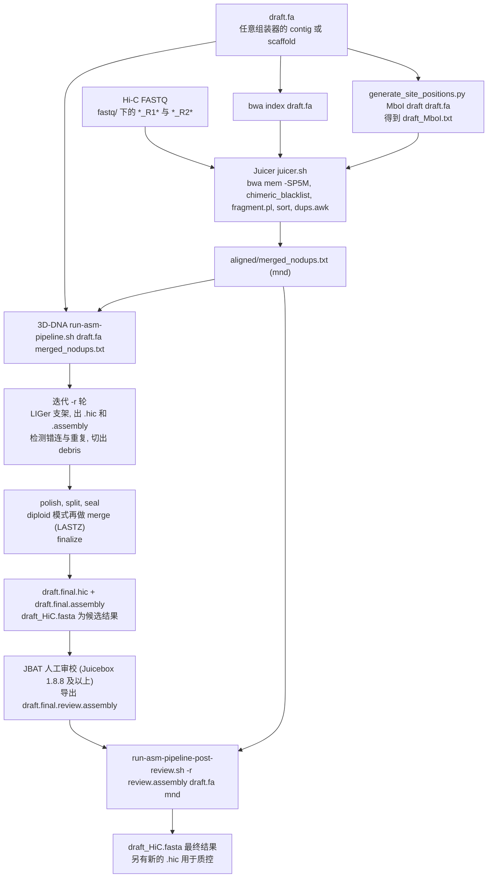

# Juicer + 3D-DNA（DNA Zoo 的 Hi-C 染色体级 scaffolding 流程）

> **仓库** https://github.com/aidenlab/juicer 和 https://github.com/aidenlab/3d-dna
>
> **版本**
> - Juicer `1.6`：tag 指向 commit `f866383d66f780d98de2c1267703b4d3473f6250`，提交于 2020-05-12；GitHub Release "Juicer 1.6 (Master)" 发布于 2020-06-05；`CPU/juicer.sh` 中写的是 `juicer_version="1.6"`。
> - 3D-DNA `201008`：tag 指向 commit `cb63403c329dd45d0fdc4851746b5a8587528132`，提交于 2021-03-16；Release "3D-DNA Phasing branch 201008" 发布于 2021-03-18。仓库内部的版本标签并不一致：README 写 "Software version: 201013"，`run-asm-pipeline.sh` 写 `version=190716`，post-review 脚本写 180114。
>
> **本地路径** `/media/deyuan/18T_B/genome_assembly/pipelines/aidenlab_juicer`（下称 `[J]`）和 `/media/deyuan/18T_B/genome_assembly/pipelines/aidenlab_3d-dna`（下称 `[D]`）
>
> **框架** 没有工作流引擎，由 Bash、GNU awk、少量 Perl/Python 和 Java（juicer_tools / juicebox_tools）组成。Juicer 按调度器分了几套脚本：CPU、SLURM、LSF、UGER、PBS、AWS。
>
> **许可证** 两者均为 MIT
>
> **维护方** Aiden Lab（The Center for Genome Architecture, Baylor College of Medicine & Rice University），DNA Zoo 项目
>
> **更新时间**
> - Juicer 默认分支 `main` 现在是开发中的 **Juicer 2.0**，最新提交 `177eb61`（2025-08-30）。
> - 3D-DNA 默认分支 `master` 最新提交 `bdb5504`（2023-11-29），但 master 停在 **180922 版，比 tag 201008 旧**（见 §7）。

---

## 1. 一句话定位

这是 DNA Zoo / Aiden Lab 的"用 Hi-C 把任意草图挂成染色体"方案，分五步：

1. 准备草图 contig/scaffold。
2. **Juicer** 把 in situ Hi-C 比对到草图并去重，得到 `merged_nodups.txt`。
3. **3D-DNA** 迭代地检测并切除错连、排序定向，再做 polish、分染色体、回补 debris，输出 `.hic`、`.assembly` 和 FASTA。
4. 在 **Juicebox Assembly Tools（JBAT）** 中人工审校。
5. 用 `run-asm-pipeline-post-review.sh` 把审校后的 `review.assembly` 转成最终 FASTA。

依据：Genome Assembly Cookbook（`manual_180322.pdf`）第 3–6 页；https://www.dnazoo.org/methods。

## 2. 适用场景与输入数据

| 输入 | 用途 | 要求 / 说明 | 依据 |
|---|---|---|---|
| 草图 `draft.fa` | 既是 Juicer 的参考，也是 3D-DNA 的输入 | 不限测序技术和组装器（Cookbook 列举用过 DISCOVAR、ALLPATHS-LG、Canu、FALCON、w2rap 等）；扩展名须为 `.fasta`、`.fa` 或 `.fna`；见下方补充 | Cookbook p.7–9, 17, 28；`[D]/run-asm-pipeline.sh:626-628` |
| in situ Hi-C 双端 FASTQ | Juicer 比对 | 放在 `<topDir>/fastq/` 下，文件名须含 `_R1`/`_R2`（`*_R*.fastq*`，可 gz）；Cookbook 建议至少 1 亿对 reads；见下方补充 | `[J]/CPU/juicer.sh:70-71, 247`；Cookbook p.4, 14–15, 18 |
| 限制酶 | 生成酶切位点文件，统计连接点 | `juicer.sh` 内置 HindIII、DpnII、MboI、NcoI、Arima 和 none 的连接点序列；`generate_site_positions.py` 内置 HindIII、DpnII、MboI、Sau3AI、Arima（Arima 对应 `GATC` 和 `GANTC`）；无酶的实验（DNase 类）用 `-s none` | `[J]/CPU/juicer.sh:199-233`；`[J]/misc/generate_site_positions.py` |
| （可选）VCF | 201008 新增的 phase 模块 | `phase/run-hic-phaser.sh <vcf> <mnd>`，用 Hi-C 给 SNP 分相（`--stringency 3 --background 1`）；**不在**主流程中调用 | `[D]/README.md:3`；`[D]/phase/run-hic-phaser.sh` |

**草图的补充要求**
- Cookbook 认为草图 scaffold N50 达到 10–100 kb 通常就足以做到染色体级。
- 含大量大 gap（≥ 15 kb）的近似 scaffold，例如光学图谱结果或由连锁图拼出的伪分子，反而可能有害。Cookbook 建议这类数据只用于验证，不要拿来作支架输入。
- 歧义碱基（IUPAC）处理不了，需要先改成 N。

**Hi-C 数据的补充说明**
- Hi-C 覆盖低于 7X，或用低频切酶、有严重覆盖偏差的库，都属于需要调参的情形。
- 在 FASTQ 中统计含连接点的 reads 比例，好的 in situ 库一般在 20–40%。对碎片化的草图，这个指标比 Juicer 的常规统计更可靠。

**不需要的数据**：trio 和 ONT UL 都不需要。

**不做的事情**：组装本身（contig 要自备）、基于 k-mer 的 QC、去冗余（只在 diploid 模式下有一个 merge 模块，见 §3）。

**DNA Zoo 的实际做法**（dnazoo.org/methods）：草图有现成的就用（NCBI 上的或合作者提供的），没有就按 "$1000" 策略用 w2rap-contigger 从 Illumina PE150 组装。之后用 Juicer 比对 in situ Hi-C，3D-DNA "**was run without parameter tuning**"，最后在 JBAT 中审校。页面没有给出任何命令行参数或软件版本。

## 3. 流程步骤

| 步骤 | 工具（版本） | 作用 | 关键参数 / 默认值 |
|---|---|---|---|
| 0. 草图 | 任意组装器 | 生成 `draft.fa` | Cookbook 的 w2rap 示例：`w2rap-contigger -t 48 -m 900 -r R1.fq,R2.fq -p w2rap --dump_all 1` |
| 1. 建索引 | BWA（Juicer 不锁版本） | 为草图建 BWA 索引 | 必须执行 `bwa index draft.fa`，否则 juicer.sh 报错退出（`CPU/juicer.sh:193-196`）；索引文件须与 fasta 放在同一目录 |
| 2. 酶切位点文件 | `[J]/misc/generate_site_positions.py`（标注为 Juicer 1.5） | 输出 `<genome>_<enzyme>.txt`，每行对应一条序列的全部酶切位点 | `generate_site_positions.py MboI draft draft.fa` 生成 `draft_MboI.txt`；`-s none` 时不需要 |
| 3. 比对 | `CPU/juicer.sh` 调用 `bwa mem -SP5M`（`:364`） | 每对 FASTQ 整体比对（CPU 版不切分）。`-SP5M` 各字母的含义（推测，依据 BWA 手册的一般知识，本笔记未查证）：两端分别比对、不做配对救援，嵌合 read 取 5′ 端为主比对，次要比对标为 secondary | `-t` 线程数（默认为全部核，`:236-242`） |
| 4. 嵌合处理 | `common/chimeric_blacklist.awk` | 拆成 normal（`*_norm.txt`）、abnormal/collisions（`*_abnorm.sam`）和 unmapped 三类 | 三段嵌合中，不含连接点的那一段距含连接点的那一段 ≤ 20 kb 时，仍算 normal（见该脚本头注释） |
| 5. 片段号与排序 | `common/fragment.pl` + `sort` | 依据位点文件标注每端所在的酶切片段，再按染色体、片段、链、位置排序 | `-s none` 时 frag 固定填 0 和 1（`:385-390`） |
| 6. 合并 | `sort -m` | 生成 `aligned/merged_sort.txt` | `:419` |
| 7. 去重 | `common/dups.awk` | 生成 `merged_nodups.txt`，另有 `dups.txt` 和 `opt_dups.txt` | 默认 wobble 为 4 bp（两端位置都在 ±4 bp 内视为重复）；`-j` 只去完全相同的重复（`dups.awk:53-59`） |
| 8. 统计与 .hic | `statistics.pl`、`juicer_tools LibraryComplexity` / `pre` | 生成 `inter.txt`、`inter_30.txt`（MAPQ ≥ 1 和 ≥ 30 两套），以及 `inter.hic`、`inter_30.hic` | `-e` 或 `-S early` 会跳过 .hic 生成，但统计**照样计算**（`:445-492`）。组装场景下 Cookbook 用 `-p assembly` |
| 9. 3D-DNA 迭代（scaffold、visualize、edit） | `scaffold/run-liger-scaffolder.sh`（LIGer）、`visualize/run-asm-visualizer.sh`、`edit/run-mismatch-detector.sh`、`edit/run-coverage-analyzer.sh`、`edit/apply-edits-prep-for-next-round.sh` | 每轮依次做：LIGer 排序定向；出 `.hic` 图；检测近对角线信号缺失（depletion，即错连）；用覆盖度识别塌缩的重复；把位于输入序列**内部**的可疑区切成 `:::debris`；进入下一轮 | `-i 15000`（更短的序列不参与）；`-r 2`（轮数）；`-q 1`；editor 参数：coarse-res 25000、region 125000、stringency 55、saturation-centile 5、fine-res 1000、norm KR、repeat-coverage 2 |
| 10. polish | `polish/run-asm-polisher.sh` | 在更大尺度上检测错配，把断点之间的大块重新做支架 | `polisher-input-size 1000000`；coarse-res **100000**（代码值）；region 3000000；stringency 55 |
| 11. split | `split/run-asm-splitter.sh` | 把 megascaffold 切成染色体。不需要知道染色体数，本质是更大尺度的 mismatch 检测 | `splitter-input-size` **100000**（代码值）；coarse-res **100000**；region 3000000 |
| 12. seal | `seal/run-assembly-sealer.sh` | 若某段 debris 两侧的 fragment 在最终组装里仍保持原有顺序和方向，就把它放回（纠正"误切"） | `-i <input_size>` |
| 13. merge（仅 diploid） | `merge/run-asm-merger.sh` + LASTZ（1.03.73） | 合并草图中未塌缩的杂合区（同一位点的两套单倍型序列） | `-m diploid`；`--merger-search-band 3000000`、`--merger-alignment-score 50000000`、`--merger-alignment-identity 20`、`--merger-alignment-length 20000`、`--merger-lastz-options "--gfextend --gapped --chain=200,200"` |
| 14. finalize | `finalize/finalize-output.sh` | 去掉两端多余的 N，在同一染色体的相邻输入序列之间插入 gap，生成 `<id>_HiC.fasta` 和 `<id>_HiC.assembly` | `-g 500`（gap 长度，bp）；FASTA 序列名为 `HiC_scaffold_N` |
| 15. JBAT 审校 | Juicebox 桌面版 ≥ 1.8.8（JBAT 从 1.8.7 开始提供） | 打开 `draft.final.hic`，Import Map Assembly 载入 `draft.final.assembly`，修正四类错误（misjoin、translocation、inversion、染色体边界），再 Export Assembly | 导出文件默认加 `.review` 后缀 |
| 16. post-review | `run-asm-pipeline-post-review.sh` | 把 `review.assembly` 转成最终 FASTA，并重建 `.hic` 用于质控 | `-r <review.assembly>`；`-s finalize`（默认）或 `seal`；`-g 500`；`-i 15000`；`-c N` |

依据：
- `[J]`：`CPU/juicer.sh`（全文）、`CPU/common/*.awk|pl`
- `[D]`：`run-asm-pipeline.sh:156-203`（默认值）、`:664-903`（主流程）；各模块脚本头注释
- Cookbook p.16–25



## 4. 如何运行

### 4.1 安装与环境

**Juicer（CPU 单机版）**，按 Juicer wiki 的 Installation 页搭目录：
```bash
git clone https://github.com/aidenlab/juicer.git        # 默认分支是 Juicer 2（main）；要 1.6 请加 --branch 1.6（推测：wiki 写于 2019 年，当时尚无此问题）
cd <myJuicerDir>
ln -s ~/juicer/CPU scripts                               # 于是 scripts/juicer.sh 与 scripts/common/ 都可用
cd scripts/common
wget https://hicfiles.tc4ga.com/public/juicer/juicer_tools.1.9.9_jcuda.0.8.jar
ln -s juicer_tools.1.9.9_jcuda.0.8.jar juicer_tools.jar  # CPU 版的 common/juicer_tools 会调用这个文件名
cd ../..
mkdir references                                         # 放 draft.fa 和 BWA 索引
ln -s <myRestrictionSiteDir> restriction_sites           # 可选
cd <myWorkingDir> && mkdir fastq && mv <fastq_files> fastq/
```
- 依赖：BWA、GNU coreutils（比对和生成 mnd 用）；Java 1.7 或 1.8 加 juicer_tools jar（生成 .hic 用）；CUDA 只有 HiCCUPS 需要。
- 脚本中还用到 `gawk`（collisions 去重，`CPU/juicer.sh:460`）、Perl（`fragment.pl`、`statistics.pl`）和 Python（`generate_site_positions.py`）。
- 1.6 版 README 写 Java ≥ 1.7（`[J]/README.md:62-63`），Juicer 2 的 README 改为 ≥ 1.8。

**3D-DNA**：README 原话是 "There is no need for installation"。依赖如下（`[D]/README.md:30-38`；Cookbook p.17）：
- 必需：Bash ≥ 4、GNU Awk ≥ 4.0.2、GNU coreutils sort ≥ 8.11、Java ≥ 1.7；
- 强烈推荐：GNU Parallel ≥ 20150322，可大幅提速；没有也能跑，脚本会自动检测；
- 仅 diploid 模式需要：LASTZ 1.03.73；
- 仅"已知染色体数"版本的 splitter（`split_chrom_aware/`）需要：Python 和 numpy。

仓库自带 `visualize/juicebox_tools.jar`。其中 `HiCGlobals` 类含字符串 "1.5.2"，类文件日期为 2016-12-15，推测是 Juicebox tools 1.5.2。

**JBAT**：需要 Juicebox 桌面版 ≥ 1.8.8（Cookbook p.6, 31；Juicebox wiki 的 "Juicebox Assembly Tools" 页）。

### 4.2 最小命令（Cookbook 原命令；原 PDF 中的 "–" 实为 "-"）
```bash
bwa index draft.fa
generate_site_positions.py MboI draft draft.fa            # 生成 draft_MboI.txt
./juicer/scripts/juicer.sh -g draft -s MboI -z draft.fa -y draft_MboI.txt -p assembly
./3d-dna/run-asm-pipeline.sh draft.fa merged_nodups.txt   # 用的是 aligned/merged_nodups.txt
# 在 JBAT 中：File > Open 打开 draft.final.hic；Assembly > Import Map Assembly 载入 draft.final.assembly
#             修正后 Assembly > Export Assembly，得到 draft.final.review.assembly
./3d-dna/run-asm-pipeline-post-review.sh -r draft.final.review.assembly draft.fa merged_nodups.txt
```

**CPU 1.6 的实用写法**（推测：由代码选项拼出，供参考）：
```bash
/opt/juicerDir/scripts/juicer.sh -D /opt/juicerDir -d $PWD \
  -g draft -s MboI -z /opt/juicerDir/references/draft.fa \
  -y /opt/juicerDir/restriction_sites/draft_MboI.txt \
  -p assembly -t 32 -e
```
- `-D` 指定 Juicer 目录（默认 `/opt/juicer`），`-d` 指定 topDir（默认当前目录）。
- `-p` 在 CPU 1.6 中是硬性要求：只要给了 `-z`，就必须给 `-p`（`CPU/juicer.sh:177-183`）。`-p assembly` 只是占位，用来通过这项检查。
- `-e` 跳过 .hic 生成，因此不会出现 Cookbook 提到的 "inter.hic / inter_30.hic missing" 报错。

**只想看草图本身的接触图**（Cookbook p.5）：
```bash
awk -f 3d-dna/utils/generate-assembly-file-from-fasta.awk draft.fa > draft.assembly
3d-dna/visualize/run-assembly-visualizer.sh draft.assembly merged_nodups.txt
```

**改用 Juicer 2（main 分支）时**：输出格式变了，默认生成 `merged_dedup.bam` 以及 `merged1.txt`、`merged30.txt`。要给 3D-DNA 用，需加 `--assembly`（帮助原文："For use before 3D-DNA; early exit and create old style merged_nodups"），或用 `CPU/common/sam_to_mnd.sh`，即 `samtools view -O SAM -F 1024 <dedup.bam> | awk -v mnd=1 -f sam_to_pre.awk`。依据：main 分支的 `CPU/juicer.sh:97-98, 132, 196, 706-727` 和 `CPU/common/sam_to_mnd.sh`。

### 4.3 示例 / 测试数据
- 两个仓库都**没有**可直接跑的小数据集。`[D]/data/` 里是 2017 年论文用于验证的连锁图表格，不是输入样例。
- DNA Zoo 方法页提供了 JBAT 演示用的 `.hic` 和 `.assembly`：http://bit.ly/jbatdemo 。
- Cookbook 中 JBAT 的示例图用的是 GM12878 的 HIC001 数据（1 亿 reads），比对到人为制造错误的 hg19 chr2/chr4 模拟组装上。

### 4.4 关键参数

**Juicer CPU 1.6**（`CPU/juicer.sh:73-147`）

| 参数 | 默认 | 说明 |
|---|---|---|
| `-g genomeID` | hg19 | 自定义草图时随便起名，如 `draft`；未给 `-y` 时用于拼出默认位点文件路径 `${juiceDir}/restriction_sites/${genomeID}_${site}.txt` |
| `-z ref.fa` | 按 genomeID 查内置表 | 草图 fasta，BWA 索引须在同一目录 |
| `-p chrom.sizes` | – | 给了 `-z` 时必填；组装场景用 `-p assembly` 占位 |
| `-s site` | none | 限制酶名，决定连接点序列和是否做片段级分析 |
| `-y site_file` | 见 `-g` | 酶切位点文件 |
| `-D juicerDir` | `/opt/juicer` | 下面须有 `scripts/`、`references/`，可选 `restriction_sites/` |
| `-d topDir` | 当前目录 | 下面须有 `fastq/`；会创建 `splits/`、`aligned/`、`HIC_tmp/` |
| `-t threads` | 全部核 | `bwa mem` 的线程数 |
| `-S stage` | – | 断点续跑，可选 `chimeric`、`merge`、`dedup`、`final`、`postproc`、`early` |
| `-e` | – | 早退：跳过 .hic 生成和 postprocessing |
| `-j` | 关闭 | 去重只去完全相同的重复（wobble 设为 0） |
| `-f` | 关闭 | 生成片段级（fragment-delimited）的 .hic |
| `-b ligation` | 按酶自动设置 | 自定义连接点序列 |
| `-a 'desc'` | – | 写入统计文件和 .hic 元数据的描述 |

**3D-DNA `run-asm-pipeline.sh`**（默认值见 `:156-203`，参数解析见 `:207-571`）

| 参数 | 代码默认 | 说明 |
|---|---|---|
| `-m\|--mode haploid\|diploid` | haploid | diploid 模式会运行 merge（需要 LASTZ）。Cookbook 写的是 `-m\|--merge`，与 201008 的代码不符 |
| `-i\|--input` | 15000 | 短于此值的序列（Cookbook 称 "Tiny"）不参与支架，原样附在输出末尾；调小可让更多序列进入染色体，但准确度略降 |
| `-r\|--rounds` | 2 | 错连纠正的轮数，代码注释写 "use 2 for Hs2 and 9 for AaegL4"。草图很准时 `-r 0` 往往已够用（Cookbook p.19） |
| `-q\|--mapq` | 1 | 支架和出图时的 MAPQ 阈值 |
| `-s\|--stage` | – | 跳到某一阶段开始，可选 scaffold、polish、split、seal、merge、finalize |
| `-e\|--early-exit` / `-f\|--fast-start` | – | `-e`：第 0 轮支架并出图后即退出；`-f`：假定第 0 轮已完成，从后面接着跑。两者配合用于调参 |
| `--editor-coarse-resolution / -region / -stringency / --editor-saturation-centile / --editor-fine-resolution` | 25000 / 125000 / 55 / 5 / 1000 | 错连检测参数 |
| `--editor-coarse-norm` | KR | 帮助文本未列出，可选 NONE、VC、VC_SQRT、KR |
| `--editor-repeat-coverage` | 2 | VC 归一化向量中达到此值的 bin 标记为重复区（`edit/run-coverage-analyzer.sh`）。Hi-C 覆盖不均导致大量序列被标成 debris 时，应调高此值（Cookbook p.29） |
| `--polisher-*` | input 1000000，coarse-res **100000**，region 3000000，stringency 55，centile 5，fine 1000 | 帮助文本写 coarse-res 25000，与代码不符 |
| `--splitter-*` | input **100000**，coarse-res **100000**，region 3000000，stringency 55，centile 5，fine 1000 | 帮助文本写 input 1000000、coarse-res 25000，与代码不符 |
| `--merger-*` | search-band 3000000，score 50000000，identity 20，length 20000 | 只能在 diploid 模式下用，否则报错退出（`:583`） |
| `-g\|--gap-size` | 500 | 最终 FASTA 中输入序列之间的 N 长度 |
| `--sort-output` | 关闭 | 染色体按长度降序输出 |
| `-c\|--chromosome-map N` | – | 额外为前 N 条 scaffold 生成"标准"Juicebox 图（每条染色体一个条目，sandboxed，`visualize/build-sandboxed-hic.sh`） |

此外，若基因组总长超过 2.1 Gb，各分辨率参数都会除以 `scale = 1 + ⌊总长 / 2.1e9⌋`（`:646-662`）。

**post-review**（`run-asm-pipeline-post-review.sh:35-71`）

| 参数 | 默认 | 说明 |
|---|---|---|
| `-r review.assembly` | 必填 | JBAT 导出的文件 |
| `-s seal\|finalize` | finalize | `seal`：从 seal 阶段起重跑主流程；`finalize`：直接按审校结果出 FASTA |
| `-i` | 15000 | 应与主流程保持一致 |
| `-q` | 1 | 出图的 MAPQ 阈值 |
| `-g` | 500 | gap 长度 |
| `--sort-output` | 关闭 | 同主流程 |
| `-c N` | – | 同主流程 |

### 4.5 单机与 SLURM 两种跑法
- **Juicer CPU**：在一台机器上按 FASTQ 对顺序处理，**不切分** FASTQ。流程是把 `fastq/` 软链到 `splits/`，再逐对 `bwa mem`（`CPU/juicer.sh:331-409`）。
  - `CPU/README.md` 标注为 BETA，称 CPU 版适合小型实验，较大的实验"will take an extremely long time"。
  - 但 Cookbook 认为组装场景的数据量"relatively small and can often be run on a single machine"（p.13）。
- **Juicer SLURM**（`SLURM/scripts/juicer.sh`）：
  - 用 `-C` 指定切分块大小，默认 90,000,000 行（约 2250 万条 reads）。即使不给 `-C`，FASTQ 总量超过 2,592,410,750 字节时也会自动切分（`:436-449`）。
  - 每个切块用一个 `sbatch` 作业比对，之后的 merge、dedup、统计、.hic 作业用 `afterok` 依赖串起来。
  - 队列参数：`-q` 短队列、`-l` 长队列、`-Q` 和 `-L` 分别是两者的时间上限、`-A` 账号。
  - **注意**：脚本开头按主机名硬编码了 Rice、BCM、Voltron 三套集群的默认值，包括 juiceDir、队列名和 `module load` 命令（`:71-132`），用之前必须改。
- **3D-DNA**：只能单机运行，不对接调度器。并行靠 GNU Parallel（`--jobs 80% --pipepart --block 1G`）和 `sort -S8G --parallel=48`，后者写死在 `scaffold/run-liger-scaffolder.sh:144-150`。推测：在集群上就把整个 `run-asm-pipeline.sh` 作为一个 sbatch 作业提交到大内存节点。

### 4.6 资源需求
- Juicer README：最好 ≥ 4 核、≥ 64 GB 内存，最低 1 核、16 GB（`[J]/README.md:49-52`）。
- 各脚本写死的 Java 堆大小：

| 位置 | 设置 |
|---|---|
| Juicer 默认的 `common/juicer_tools` 包装 | `-Xmx16000m` |
| Juicer 统计步骤 | `export _JAVA_OPTIONS=-Xmx16384m`（`CPU/juicer.sh:449`） |
| **3D-DNA `visualize/juicebox_tools.sh`** | **`-Xms49152m -Xmx49152m`，即启动就固定占用 48 GB** |

  3D-DNA 每一轮出图、每次检测错连都会调用这个 48 GB 的 Java，内存不足的机器需要先改这个文件。
- 磁盘：`merged_nodups.txt` 每行带两端的 CIGAR 和序列，体积很大；3D-DNA 每轮还会生成编辑后的 mnd 副本和多个 `.hic`。推测磁盘需求约为原始 Hi-C 数据的数倍。

## 5. 主要输出

### 5.1 Juicer
```
<topDir>/
├── fastq/                     # 输入
├── splits/                    # 中间产物（CPU 版：fastq 软链、*.sam、*.sort.txt、*_abnorm.sam、*.res.txt），跑完可删
├── HIC_tmp/                   # sort 的临时目录
└── aligned/
    ├── merged_sort.txt
    ├── merged_nodups.txt      # ★ 3D-DNA 和 JBAT 的输入（mnd）
    ├── dups.txt  opt_dups.txt
    ├── abnormal.sam  unmapped.sam  collisions*.txt
    ├── header  inter.txt  inter_30.txt  (*_hists.m)
    └── inter.hic  inter_30.hic   # 仅在不加 -e 且 -p 为真实 chrom.sizes 时生成
```

### 5.2 3D-DNA（写在**当前目录**；以 `draft.fa` 为例，genomeid = `draft`）
```
draft.cprops / draft.mnd.txt(软链到输入 mnd)
draft.0.{cprops,asm,assembly,hic} + draft.0_asm.{scaffold,superscaf}_track.txt   # 第 0 轮；之后每轮为 draft.1.*、draft.2.* …
depletion_score_{wide,narrow}.at.step.N.wig  mismatch_{wide,narrow}.at.step.N.bed
coverage_wide.at.step.N.wig  repeats_wide.at.step.N.bed                          # 诊断轨，可载入 Juicebox
suspect_2D.at.step.N.txt  edits.for.step.N.txt  mismatches.at.step.N.txt  draft.edits.txt
draft.resolved.*      → 软链到最后一轮
draft.polished.*      （含 .hic、edits_2D、mismatch*.bed、*.wig）
draft.split.*
draft.rawchrom.{assembly,cprops,asm,hic,fasta}
draft.final.{assembly,hic,cprops,asm,fasta}   # haploid 模式下是指向 rawchrom.* 的软链 ← 送进 JBAT 的就是这里的 .hic + .assembly
draft_HiC.fasta  draft_HiC.assembly           # ★ 候选最终结果（已插入 500 bp gap），序列名为 HiC_scaffold_N
draft_HiC*.hic                                # 仅 -c N 时生成：标准（sandboxed）Juicebox 图
```
依据：`[D]/run-asm-pipeline.sh:664-903`、`finalize/finalize-output.sh:106-144`、`finalize/construct-fasta-from-asm.sh`、`visualize/build-sandboxed-hic.sh:156-170`。

注意两点：
- `draft.final.fasta`（即 rawchrom.fasta）只是**按编辑结果切开的片段级 FASTA**（`:850`），不是染色体级结果。染色体级结果在 `draft_HiC.fasta`。
- post-review 的输出：从 review.assembly 拆出 `draft.final.cprops` 和 `draft.final.asm`，重建 `draft.final.hic`，再生成 `draft_HiC.fasta` 和 `draft_HiC.assembly`（`run-asm-pipeline-post-review.sh:238-264`）。

### 5.3 关键文件格式

**merged_nodups.txt（"long format"，以空白分隔，16 列）**，定义来自 Juicer wiki 的 Pre 页：
```
<str1> <chr1> <pos1> <frag1> <str2> <chr2> <pos2> <frag2> <mapq1> <cigar1> <sequence1> <mapq2> <cigar2> <sequence2> <readname1> <readname2>
```
- `str`：0 表示正链，其他值表示负链。
- `chr` 用的就是草图里的序列名。`chimeric_blacklist.awk` 保证每行都满足 chr1 ≤ chr2。
- `frag` 是酶切片段编号。`-s none` 时填 0 和 1，这是因为 Pre 会丢弃同一片段内的配对（wiki 原话："pre throws away reads that map to the same restriction fragment"）。
- 3D-DNA 只读取第 2、3、6、7 列（序列名和位置）以及第 9、12 列（MAPQ，须 ≥ `-q`），见 `[D]/scaffold/scrape-mnd.awk:37-49`。

**`.assembly`**（Cookbook p.26, 34；`[D]/utils/*.awk`）：
```
>ctg1 1 1520033
>ctg2 2 830221
>ctg3:::fragment_1 3 400000
>ctg3:::fragment_2:::debris 4 25000
>ctg3:::fragment_3 5 900000
1 -5 3
2
4
```
上面只是示意，不是真实数据。

- **上半部分**（等同于旧的 `.cprops`）：每条输入序列（或切开后的片段）一行，格式为 `>名字 编号 长度`。
  - 3D-DNA 内部按长度降序编号（`generate-sorted-cprops-file.awk`）；`generate-assembly-file-from-fasta.awk` 则保持 FASTA 中的顺序。
  - 被切开的序列命名为 `原名:::fragment_i`，被切出的问题片段再加 `:::debris`；整条序列都被判为问题时命名为 `原名:::debris`（`edit/edit-cprops-according-to-annotations.awk:60-85`）。
  - finalize 阶段会再加入 `hic_gap_N` 条目，作为 gap 的占位。
- **下半部分**（等同于旧的 `.asm`）：每行是一条 superscaffold（染色体），由带符号的编号组成，**负号表示取反向互补**（Cookbook p.34）。debris 片段单独成行，放在最后。
- JBAT 只修改 `.assembly`，**`.hic` 在整个审校过程中不变**（Cookbook p.32）。

**3D-DNA 生成的 `.hic`**：所有序列首尾相接，拼成一条名为 `assembly` 的伪染色体（`visualize/run-asm-visualizer.sh`），用自带的 juicebox_tools 执行 `pre` 生成，分辨率从 2.5 Mb 到 1 kb。这样任何排序或翻转都只需改坐标，不必重新比对。

## 6. 设计亮点（值得学习的地方）

1. **组装结果是作用在原始草图上的"指令"**。`.assembly` 只记录切分、排序、方向和染色体分组，完全可逆、体积很小，可以在 JBAT 里编辑，再用脚本应用到原始 FASTA 上（Cookbook p.26, 35）。
2. **只做坐标换算，不重新比对**。每轮编辑后，用 `lift/lift-input-mnd-to-asm-mnd.awk` 把原 mnd 坐标"抬升"到新组装上，Hi-C reads 不用重新比对，所以迭代成本很低。
3. **用 Hi-C 信号本身纠错**。近对角线信号缺失（depletion score）对应错连，归一化覆盖度过高对应塌缩的重复，二者在粗、细两个分辨率上迭代检测（`edit/run-mismatch-detector.sh`、`run-coverage-analyzer.sh`）。只有位于输入序列内部的可疑区才会切成 debris，位于序列之间的只记录为 mismatch（`run-asm-pipeline.sh:733-736`）。
4. **切掉的片段不丢**。debris 放在组装末尾留作参考；seal 阶段会把误切的片段放回（`seal/seal-assembly.awk`）。
5. **每个阶段、每一轮都产出可审校的 `.hic` 和 `.assembly`**，事后可以挑选最满意的一轮送进 JBAT（Cookbook p.19）。配套的 `.wig` 和 `.bed` 诊断轨能直观反映参数是否合适。
6. **"自动化 + 人工审校"的分工**。Cookbook 的观点是：与其做大范围参数扫描，不如用默认参数加少量人工修正。DNA Zoo 也明确是"without parameter tuning"，再加 JBAT 审校。
7. **依赖极简**：只需 bash、awk、java，没有编译环节，GNU Parallel 也是可选的。
8. **自带一致性检查**：haploid 模式下，FINAL FASTA 中的非 N 碱基总数应与草图相同，可用 `supp/fasta-count-sequenced-bases.sh` 核对（Cookbook p.28）。

## 7. 局限与注意事项（坑）

1. **版本混乱，务必核对**：
   - **Juicer**：tag 1.6 是最后的稳定版（2020 年）。直接 `git clone` 得到的是 main 分支上的 **Juicer 2**，它的输出和选项都变了（默认生成 `merged_dedup.bam` 和 `merged1/30.txt`），需要 `--assembly` 才能生成 3D-DNA 能读的 mnd（main 分支 README 的 "Read this first!!" 一节）。tag 1.6 自己的 README 还写着 "Juicer version 1.5"。
   - **3D-DNA**：GitHub 默认分支 `master` 停在 **180922 版**，比 tag `201008` 少了 45 个提交，包括 phase 模块、`-c` 选项、`build-sandboxed-hic.sh` 和按大小排序 assembly 的脚本。master 只比 201008 多一个提交 `bdb5504`，而且只改了 `utils/wrap-fasta-sequence.awk` 的一行注释（`git diff 201008 origin/master`）。
2. **输出文件名与 Cookbook 不一致**。Cookbook（2018）写的最终产物是 `*.FINAL.fasta` / `*.FINAL.assembly`，那是 master（180922）的命名；201008 改成了 **`<id>_HiC.fasta` / `<id>_HiC.assembly`**（`finalize/finalize-output.sh:137-141`）。另外 `draft.final.fasta` 并不是最终结果，见 §5.2。
3. **帮助文本、Cookbook 与代码默认值不一致**：
   - polisher 和 splitter 的 coarse resolution，代码是 100000，帮助写 25000；
   - `--splitter-input-size`，代码是 100000，帮助写 1000000；
   - `-m` 在代码里是 `--mode haploid|diploid`，Cookbook 写成 `-m|--merge`；
   - merger 参数，Cookbook 写 `--merger-band-size` 且"Hardcoded: 1000000"，代码里是 `--merger-search-band`，默认 3000000；
   - `-s` 实际还接受 `scaffold`，帮助文本没有列出；
   - `--editor-coarse-norm` 帮助文本没有列出。
4. **Juicer CPU 1.6 的选项坑**：
   - `-r`（改用 bwa aln）和 `-R` 在 `case` 中有处理，但**不在 getopts 字符串里**（`CPU/juicer.sh:126, 132-133`），用了会直接打印帮助退出；
   - 给了 `-z` 就必须给 `-p`；
   - `aligned/` 目录已存在时拒绝运行，除非用 `-S` 续跑（`:271-280`）；
   - FASTQ 文件名必须含 `_R1`/`_R2`；
   - `-e` / `-S early` **仍会**先跑统计再退出（代码注释："if early exit, we stop here, once the statistics are calculated"），这与 Cookbook 说的"跳过统计"不符；
   - 不加 `-e` 而用 `-p assembly` 时，生成 .hic 和 postprocessing 会报错，Cookbook 承认这一点："some Juicer versions do not gracefully handle the assembly scenario"。
5. **Juicer SLURM 版需要改脚本**：集群名、模块、队列都是写死的（`SLURM/scripts/juicer.sh:71-132`）。
6. **大内存 Java**：3D-DNA 的 `juicebox_tools.sh` 固定使用 48 GB 堆，LIGer 的 sort 写死 `-S8G --parallel=48`，小内存工作站要先改这些值。
7. **在一个干净的目录里运行**。3D-DNA 把所有文件写到当前目录，发现已有 `<id>.*.cprops` 或 `<id>.mnd.*.txt` 时拒绝启动（`run-asm-pipeline.sh:671-673`）。post-review 最好也换个新目录跑（推测：在原目录运行时，写入 `draft.final.*` 会穿过软链，覆盖 `draft.rawchrom.*`，包括原始候选的 `.hic`，见 `run-asm-pipeline.sh:852-858` 与 `run-asm-pipeline-post-review.sh:244-258`）。
8. **超过 2.1 Gb 的基因组会缩放坐标**，否则装不进 `.hic` 的单条 `assembly` 伪染色体（`lift/lift-input-mnd-to-asm-mnd.awk` 头注释："field of view (2.1 Gb)"）。JBAT 载入 `.assembly` 时会自动设置 scale，"Set Scale" 是遗留选项（Cookbook p.40）。
9. **JBAT 使用注意**：
   - `.hic` 与 `.assembly` 必须来自同一参考；
   - 要接着上次的修改继续，须先 Import Map Assembly 载入**原始** `.assembly`，再 Import Modified Assembly 载入修改版；
   - 序列多达数十万条时界面会卡，可用 3D-DNA 的 bundle/unbundle 脚本把小序列打包处理（`utils/bundle-unattempted.awk` 等）；
   - 在 Windows 上导出的 `.assembly` 含 CRLF 换行，会导致 finalize 出错，需要先转换（Cookbook p.40）。
10. **需要调参的情形**（Cookbook p.18, 28–29）：Hi-C 数据少（< 7X）、用低频切酶、信号噪声大或覆盖偏差严重（dilution Hi-C、样本降解）、草图含大 gap 或是未充分抛光的长读组装、小基因组、草图杂合区未塌缩或部分二倍体。典型症状是"过多序列被标成 debris"，可依次调整 `--editor-repeat-coverage`、`--editor-saturation-centile`、`--editor-coarse-stringency` 等参数，并对照 `.wig` 和 `.bed` 诊断轨判断效果。
11. **短序列默认不参与支架**（< 15 kb），直接附在结果末尾。高度碎片化的草图被挂上染色体的比例会因此偏低。
12. **merge 模块不成熟**。Cookbook 称其"under development"，稳定版要用原始的 3D-DNA 发布版（p.19）；只在 diploid 模式下可用。
13. **歧义碱基需要先转成 N**（Cookbook p.28）。

## 8. 与 sanger-tol/genomeassembly 的对比

### 8.1 Juicer + 3D-DNA 与 sanger-tol/genomeassembly v1.0.1

| 维度 | Juicer 1.6 + 3D-DNA 201008（DNA Zoo） | sanger-tol/genomeassembly v1.0.1 |
|---|---|---|
| 覆盖范围 | **只负责 Hi-C scaffolding 加人工审校**，contig 需自备 | 从 k-mer、组装、去冗余、抛光、scaffolding、出图、QC 到细胞器的完整流程 |
| 框架 | Bash、awk、Java 脚本，手动按步骤执行 | Nextflow（nf-core 4.1.0） |
| 输入 | 草图 FASTA 加 Hi-C FASTQ（放进 `fastq/` 目录） | YAML 描述的 `genomic_data`（Hi-C 以未比对的 CRAM 提供）和 `assembly_specs` |
| Hi-C 比对 | `bwa mem -SP5M`，在 CPU 版中整对比对；SLURM 版切块后各自投 sbatch | 从 CRAM 分块比对，可选 bwa-mem2 或 minimap2 |
| 去重 | `dups.awk`（两端 ±4 bp 的 wobble，并单独标记光学重复） | `samtools markdup` |
| 中间格式 | `merged_nodups.txt`（16 列文本，含序列） | 比对文件（BAM/CRAM） |
| 支架算法 | 3D-DNA：LIGer 迭代支架、错连检测和 debris 切除、polish、split、seal，diploid 模式下另有 merge | YaHS |
| 接触图 | 每个阶段都生成 JBAT 兼容的 `assembly` 伪染色体 `.hic` | PretextMap、Juicer `.hic`、cooler |
| 人工审校 | **流程的标准环节**：JBAT 审校后执行 post-review | 不包含，需另用 sanger-tol/treeval、curationpretext |
| 分相 | 主流程不分相；201008 带一个独立的 phase 模块（输入 VCF 加 mnd） | hifiasm 的 Hi-C 分相或 trio 模式 |
| QC | 只有 Juicer 统计（`inter.txt`）和 3D-DNA 的诊断轨 | 每个阶段都跑 asmstats、gfastats、BUSCO、MerquryFK |
| 可复现与缓存 | 没有，靠 `-S`/`-s` 手动续跑 | 每个阶段以 MD5 哈希标识，并有 `index.json` 记录参数和版本 |
| 并行与集群 | Juicer 有调度器专用脚本；3D-DNA 只能单机，用 GNU Parallel 加速 | Nextflow executor |

### 8.2 3D-DNA 与 YaHS（sanger-tol 使用的 scaffolder）

YaHS 一列的信息来自 YaHS README（默认分支 `main`）和最新 release v1.2.2（2024-09-30）。

| 维度 | 3D-DNA 201008 | YaHS |
|---|---|---|
| 实现与依赖 | Bash、GNU awk、Java（juicebox_tools），可选 GNU Parallel 和 LASTZ | C 程序，需要 C 编译器、make、zlib |
| Hi-C 输入 | Juicer 的 `merged_nodups.txt` | BAM、BED、BIN 或 PA5（建议先标记 PCR 和光学重复）；BAM 可以按 read 名排序，也可以不排序（两种情况下的行为略有差异） |
| 组装纠错 | 迭代检测错连（depletion 加覆盖度判断重复），切出 debris，共 `-r` 轮 | 初始 contig 纠错（`--no-contig-ec` 可关闭），每轮还会检查 scaffold 错误（`--no-scaffold-ec` 可关闭） |
| 支架策略 | LIGer 贪心迭代，基于 contig 之间的整体接触矩阵 | 在一系列分辨率上逐级进行（`-r`，默认 10 kb 到 500 Mb），每级 `-R` 轮；README 称其考虑了"Hi-C 信号的拓扑分布" |
| 切成染色体 | split 模块（在大尺度上做 mismatch 检测） | README 未单独描述 |
| 未塌缩的杂合 | diploid 模式用 LASTZ 合并 | README 未提供此功能 |
| 端粒 | 不处理 | `--telo-motif`：带端粒的序列末端不允许再与其他序列连接 |
| 短序列与规模限制 | `-i` 15 kb 以下不参与 | `-l` 设最短 contig；最多处理 **45,000 条 contig** |
| 输出 | 每个阶段的 `.hic`、`.assembly`、诊断轨，以及 `<id>_HiC.fasta` | 各轮的 AGP 和 `*_scaffolds_final.{agp,fa}` |
| 接触图 | 自动生成 | 用自带的 `juicer pre` 加 `juicer_tools pre` 另外生成 |
| 与 JBAT 往返 | 原生支持：`.final.hic` 加 `.final.assembly` → 审校 → `run-asm-pipeline-post-review.sh` | `juicer pre -a` 生成 `out_JBAT.{txt,assembly,liftover.agp}`，再用 juicer_tools 生成 `.hic` → 审校 → `juicer post` 生成 `*.FINAL.{agp,fa}` |
| 超过 2 Gb 时的缩放 | scale = 1 + ⌊L/2.1 Gb⌋；Cookbook 称 JBAT 载入 `.assembly` 后会自动设置 | 缩放因子总是 2 的幂，**必须在 Juicebox 中用 Assembly > Set Scale 手动设置**，否则接触图和 assembly 对不上 |
| 速度 | 无官方数据（推测：受 Java 出图和 awk 文本处理限制，明显更慢） | README：从 5,483 条 contig、约 45X Hi-C 重建人类基因组不到 5 分钟 |
| 已知局限 | 默认值不一致、48 GB Java 堆、版本混乱（见 §7） | 罕见的 T2T 端到端假连接；contig 数上限 45,000；基因组大且 contig 多时内存很高 |

**选用建议（推测）**：
- 用 HiFi 组装出的高连续性 contig 做常规 scaffolding 时，YaHS 更快，也更容易接进流程（sanger-tol 就是这样用的）。
- 草图碎片化严重、怀疑有较多错连，或希望复现 DNA Zoo 的做法时，3D-DNA 更合适，它的迭代纠错和 debris/seal 机制正是为这类情况设计的。
- 无论用哪一个，**最后都应在 JBAT（或 PretextView）里人工审校**；两者都能生成 JBAT 需要的 `.hic` 加 `.assembly`。

## 9. 参考文献与链接

- Durand NC\*, Shamim MS\*, Machol I, Rao SSP, Huntley MH, Lander ES, Aiden EL. Juicer provides a one-click system for analyzing loop-resolution Hi-C experiments. *Cell Systems* 3(1):95–98 (2016). doi:10.1016/j.cels.2016.07.002
- Dudchenko O, Batra SS, Omer AD, Nyquist SK, Hoeger M, Durand NC, Shamim MS, Machol I, Lander ES, Aiden AP, et al. De novo assembly of the *Aedes aegypti* genome using Hi-C yields chromosome-length scaffolds. *Science* 356(6333):92–95 (2017). doi:10.1126/science.aal3327
- Durand NC\*, Robinson JT\*, Shamim MS, Machol I, Mesirov JP, Lander ES, Aiden EL. Juicebox provides a visualization system for Hi-C contact maps with unlimited zoom. *Cell Systems* 3(1):99–101 (2016). doi:10.1016/j.cels.2015.07.012
- Dudchenko O, Shamim MS\*, Batra S\*, et al. The Juicebox Assembly Tools module facilitates de novo assembly of mammalian genomes with chromosome-length scaffolds for under $1000. *bioRxiv* 254797 (2018). doi:10.1101/254797
- Rao SSP, Huntley MH, et al. 2014（in situ Hi-C 方案，Cookbook 引用；本笔记未查原文）
- Hoencamp et al., 2021（3D-DNA phase 模块，README 引用；本笔记未查原文）
- Zhou C, McCarthy SA, Durbin R. YaHS: yet another Hi-C scaffolding tool. *Bioinformatics* 39(1):btac808（YaHS README）
- Genome Assembly Cookbook：https://aidenlab.org/assembly/manual_180322.pdf
- DNA Zoo 方法页：https://www.dnazoo.org/methods ；JBAT 演示数据：http://bit.ly/jbatdemo
- Juicer wiki：https://github.com/aidenlab/juicer/wiki （Installation、Pre 两页）；JBAT wiki：https://github.com/aidenlab/Juicebox/wiki/Juicebox-Assembly-Tools
- JBAT 教程视频（Cookbook 提供）：https://www.youtube.com/watch?v=Nj7RhQZHM18
- YaHS：https://github.com/c-zhou/yahs

## 本笔记依据（读过的文件 / 页面）

**Juicer 本地仓库**：`/media/deyuan/18T_B/genome_assembly/pipelines/aidenlab_juicer`，tag 1.6，commit f866383
- `README.md`、`CPU/README.md`、`SLURM/README.md`
- `CPU/juicer.sh`（全文）
- `CPU/common/`：`chimeric_blacklist.awk`（头注释与输出行）、`dups.awk`（wobble 逻辑）、`fragment.pl`（头注释）、`countligations.sh`、`juicer_tools`
- `misc/generate_site_positions.py`（前 140 行）
- `SLURM/scripts/juicer.sh`（版本、站点默认值、getopts、切分逻辑、early exit 段落）

**Juicer main 分支**（Juicer 2.0）：执行 `git fetch --depth 1 origin main` 后用 `git show FETCH_HEAD:` 读取 `README.md`、`CPU/juicer.sh`（选项和 `--assembly` 段落）、`CPU/common/sam_to_mnd.sh`、`Docker/README.md`，另看了 `git diff --stat 1.6 FETCH_HEAD`

**3D-DNA 本地仓库**：`/media/deyuan/18T_B/genome_assembly/pipelines/aidenlab_3d-dna`，tag 201008，commit cb63403
- `README.md`、`run-asm-pipeline.sh`（全文）、`run-asm-pipeline-post-review.sh`（全文）
- `scaffold/`：`run-liger-scaffolder.sh`（前 150 行）、`README.txt`、`scrape-mnd.awk`
- `visualize/`：`run-asm-visualizer.sh`（全文）、`run-assembly-visualizer.sh`（usage）、`juicebox_tools.sh`、`README.txt`、`build-sandboxed-hic.sh`（头注释与 pre 命令），以及 `juicebox_tools.jar`（只读了 MANIFEST 和类中的字符串，未执行）
- `edit/`：`run-mismatch-detector.sh`（头注释与默认值）、`run-coverage-analyzer.sh`（全文）、`README.txt`、`apply-edits-prep-for-next-round.sh`（头注释）、`edit-cprops-according-to-annotations.awk`
- `polish/run-asm-polisher.sh`、`split/run-asm-splitter.sh`（头注释）；`seal/run-assembly-sealer.sh`、`seal/seal-assembly.awk`、`seal/README.txt`
- `finalize/finalize-output.sh`（全文）、`finalize/construct-fasta-from-asm.sh`、`finalize/riffle-asm.awk`
- `utils/`：`generate-sorted-cprops-file.awk`、`generate-assembly-file-from-fasta.awk`、`convert-assembly-to-cprops-and-asm.awk`、`convert-cprops-and-asm-to-assembly.awk`、`wrap-fasta-sequence.awk`
- `lift/lift-input-mnd-to-asm-mnd.awk`（头注释）、`phase/run-hic-phaser.sh`（usage）

**3D-DNA master 分支**：执行 `git fetch --depth 1 origin master` 后对比，读了 `README.md`、`run-asm-pipeline.sh`（`version=180922`）、`finalize/finalize-output.sh`（`.FINAL` 命名）；另用 `gh api` 列出 `master...201008` 之间的 45 个提交和全部分支

**网页与文档**
- https://www.dnazoo.org/methods
- Genome Assembly Cookbook PDF（`manual_180322.pdf`，43 页，Olga Dudchenko，2018-03-26），已下载到 scratchpad 并读完全文
- Juicer wiki 的 Installation 页和 Pre 页；Juicebox wiki 首页与 Juicebox-Assembly-Tools 页（均通过 WebFetch 转成摘要阅读）
- YaHS 的 `README.md`（通过 `gh api repos/c-zhou/yahs/readme` 获取）和 releases 列表
- `gh api` 获取的 juicer 和 3d-dna 的 releases、tags、仓库元数据，以及 compare 结果
