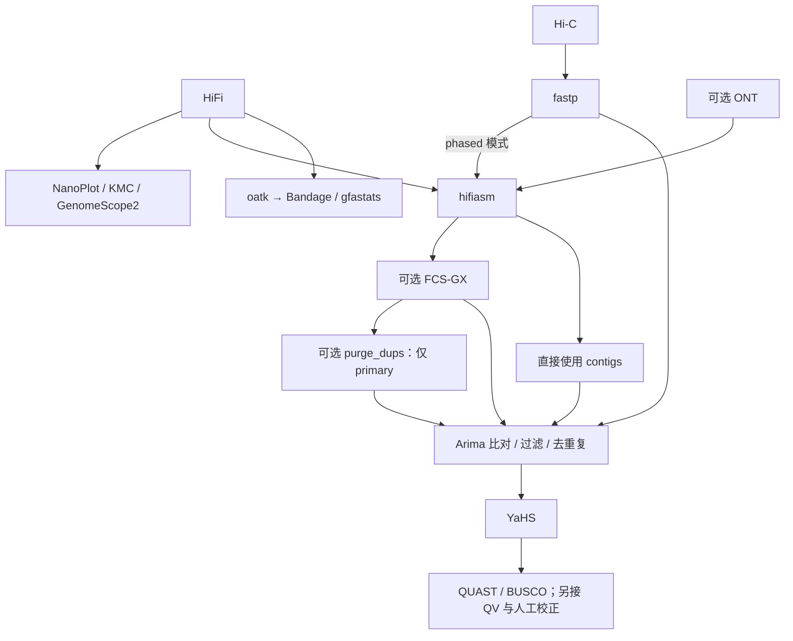

# Colora：论文配套完整组装工作流

2026-11-01；源码 `pipelines/LiaOb21_colora`，SHA 见 [清单](sources/source_manifest.json)。已读 README、配置说明、主 Snakefile、目标选择、hifiasm、FCS-GX、YaHS 和 Picard 规则；未执行 Snakemake 或论文物种实验。

论文：[Obinu 等，Colora: a Snakemake workflow for complete chromosome-scale de novo genome assembly，Bioinformatics 41(5), btaf175 (2025)](https://doi.org/10.1093/bioinformatics/btaf175)。[作者源码](https://github.com/LiaOb21/colora)提供真实 FASTQ 测试、环境与配置，不是只有工具列表。

## 输入、分支和输出

主 Snakefile 从 `hic_path` 匹配 `{sample}_1.fastq.gz`，通过 `sample, = ...` 解包，实际要求一个匹配样本前缀；它不是任意多样本批处理入口。需要成对的 `_1/_2.fastq.gz`，HiFi 多文件自动合并；ONT 要预先合并，并在 hifiasm 参数中指定。`hifi_path`/`hic_path` 目录字符串要按上游示例保留结尾 `/`。



`hifiasm.phased_assembly: true` 时生成 hap1/hap2；规则显式读取 `asm.hic.hap1.p_ctg.gfa` 与 hap2。false 时使用 `--primary` 产生 primary/alternate。`include_purge_dups: true` 与 phased 同时启用会被 `common.smk` 拒绝。不要从“phased 不 purge”的本流程限制，推导为所有其他流程均不能在诊断后清理 hap 内的假重复。

默认目标包含 NanoPlot、k-mer 谱、GenomeScope、QUAST、BUSCO、YaHS 最终 FASTA，以及 oatk 细胞器图/统计。主要核组装集中软链接在 `results/assemblies/`；自动挂载结果在 `results/yahs_{hap}/asm_yahs_scaffolds_final.fa`。没有替你完成 Juicebox/Pretext 人工编辑，也没有默认 Merqury QV，应另接评价与 curation。

## 测试准备与启动

作者提供酵母测试，原始读段来自 SRR27947616 / PRJNA1075684。README 要求下载对应 BUSCO 库，并把仓库拆分的 HiFi/ONT 文件合并为配置所指文件。**合并只生成新文件即可，不必照抄 README 删除原拆分文件的 rm 命令**；留存原件利于校验。`config/config_test.yaml` 的 FCS 数据库是 test-only，不能拿它筛生产组装。

完成数据、BUSCO、oatk 数据库和引擎环境准备后，在 Colora 根目录：

```bash
snakemake --configfile config/config_test.yaml \
  --software-deployment-method conda \
  --snakefile workflow/Snakefile --cores 4 --dry-run

# 检查上一步 DAG 与输入无误后，去掉 --dry-run 才会实际计算
```

上游估计测试约 40 分钟，依赖环境下载和硬件；这是**作者估计，不是本机测量**。生产配置从 `config/config.yaml` 复制到项目单独文件，设置 reads、内存/线程、倍性、物种 taxid、BUSCO/oatk 谱系、Hi-C 协议、可选 ONT/FCS/purge；不能直接用酵母例子。

## 实现需要特别注意

1. `picard.smk` 用 `REMOVE_DUPLICATES=TRUE`，输出可索引 BAM；不能笼统说所有工作流只标记不删除重复。该规则还写死 Java `-Xmx30G`，更改 Snakemake 的 mem_mb 不会自动改这个 heap。
2. 当前 Arima 路径不是 chromap 路径，厂商建库/酶信息不能互换；Omni-C 不应盲用测试里的 `-e GATC`。
3. 配置文档把 `--cut_front`、窗口 5 描述为 Arima 前端处理，但这与 fastp 的固定长度 trim 参数不是同一表达。实际执行前检查当前 fastp 帮助和建库说明，不能仅凭配置注释宣称每条 read 恰好删去 5 bp。
4. FCS-GX 依赖数据库、taxid 和实际资源，按固定版本记录；清洁 FASTA 与被移除序列应同时保存并审核，不能只留一份 final。
5. Snakemake 的目标只声明 FASTA 不代表 AGP、比对统计、环境与日志不重要。为交付补全 AGP/FASTA 一致性、reads 回贴、k-mer 完整性/QV、contact map 和人工编辑后再评价。
