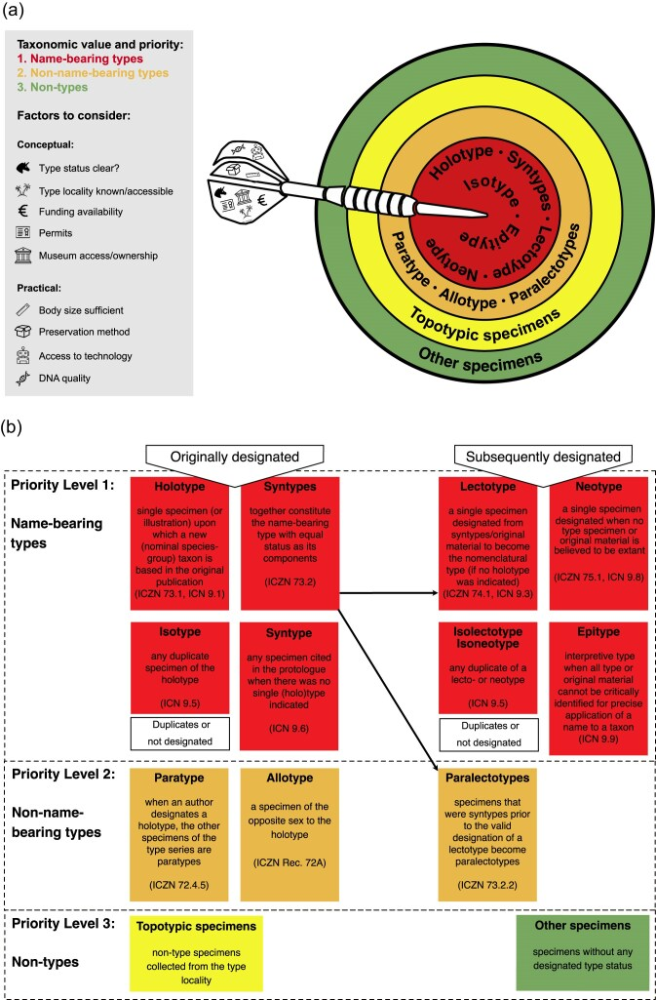
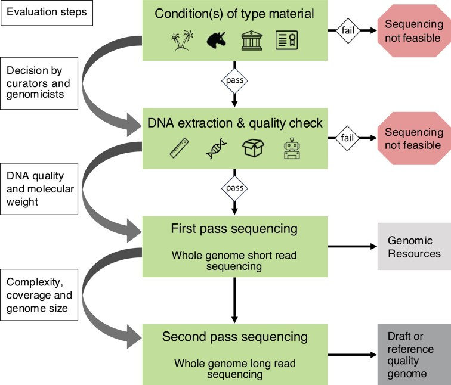
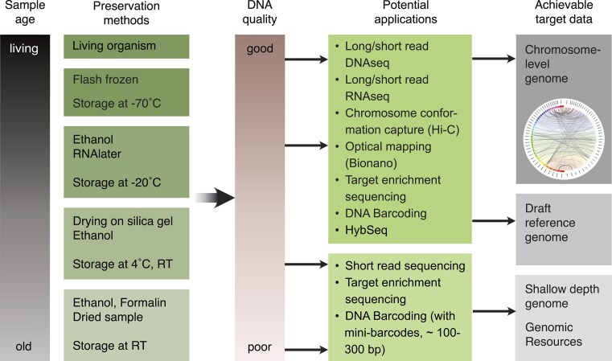

# Type Genomics：模式标本基因组与分类溯源

学习日期：2026-11-05，Asia/Shanghai。用户指定论文：Harald Letsch 等（2025），*Type Genomics: A Framework for Integrating Genomic Data into Biodiversity and Taxonomic Research*，*Systematic Biology* **74**(6):1029–1044，DOI [10.1093/sysbio/syaf040](https://doi.org/10.1093/sysbio/syaf040)。PMC/全文XML标注2025-05-20，卷期属2025年11月；在线日期与卷期日期分别保存。

本轮证据为**论文科学正文通读、图1–3逐图查看、补充表S1表体阅读，以及相关ICZN官方条款定向核查**。没有开展DNA提取、测序、模式鉴定或生物信息流程复现；没有逐篇通读论文所引文献。来源、文件哈希、访问失败与具体阅读范围见[阅读账本](sources/type_genomics_2026-11-05/review_ledger.json)和[归档说明](sources/type_genomics_2026-11-05/README.md)。

## 1. 论文解决的核心问题

一个组装可以非常连续、BUSCO很高，却仍然缺少可靠的物种名称来源。普通凭证标本支持追溯“测的是哪一只”，而载名模式标本为物种群名称提供命名学参照。论文试图把模式标本的基因组信息，与形态、标签、采集信息和馆藏记录连接起来，构建扩展模式标本及其数字信息。

这里的 **type指模式标本，不是模式生物（model organism）**。模式标本也不必是该物种形态或基因型最常见的个体。应把名称固定与物种界定分开：模式固定名称的应用，物种边界、杂交和种内变异仍需比较研究。不能用某个模式个体的一套基因型定义整个物种的全部变异。

论文主张同时重视完整基因组与低覆盖数据。一个很有用的组合是：**历史载名模式提供分类身份联系，新鲜且鉴定可靠的标本提供高质量参考基因组**。两者通过可审查的形态和多位点基因组证据建立联系，分别保存个体与数据身份。这种联系不使新鲜标本自动获得模式地位，也不使它的组装变成“直接来自正模的基因组”。

文章属于框架、综述与实践建议，依托已发表案例提出路线；不是在统一数据集上比较提取方法、覆盖阈值或成功率的新benchmark。

## 2. 图1：分类价值和实验可行性要分别评估

图源：Letsch et al. 2025，Fig.1，CC BY 4.0；原图未改。图中同时涉及动物和植物/真菌等命名体系，不能把全部术语并入动物模式目录。

对本项目的动物材料，重点区分：

| 对象 | 命名与证据意义 | 本项目记录要求 |
|---|---|---|
| 正模 holotype | 原始命名中固定的单一载名标本 | 原始文献、馆藏号、实体及取样关系 |
| 总模 syntypes | 未固定单一正模/选模时共同承载名称的一组标本 | 每个个体独立ID；警惕系列中混有不同物种 |
| 选模 lectotype | 后续从总模中依法指定的单一载名标本 | 正式指定出处；测序成功不自动构成指定 |
| 新模 neotype | 在规定条件下后续指定 | 记录正式命名学行为及依据，不能为方便测序随意替换 |
| 副模、其他非载名材料 | 可提供重要比较证据，具有不同地位 | 保留原始身份；不标成正模来源 |
| 模式产地的新采标本 topotypic specimen | 地理来源接近原始材料，仍需鉴定 | 采集地对应证据和不确定性；不能仅凭同产地认定同种 |
| 其他已鉴定凭证标本 | 可承担高质量组装及种内比较 | 鉴定者、依据、馆藏记录和数据来源 |

ICZN定向核查：Article 72.1、72.4.5、72.5.6与72.10区分载名功能、副模和图示个体；Article 75.1–75.3要求新模具有明确的特殊需要及规定证据，75.5–75.6另涉及委员会处理。不能因为原模式DNA差、没有基因组或测序不便就常规另立新模。图1的isotype、epitype等术语涉及ICN，本轮未做植物/真菌规范的完整核查，不套用于多毛类。

作者把载名模式放在分类价值优先位置，同时用模式身份、产地可达性、资金、许可、馆藏权属、体型、保存方式、技术和DNA质量来判断可行性。这个优先序不等于“无论风险都先破坏正模”。材料可用性及关键鉴别结构由馆藏人员与类群专家共同评估。

## 3. 图2：先获取可用信息，再判断是否值得升级

图源同上，Fig.2，CC BY 4.0；原图未改。论文流程为：材料条件评估 → DNA提取和质量检查 → 第一轮短读测序获得基因组资源 → 根据条件决定是否第二轮长读测序。前两步可以终止；第一轮成果也可以作为合理终点。

**材料与提取。** 核对模式身份、馆藏权属和允许的取样范围、可保留的诊断结构、DNA损伤风险及实验条件。尽可能先用保存条件相近的非模式材料试验；作者同时提醒，相似保存状态也不能保证同样成功。尽量减少取样与重复破坏，记录剩余组织和提取物。所谓微损/非破坏方法仍需检查诊断结构是否保存，不能只凭试剂盒名称认定无损。

**第一轮数据。** 作者推荐短读优先，用低覆盖WGS或目标富集等方式取得可复用信息；实际策略随材料和目的调整。

| 方案 | 论文强调的优势 | 主要限制与使用边界 |
|---|---|---|
| 短读WGS | 无须先指定标记；可重用核基因和细胞器信息 | 低内源比例、大基因组或大量污染会降低有效回报 |
| 目标富集TE | 将资源集中到指定核标记，减少部分非目标测序 | 探针适配和标记交集决定后续兼容性；不能消除全部污染 |
| Hyb-Seq | 目标核标记与非富集部分的信息结合 | 本文主要举植物方案；Angiosperms353不是多毛类通用方案 |
| 后续长读及长程数据 | 在保存和材料条件允许时提高参考组装质量 | 不是所有历史模式都能升级，也没有本文统一成功阈值 |

**是否追加测序。** 作者提出查看覆盖、BUSCO与细胞器完整性等信息。本项目进一步解释：这些是已获得信息量的指标，长读适配仍需DNA分子长度、产量和损伤等证据；Hi-C还需适用的组织/细胞核材料，不能由“已有纯化DNA”或“BUSCO较高”直接推断可做。一次提取失败不宜自动追加破坏性取样。

## 4. 低覆盖数据有价值，但不是普适质量承诺

正文举出短读约10–20×或contig级草图可支持分类、系统发育和部分比较分析，并对恢复蛋白编码基因、BUSCO、细胞器和SNP表达了较强预期。应保留其**文献框架中的举例和建议**地位，不转写为“任何物种10×都能恢复几乎所有基因”的验收线。

结合本项目既有组装知识，实际结果还取决于内源DNA比例、文库复杂度、读长与损伤、污染、重复、杂合和倍性。总测序碱基量除以基因组大小只是粗略名义覆盖；历史样本尤其应分别报告原始量、目标来源有效独立分子/碱基量与覆盖广度。大量PCR重复、污染或细胞器reads不能充当核基因组有效覆盖。使用参考比对估算内源比例时，还须报告参考版本、近缘差异与比对偏倚。

以下为本项目分析边界，不是本文完成的实验结论：

- 基因未恢复可能是缺测、损伤或方法失败，不能直接当作基因丢失或物种特征。
- 低深度SNP硬判型和杂合度估计会受缺失与偏倚影响；需要适配低深度的统计方法及误差检查，本文未给出可直接执行的统一软件流程。
- 线粒体与核结果不一致应调查渐渗、谱系历史、NUMTs、异质性和污染，不能仅选最接近期望名称的结果。
- 全基因组数据增加信息量，仍不能自动消除污染、旁系同源、参考偏倚或物种界定的不确定性。
- 参考比对可以帮助联系模式与新鲜参考，但“能比对上”不足以证明同种；应比较替代近缘候选、多个核标记及形态证据。

本项目原有**采用HiFi路线时目标个体有效HiFi≥50×**要求继续适用于高质量核参考组装。模式标本的低覆盖身份研究是另一种交付目标，不因缺HiFi而被整体判失败，也不能借本文把高质量HiFi组装门槛降到10–20×。参见[49范围与路由](49_全基因组组装任务范围与数据路由总纲.md)、[21质量判断](21_组装基础与质量判断.md)。

## 5. 图3与S1：保存历史决定可选技术

图源同上，Fig.3，CC BY 4.0；原图未改。图表达保存时间、温度、方式与技术可行性的趋势，不是按某个保存温度即可保证成功的实测阈值矩阵。RNA、DNA及Hi-C材料需求也不能互换。本文举冷冻、脱水、乙醇等方法；这不能替代针对类群、组织、保存时长和实际建库方案的验证。

[补充表S1](sources/type_genomics_2026-11-05/syaf040_supplemental_file.pdf)共13页，表体在PDF第1–5页，后续为参考文献；本轮读表体并视觉复核第2、4页，未逐篇追踪其参考文献。表按骨/牙等硬组织、湿组织和干组织，列出提取方式、优缺点及模式标本应用例。

表中值得保留的具体边界：

1. 一些侧重HMW DNA的常规提取/纯化方案会损失短降解片段；适合新鲜组织不等于适合历史DNA。
2. 针对短片段的硅胶纯化及其改法可提高回收，但操作、成本、装置和材料适用性不同，不能从综述表直接生成唯一实验SOP。
3. 湿组织栏列入适配福尔马林材料的方法及成功案例，但并未给出对多毛类统一有效的方案或成功率。
4. 表中PacBio超低输入/WGA改法的“模式标本应用例”列写着none yet；该表不能证明这一改法已用于载名模式。WGA还引入扩增偏倚，后续变异/拷贝数分析需另审计。
5. 部分方法只产出PCR条形码或细胞器信息；表列“模式研究案例”不等于全部完成核基因组组装。

作者明确把“常温长期保存、福尔马林固定的小型软体无脊椎动物”列为困难情形，认为部分馆藏可能尚难成功，应先做探索或等待方法改进。这一段对历史多毛类材料比从其他类群转引的最佳结果更有直接提醒作用。表S1不是多毛类提取技术比较试验。

## 6. 对多毛类/Travisia研究的应用推演

以下是**本项目依据论文形成的研究设计**，尚无用户真实样本、模式材料或测序数据验证。

可采用两类材料互补：历史载名模式用于名称与可恢复序列的关联；新鲜标本在充分鉴定、保留凭证后用于参考组装。新采样尽可能包括可靠解释的模式产地、相邻分布区及需要排除的近缘候选，而不是把一个模式产地个体直接当作已确认同种。每个标本保留独立的形态记录、采集信息与分子数据。

对软体多毛类，取样前应由专家确定需要保护的前后端、疣足、刚毛、鳃等实际鉴别结构；不同类群和发育阶段的要点不同，本文没有规定通用“剪某一体节”方案。新鲜材料的形态固定与分子保存须在采集时协调，先记录活体/鲜体信息及分样关系；提取整只微小个体的情形尤其要明确还剩哪些实体凭证，不能事后把另一只个体的照片当作同一个体。

在分析中保留标本→组织→提取物→文库→reads→组装/位点→鉴定结论的链条。模式与新鲜材料可比较线粒体及多个独立核标记，但数据存在缺口时保留“关系未解决”，不强制输出物种一致。历史标本的宿主、肠内容物、附着物等可能影响来源判断，这是软体材料的应用风险推演，并非本文新增的Travisia实测发现。

低覆盖历史数据适合在可恢复范围内确认关系，不宜直接用来要求AUGUSTUS完整预测，再把缺失模型判成演化性基因丢失。完整结构注释优先依托质量经过评估的参考及合适RNA/蛋白证据；跨个体证据继续分开标记，见[63 AUGUSTUS](63_AUGUSTUS原理训练证据与局部注释实测.md)与[41 RNA证据](41_二代三代RNA注释证据处理规范.md)。

## 7. 将标本溯源加入后续数据模型

这是从论文转化的记录建议，**未实现自动鉴定或命名学判断器**。

| 层级 | 最少应保留的信息 | 避免的混淆 |
|---|---|---|
| 名称与鉴定 | 原始名、当前鉴定、作者/年份、鉴定者/日期/依据、命名体系、版本 | 当前鉴定不覆盖历史名称记录 |
| 实体标本 | 机构、collectionCode、catalogNumber或稳定ID、模式状态原文、指定文献 | 模式标签、模式产地和正式模式地位分别保存 |
| 来源与形态 | 标签影像、产地原文及解释、坐标不确定性、采集者/日期、诊断影像 | 模式产地解释不抹去原始标签；照片对应到个体 |
| 分样与保存 | 组织ID、母标本ID、固定/保存方式、温度与历史已知范围、取样位置、剩余凭证 | 不把同种其他个体或多只混样当成原模式个体 |
| 实验与权限 | 取样许可记录、提取/文库ID、批次、方法版本、对照、DNA质量 | 保留失败、污染和重复取样记录；不虚填已审批 |
| 数据与分析 | BioSample/原始reads/组装accession及版本、SHA256、程序/参数、参考版本、质量结果 | 原始类型来源与后续参考辅助结果不互换 |
| 标本间关联 | 模式ID、新鲜参考标本ID、是否同一个体、联系依据、支持/冲突/未知 | 关联证据不自动改变任一标本地位 |

数字孪生是信息集合，可增强可访问性与减少重复取样；按ICZN Article 72.5.6/73.1.4，动物命名中图示对应的载名对象是被图示的标本，不是图像文件。Declaration45鼓励保存实体及全面记录，特殊无法保存情形另有建议。不能把论文讨论的“typeless/illustration”直接改写为“有照片和基因组就可免留动物模式”。植物ICN例外与动物规则分开。

## 8. 结论的证据等级与未解决问题

| 结论 | 证据 | 可用于什么 | 不能据此宣称什么 |
|---|---|---|---|
| 扩展模式标本连接名称、形态与基因组 | 本文框架与图1–3 | 研究设计、来源记录 | 已验证所有类群的统一流程 |
| 历史模式低覆盖可关联高质量非模式参考 | 本文论述及其引用案例 | 设计比较与数据角色 | 任意低覆盖样本均已确认同种 |
| 提取取决于保存状态和组织 | 本文正文、S1案例汇编 | 定向选择原始方法文献 | 已掌握或实测表中全部湿实验 |
| 新模指定和数字资料的地位有规范边界 | ICZN官方条款定向核对 | 避免常见命名学误读 | 全面命名学审查已完成 |
| 本项目可补充标本追踪与双材料研究 | 上述应用推演 | 后续样本表和流程设计 | 已取得或验证任何Travisia模式基因组 |

需要另行解决：真实模式材料身份与馆藏授权、适配组织的实验方案、污染真实性审计、低覆盖分析参数、核/线粒体一致性、近缘候选的充分比较、跨个体参考偏倚及公开提交元数据映射。本文没有给出物种划分的统一遗传距离阈值，也没有确定所有材料的最低测序量或长读/Hi-C的通用适配线。

## 来源

1. [论文PMC全文](https://pmc.ncbi.nlm.nih.gov/articles/PMC12712332/)，[Europe PMC原始XML接口](https://www.ebi.ac.uk/europepmc/webservices/rest/PMC12712332/fullTextXML)，[本地XML](sources/type_genomics_2026-11-05/article.xml)。全文及图1–3按CC BY4.0归档并注明作者/DOI；中文笔记为归纳与分析，未修改原图。
2. [Dryad补充材料，10.5061/dryad.zs7h44jn5](https://datadryad.org/dataset/doi:10.5061/dryad.zs7h44jn5)，2025-07-08版本；文件通过[Europe PMC附件接口](https://www.ebi.ac.uk/europepmc/webservices/rest/PMC12712332/supplementaryFiles)取得。主文PDF未获取，不能将XML阅读记为PDF逐页阅读。
3. [ICZN Article72](https://code.iczn.org/types-in-the-species-group/article-72-general-provisions/)、[Article73](https://code.iczn.org/types-in-the-species-group/article-73-name-bearing-types-fixed-in-the-original-publication-holotypes-and-syntypes/)、[Article75](https://code.iczn.org/types-in-the-species-group/article-75-neotypes/)、[Declaration45](https://www.iczn.org/the-code/declaration-45-addition-of-recommendations/)，2026-11-05定向核查；不是全部ICZN/ICN通读或对任何具体名称作出裁决。
